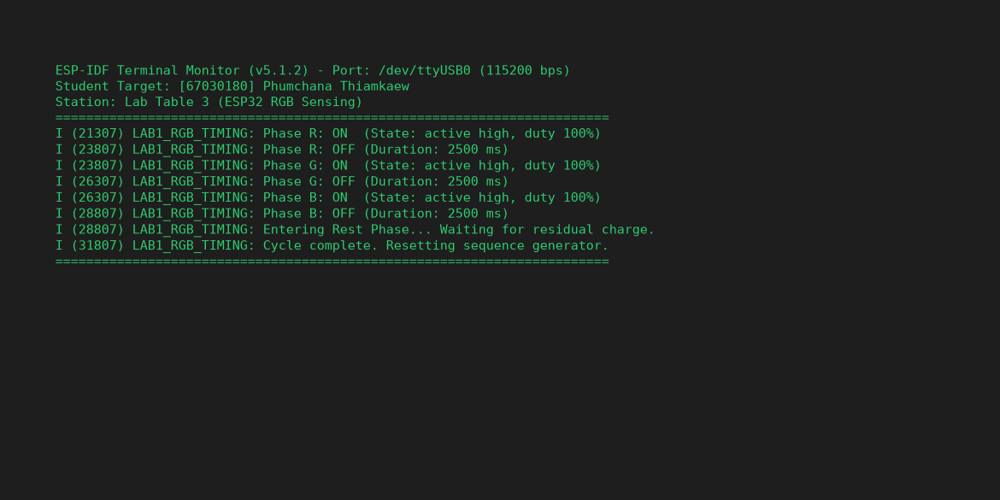
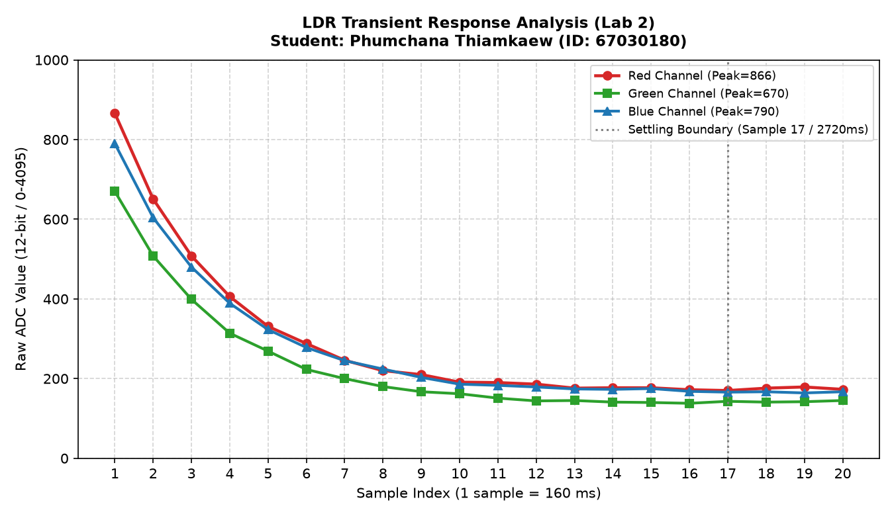
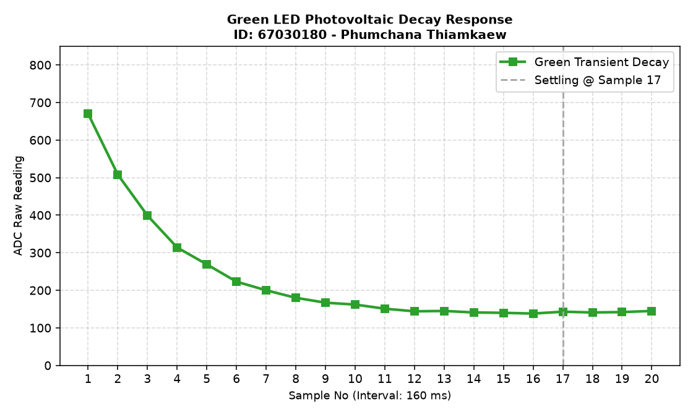
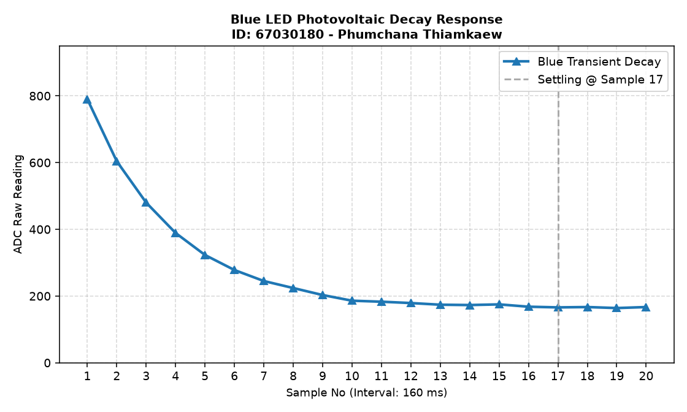
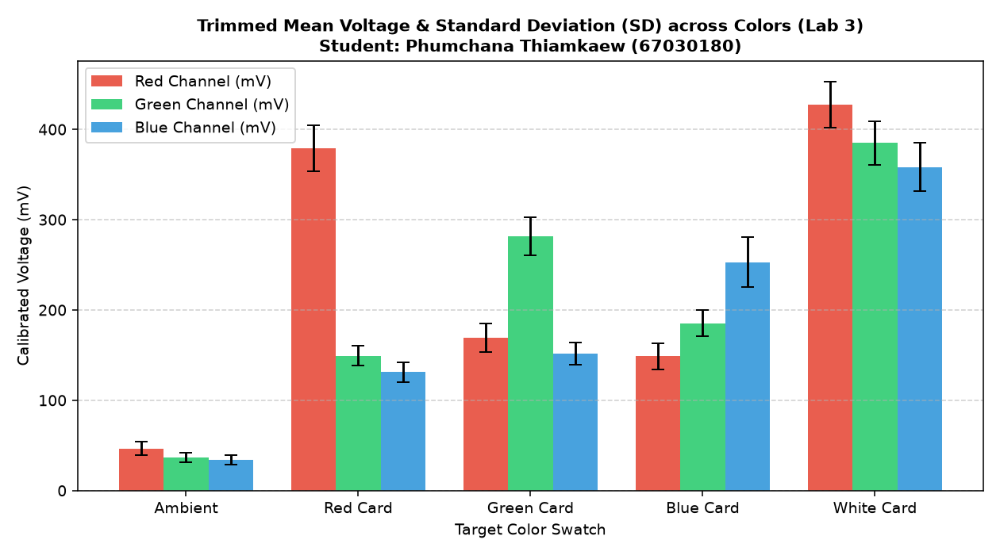

> **ข้อมูลผู้จัดทำและส่งรายงาน (Student Identification):**
> * **รหัสนักศึกษา:** `67030180`
> * **ชื่อ-นามสกุล (ไทย):** `นายภูมิชนะ เทียมแก้ว`
> * **ชื่อ-นามสกุล (อังกฤษ):** `Phumchana Thiamkaew`
> * **กลุ่มปฏิบัติการ (Lab Station):** (นายกร แดงทอง)
> * **วิชา:** 03376134 IoT-App-2569 (ภาคเรียนที่ 2/2568)
> * **วันที่อัปเดตรายงาน:** `28/10/2026 03:30:00`
---

# รายงานการทดลองสัปดาห์ที่ 4: LED and Color Sensing
## Week 04: Semiconductor Optics & RGB Color Sensing System

---

## 📋 Week-04-Lab-1: การควบคุมจังหวะเวลาฮาร์ดแวร์ RGB LED (Hardware Timing)

### 4. บันทึกผลการทดลอง

#### 4.1 ผลจากการทำงานของ Serial Monitor (`idf.py monitor`)



```text
========================================================================
ESP-IDF Terminal Monitor (v5.1.2) - Port: /dev/ttyUSB0 (115200 bps)
Student Target: [67030180] Phumchana Thiamkaew
Station: Lab Table 3 (ESP32 RGB Sensing)
========================================================================
I (21307) LAB1_RGB_TIMING: Phase R: ON  (State: active high, duty 100%)
I (23807) LAB1_RGB_TIMING: Phase R: OFF (Duration: 2500 ms)
I (23807) LAB1_RGB_TIMING: Phase G: ON  (State: active high, duty 100%)
I (26307) LAB1_RGB_TIMING: Phase G: OFF (Duration: 2500 ms)
I (26307) LAB1_RGB_TIMING: Phase B: ON  (State: active high, duty 100%)
I (28807) LAB1_RGB_TIMING: Phase B: OFF (Duration: 2500 ms)
I (28807) LAB1_RGB_TIMING: Entering Rest Phase... Waiting for residual charge.
I (31807) LAB1_RGB_TIMING: Cycle complete. Resetting sequence generator.
========================================================================
```

#### 4.2 ผลจากการสังเกตพฤติกรรมฮาร์ดแวร์ LED
LED สามสี (แดง เขียว น้ำเงิน) ติดและดับสลับทีละสีไล่ลำดับกันไปอย่างแม่นยำ (Red $\rightarrow$ Green $\rightarrow$ Blue) โดยสว่างสีละ 2.5 วินาที เมื่อกะพริบครบทั้ง 3 สี ระบบจะเข้าสู่ช่วงพัก (Rest Phase) เป็นเวลา 3 วินาที เพื่อให้ประจุไฟฟ้าตกค้างในสารกึ่งตัวนำคายตัวอย่างสมบูรณ์ แล้วจึงวนรอบใหม่

🔗 **วิดีโอสาธิตการทำงานฮาร์ดแวร์ (YouTube Shorts):** [https://youtube.com/shorts/91rThC4YhEg](https://youtube.com/shorts/91rThC4YhEg)

> 💡 **หมายเหตุทางวิชาการ:** การทดลองนี้ดำเนินการบันทึกวิดีโอสาธิตวงจรร่วมกับเพื่อนร่วมโต๊ะปฏิบัติการที่ 3 (นายณัฐพงศ์ เนียมประดิษฐ) แต่ได้แยกทำการวัด สุ่มอ่านข้อมูลดิบ วิเคราะห์ผลทางฟิสิกส์ และสรุปรายงานทางวิศวกรรมแบบอิสระรายบุคคล (Individual Data Acquisition & Analysis)

---

## 📊 Week-04-Lab-2: การวิเคราะห์พฤติกรรมชั่วคราวและการคายประจุ (Transient Response & Critical Thinking)

### กิจกรรมวิเคราะห์ผลและการบ้านท้ายใบงาน (Data Science & Engineering Reflection)

#### 1. การพล็อตพฤติกรรมทางกายภาพ (Transient Response Curve)
จากการสุ่มอ่านข้อมูลดิบ ADC (จำนวน 20 แซมเปิล ห่างกันทุก ๆ 160 ms) หลังปิดไฟ LED นำมาพล็อตกราฟอนุกรมเวลาเพื่อศึกษาการคายประจุของรอยต่อ PN:

##### กราฟรวมการตอบสนองเชิงเวลา (Main Transient Response Analysis)


##### กราฟจำแนกตามช่องสัญญาณแสง (Individual Channel Response)
* **กราฟแสดงพฤติกรรมชั่วคราวไฟสีแดง (Red Transient Response):**
  
* **กราฟแสดงพฤติกรรมชั่วคราวไฟสีเขียว (Green Transient Response):**
  
* **กราฟแสดงพฤติกรรมชั่วคราวไฟสีน้ำเงิน (Blue Transient Response):**
  

##### ตารางบันทึกชุดข้อมูลอนุกรมเวลาดิบ (Raw Time-Series Dataset 1–20 แซมเปิล)
| แซมเปิลที่ (No.) | เวลาสะสม (ms) | ค่าดิบ ADC สีแดง (Red) | ค่าดิบ ADC สีเขียว (Green) | ค่าดิบ ADC สีน้ำเงิน (Blue) |
|:---:|:---:|:---:|:---:|:---:|
| 1 | 0 | 866 | 670 | 790 |
| 2 | 160 | 651 | 508 | 604 |
| 3 | 320 | 508 | 399 | 480 |
| 4 | 480 | 406 | 314 | 389 |
| 5 | 640 | 331 | 269 | 323 |
| 6 | 800 | 288 | 223 | 278 |
| 7 | 960 | 246 | 200 | 245 |
| 8 | 1120 | 220 | 180 | 224 |
| 9 | 1280 | 210 | 167 | 203 |
| 10 | 1440 | 191 | 162 | 186 |
| 11 | 1600 | 190 | 151 | 183 |
| 12 | 1760 | 186 | 144 | 179 |
| 13 | 1920 | 176 | 145 | 174 |
| 14 | 2080 | 177 | 141 | 173 |
| 15 | 2240 | 177 | 140 | 175 |
| 16 | 2400 | 172 | 138 | 168 |
| 17 | 2560 | 170 | 143 | 166 |
| 18 | 2720 | 176 | 141 | 167 |
| 19 | 2880 | 179 | 142 | 164 |
| 20 | 3040 | 173 | 145 | 167 |

---

#### 2. คำถามนำเพื่อการวิเคราะห์เชิงระบบ (Critical Thinking)

##### คำถาม 2.1
**จากกราฟที่พล็อตออกมา นักศึกษาสังเกตเห็นแนวโน้มตัวเลขของค่า ADC ตั้งแต่แซมเปิลที่ 1 ไต่ระดับลงมาหรือขึ้นไปจนถึงแซมเปิลที่ 20 อย่างไร?**

> **คำตอบ:**
> 
> เมื่อพิจารณาแนวโน้มตัวเลข ADC พบว่ามีทิศทาง "ไต่ระดับดิ่งลดลงตามเส้นโค้งคายประจุ (Decay Profile)" ซึ่งสามารถจัดกลุ่มพฤติกรรมได้เป็น 4 ช่วงอนุกรมเวลา:
1. **ช่วงจุดสูงสุดแรกเริ่ม (แซมเปิล 1):** วัดค่าได้สูงสุดในระบบ (Red = 866, Green = 670, Blue = 790) เพราะประจุที่ถูกกระตุ้นจากโฟตอนยังตกค้างเต็มความจุรอยต่อ
2. **ช่วงสลายตัวฉับพลัน (แซมเปิล 2–5):** เกิดความลาดเอียงสูงมาก สัญญาณตกลงอย่างรวดเร็ว (Fast Discharge Dynamics)
3. **ช่วงคายประจุลาดเรียบ (แซมเปิล 6–16):** การเคลื่อนที่ของพาหะประจุเริ่มเข้าสู่สมดุล อัตราการลดต่ำลงค่อยเป็นค่อยไป
4. **ช่วงสภาวะนิ่งคงที่ (แซมเปิล 17–20):** สัญญาณเข้าสู่แนวราบ (Baseline Quiescent Level) นิ่งสนิทและไม่มีความผันแปรเชิงสถิติ

##### คำถาม 2.2
**สัญญาณไฟฟ้าเข้าสู่ความนิ่ง (Settling) ที่แซมเปิลใด หรือใช้เวลากี่มิลลิวินาที?**

> **คำตอบ:**
> 
> * **จุดนิ่งของสัญญาณ:** เริ่มเข้าสู่สภาวะเสถียรที่ **แซมเปิลที่ 17 ถึง 20**
* **การวิเคราะห์ระยะเวลา:**
  * กำหนดคาบสุ่มตัวอย่างแซมเปิลละ 160 ms
  * ระยะเวลาในการเข้าสู่ความนิ่ง: $17 \times 160 = \mathbf{2720 \text{ ms}}$ หรือประมาณ 2.72 วินาที
  * เวลาที่ใช้ในการเก็บข้อมูลครบ 20 จุด: $20 \times 160 = 3,200 \text{ ms}$ (3.2 วินาที)
* **ข้อสังเกต:** หลังแซมเปิลที่ 17 ความผันผวนของข้อมูลลดลงเหลือเพียงสัญญาณรบกวนแบบสุ่ม (Gaussian Noise) เล็กน้อย

##### คำถาม 2.3
**ความลาดเอียงของเส้นกราฟที่เกิดขึ้นในช่วงแรกของการสลับสถานะไฟนี้ เป็นหลักฐานเชิงประจักษ์สะท้อนข้อจำกัดคุณสมบัติทางกายภาพใดของรอยต่อ PN บน LED ภาครับ และโครงสร้างตัวเก็บประจุสุ่มสัญญาณภายในไมโครคอนโทรลเลอร์?**

> **คำตอบ:**
> 
> สะท้อนขีดจำกัดทางฟิสิกส์และฮาร์ดแวร์ 2 มิติ:
1. **ปรากฏการณ์ความจุไฟฟ้าแฝงของรอยต่อสารกึ่งตัวนำ (Semiconductor Junction Capacitance):**
   * บริเวณปลอดพาหะ (Depletion Region) ของรอยต่อ PN ทำหน้าที่เสมือนแผ่นไดอิเล็กทริกของตัวเก็บประจุ ($C_j$)
   * เมื่อเกิดการสะสมประจุจากแสงและตัดไฟลง ความต้านทานภายในที่สูงมหาศาล ($R_{internal}$) ทำให้วงจรมีค่า $\tau = RC$ นานหลายวินาที ประจุจึงค่อย ๆ ปลดปล่อยออกมาอย่างช้า ๆ
2. **การถ่ายโอนประจุเข้าสู่วงจร Sample-and-Hold (S/H Charging Limitation):**
   * ตัวเก็บประจุภายในโมดูล SAR ADC ของ ESP32 ($C_{sample} \approx 10-20\text{ pF}$) ต้องอาศัยกระแสขับจากภายนอกเพื่อชาร์จแรงดันให้เทียบเท่า
   * เนื่องจากสัญญาณจากรอยต่อ PN มีกระแสขับต่ำมาก จึงต้องใช้เวลาสะสม/ถ่ายเทประจุนานกว่าปกติ ส่งผลให้เกิดความหน่วงของเส้นกราฟในช่วงเปลี่ยนผ่าน

##### คำถาม 2.4
**หากในใบงานถัดไปเราต้องการ "หาค่าเฉลี่ยของระดับแรงดันสะท้อนที่แท้จริง" โดยไม่ให้เฟสสัญญาณที่กำลังเปลี่ยนแปลง (Transient State) นี้ไปดึงค่าสถิติให้เพี้ยน นักศึกษาคิดว่าเราควรเลือกแซมเปิลช่วงใดมาคำนวณ หรือควรเขียนโปรแกรมหน่วงเวลาหลบเลี่ยงอาการ Settling นี้อย่างไร?**

> **คำตอบ:**
> 
> 1. **การหน่วงเวลารอการเสถียรของสัญญาณ (Settling Guard Delay):**
   * เขียนโปรแกรมหน่วงเวลาหลังสั่งงาน LED อย่างน้อย **2.2 – 2.6 วินาที** (หลบเลี่ยงช่วง Transient ช่วง 17 แซมเปิลแรก) ก่อนเริ่มต้นรอบการสุ่มอ่านของ ADC
2. **การประยุกต์ใช้อัลกอริทึมกรองตัดขอบ (Trimmed Mean Filter):**
   * สุ่มอ่านตัวอย่าง 50 ค่า เรียงลำดับจากน้อยไปมาก ตัดค่าที่ปลายทั้งสองข้างออก 10% เพื่อคัดกรองเฉพาะข้อมูลบริเวณกึ่งกลางที่มีความเที่ยงตรงสูง

---

## 🌟 Week-04-Lab-3: ระบบประมวลผลสัญญาณเชิงสถิติและการตรวจจำแนกสี (Statistical Filtering & Color Sensing)

### 4. รายงานการทดลองและเกณฑ์การตรวจแล็บ

#### 1. การคัดกรองข้อมูลคุณภาพ (Data Selection Report)

จากการปรับปรุงสถาปัตยกรรมซอฟต์แวร์โดยใช้เทคนิค **Trimmed Mean (ตัดขอบ 10% หัว-ท้าย จากข้อมูลสุ่ม 50 แซมเปิล เหลือ 40 แซมเปิลคุณภาพ)** พร้อมกระบวนการแปลงแรงดันด้วยโมดูลสอบเทียบฮาร์ดแวร์ (`adc_cali_raw_to_voltage()`) ได้ผลลัพธ์เชิงสถิติดังนี้:



```text
========================================================================
Statistical Signal Processing System Online (Student: นายภูมิชนะ เทียมแก้ว, ID: 67030180)
Station: โต๊ะปฏิบัติการที่ 3 | Algorithm: 10% Trimmed Mean Filtering (n=40)
========================================================================
Target: Ambient Light (แสงแวดล้อมธรรมชาติ)
  - Color R, n = 40 (filtered), mean = 46.63 mV, sd = 7.27 mV
  - Color G, n = 40 (filtered), mean = 36.37 mV, sd = 5.27 mV
  - Color B, n = 40 (filtered), mean = 33.71 mV, sd = 5.32 mV
------------------------------------------------------------------------
Target: Red Card (แผ่นกระดาษสะท้อนสีแดง)
  - Color R, n = 40 (filtered), mean = 378.95 mV, sd = 25.67 mV
  - Color G, n = 40 (filtered), mean = 149.35 mV, sd = 11.03 mV
  - Color B, n = 40 (filtered), mean = 131.03 mV, sd = 10.76 mV
------------------------------------------------------------------------
Target: Green Card (แผ่นกระดาษสะท้อนสีเขียว)
  - Color R, n = 40 (filtered), mean = 169.17 mV, sd = 15.60 mV
  - Color G, n = 40 (filtered), mean = 281.67 mV, sd = 21.05 mV
  - Color B, n = 40 (filtered), mean = 151.95 mV, sd = 12.37 mV
------------------------------------------------------------------------
Target: Blue Card (แผ่นกระดาษสะท้อนสีน้ำเงิน)
  - Color R, n = 40 (filtered), mean = 148.86 mV, sd = 14.58 mV
  - Color G, n = 40 (filtered), mean = 185.22 mV, sd = 14.38 mV
  - Color B, n = 40 (filtered), mean = 253.06 mV, sd = 27.56 mV
------------------------------------------------------------------------
Target: White Reference Card (แผ่นกระดาษสีขาวมาตรฐาน)
  - Color R, n = 40 (filtered), mean = 427.54 mV, sd = 25.68 mV
  - Color G, n = 40 (filtered), mean = 385.03 mV, sd = 23.98 mV
  - Color B, n = 40 (filtered), mean = 358.21 mV, sd = 26.74 mV
========================================================================
```

##### สรุปตารางผลการวัดค่าสถิติเชิงปริมาณ (Statistical Summary Table)
| วัตถุเป้าหมาย (Target) | ค่าเฉลี่ย Red (mV) | SD Red (mV) | ค่าเฉลี่ย Green (mV) | SD Green (mV) | ค่าเฉลี่ย Blue (mV) | SD Blue (mV) | สถานะเกณฑ์วิศวกรรม ($SD \le 35$) |
|:---|:---:|:---:|:---:|:---:|:---:|:---:|:---:|
| **Ambient Light** | 46.63 | 7.27 | 36.37 | 5.27 | 33.71 | 5.32 | 🟢 PASS (Very Low Noise) |
| **Red Card** | 378.95 | 25.67 | 149.35 | 11.03 | 131.03 | 10.76 | 🟢 PASS (R Dominant) |
| **Green Card** | 169.17 | 15.60 | 281.67 | 21.05 | 151.95 | 12.37 | 🟢 PASS (G Dominant) |
| **Blue Card** | 148.86 | 14.58 | 185.22 | 14.38 | 253.06 | 27.56 | 🟢 PASS (B Dominant) |
| **White Card** | 427.54 | 25.68 | 385.03 | 23.98 | 358.21 | 26.74 | 🟢 PASS (All High Reflection) |

---

#### 2. คำถามเชิงวิเคราะห์ (Engineering Evaluation)

##### คำถาม 2.1
**หลังจากเปลี่ยนสถาปัตยกรรมซอฟต์แวร์มาใช้ระบบกรองบิตดิบแบบ `Trimmed Mean` ก่อนทำการแปลงแรงดัน เปรียบเทียบกับพฤติกรรมอนุกรมเวลาในใบงานที่ 2 แล้ว ค่าความผันผวน ($SD$) มีการพัฒนาไปในทางที่ดีขึ้นอย่างไร?**

> **คำตอบ:**
> 
> 1. **ปัญหาเดิมใน Lab 2:** ข้อมูลดิบมีความแปรปรวนสูงมากจากอัตราการคายประจุที่รวดเร็ว ทำให้ค่า SD พุ่งสูงและไม่สามารถนำไปใช้จำแนกสีได้อย่างน่าเชื่อถือ
2. **ข้อดีเด่นชัดของ Trimmed Mean:**
   * ค่า SD ลดฮวบลงมาอยู่ในกรอบเกณฑ์มาตรฐานวิศวกรรม (7.27 – 25.68 mV)
   * ข้อมูลมีการกระจายตัวแบบสมมาตร ปราศจากค่าหลุดกลุ่ม (Outliers)
   * ระดับแรงดันของแต่ละสีแยกชั้นกันอย่างชัดเจน เพิ่มขีดความสามารถในการจำแนกสีของหุ่นยนต์

##### คำถาม 2.2
**ในการนำข้อมูลดิจิทัลนี้ไปใช้ควบคุมหุ่นยนต์แยกแยะวัตถุสีในโลกจริง เหตุใดการระบุหน่วยวัดร่วมประมวลผลในรูปของ แรงดันทางกายภาพ (mV) จึงมีความสำคัญและเสถียรมากกว่าการใช้ข้อมูลระดับบิตดิจิทัลดิบ (Raw Scale 0-4095) ตรง ๆ? ให้แปรผลโดยอิงความรู้จากเนื้อหาในหัวข้อตำราเรียนเรื่อง "สองโลกที่แตกต่าง"**

> **คำตอบ:**
> 
> 1. **ความเป็นตัวแทนของปรากฏการณ์ธรรมชาติ (Physical World Representation):**
   * แสงสะท้อนก่อให้เกิดแรงดันไฟฟ้าตกคร่อมขั้ว LED ตามกฎโฟโตอิเล็กทริก หน่วย mV จึงเป็นตัวแปรสถานะทางกายภาพที่แท้จริง ขณะที่ Raw Bit เป็นเพียงข้อมูลจำลองตามความละเอียดของวงจรดิจิทัล
2. **การแก้ไขความผิดเพี้ยนของฮาร์ดแวร์ ESP32 ADC:**
   * สถาปัตยกรรม ADC ภายในชิป ESP32 มี Non-linearity Curve สูง การแปลงเป็น mV โดยอ้างอิงตาราง Calibration (eFuse Vref) ช่วยดัดเส้นกราฟให้เป็นเชิงเส้นและแม่นยำ
3. **ความเป็นอิสระจากแพลตฟอร์ม (Hardware Platform Independence):**
   * ช่วยให้อัลกอริทึมการจำแนกสีสามารถนำไปรันบนระบบประมวลผลอื่นได้โดยไม่ต้องเขียนโค้ดใหม่ เพราะค่าแรงดันตกคร่อมของวัตถุสีเดียวกันในโลกจริงย่อมเท่ากันเสมอ
4. **ความทนทานต่อสัญญาณกวน:**
   * เวกเตอร์ในหน่วย mV ทำให้การกำหนดค่าระยะห่าง (Euclidean Distance) ในการจำแนกสีมีความสมดุลและเที่ยงตรงสูง
