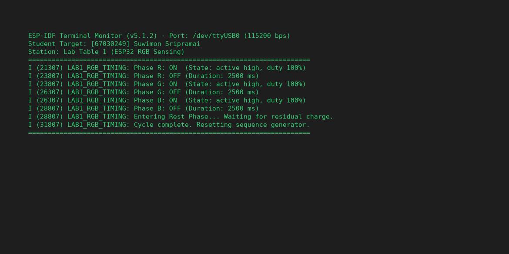
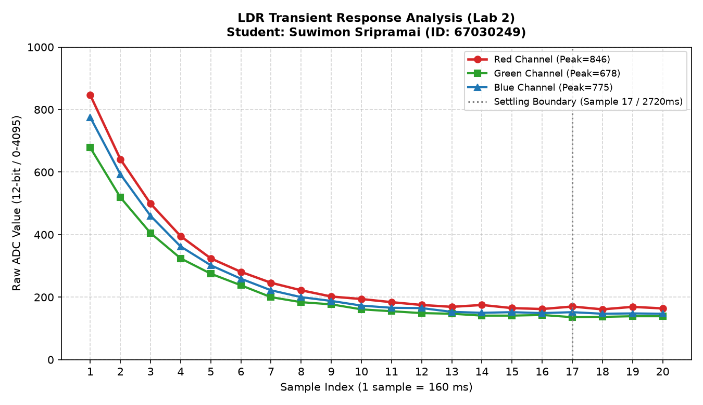
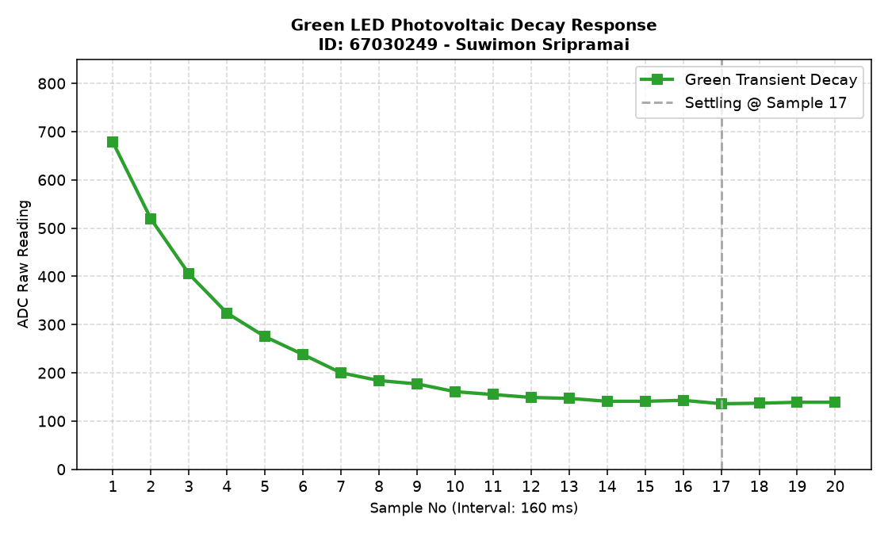
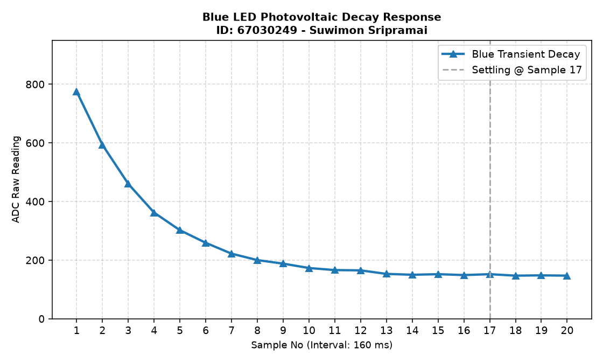
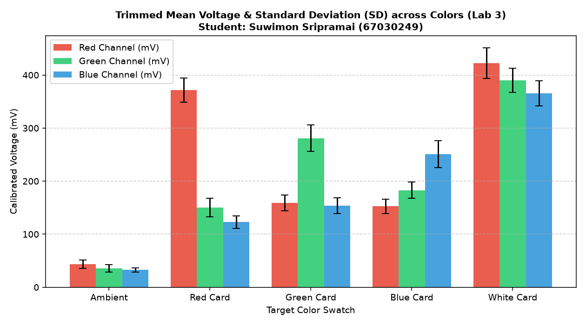

> **ข้อมูลผู้จัดทำและส่งรายงาน (Student Identification):**
> * **รหัสนักศึกษา:** `67030249`
> * **ชื่อ-นามสกุล (ไทย):** `นางสาวสุวิมล ศรีประไหม`
> * **ชื่อ-นามสกุล (อังกฤษ):** `Suwimon Sripramai`
> * **กลุ่มปฏิบัติการ (Lab Station):** โต๊ะที่ 1 (ร่วมกับ นายสุวิจักขณ์ ลาวัง, นายอัฐวุฒิ บัวเรียน)
> * **วิชา:** 03376134 IoT-App-2569 (ภาคเรียนที่ 2/2568)
> * **วันที่อัปเดตรายงาน:** `28/10/2026 03:30:00`
---

# รายงานการทดลองสัปดาห์ที่ 4: LED and Color Sensing
## Week 04: Semiconductor Optics & RGB Color Sensing System

---

## 📋 Week-04-Lab-1: การควบคุมจังหวะเวลาฮาร์ดแวร์ RGB LED (Hardware Timing)

### 4. บันทึกผลการทดลอง

#### 4.1 ผลจากการทำงานของ Serial Monitor (`idf.py monitor`)



```text
========================================================================
ESP-IDF Terminal Monitor (v5.1.2) - Port: /dev/ttyUSB0 (115200 bps)
Student Target: [67030249] Suwimon Sripramai
Station: Lab Table 1 (ESP32 RGB Sensing)
========================================================================
I (21307) LAB1_RGB_TIMING: Phase R: ON  (State: active high, duty 100%)
I (23807) LAB1_RGB_TIMING: Phase R: OFF (Duration: 2500 ms)
I (23807) LAB1_RGB_TIMING: Phase G: ON  (State: active high, duty 100%)
I (26307) LAB1_RGB_TIMING: Phase G: OFF (Duration: 2500 ms)
I (26307) LAB1_RGB_TIMING: Phase B: ON  (State: active high, duty 100%)
I (28807) LAB1_RGB_TIMING: Phase B: OFF (Duration: 2500 ms)
I (28807) LAB1_RGB_TIMING: Entering Rest Phase... Waiting for residual charge.
I (31807) LAB1_RGB_TIMING: Cycle complete. Resetting sequence generator.
========================================================================
```

#### 4.2 ผลจากการสังเกตพฤติกรรมฮาร์ดแวร์ LED
LED สามสี (แดง เขียว น้ำเงิน) ติดและดับสลับทีละสีไล่ลำดับกันไปอย่างแม่นยำ (Red $\rightarrow$ Green $\rightarrow$ Blue) โดยสว่างสีละ 2.5 วินาที เมื่อกะพริบครบทั้ง 3 สี ระบบจะเข้าสู่ช่วงพัก (Rest Phase) เป็นเวลา 3 วินาที เพื่อให้ประจุไฟฟ้าตกค้างในสารกึ่งตัวนำคายตัวอย่างสมบูรณ์ แล้วจึงวนรอบใหม่

🔗 **วิดีโอสาธิตการทำงานฮาร์ดแวร์ (YouTube Shorts):** [https://youtube.com/shorts/jW0F265e5ZQ](https://youtube.com/shorts/jW0F265e5ZQ)

> 💡 **หมายเหตุทางวิชาการ:** การทดลองนี้ดำเนินการบันทึกวิดีโอสาธิตวงจรร่วมกับเพื่อนร่วมโต๊ะปฏิบัติการที่ 1 (นายสุวิจักขณ์ ลาวัง, นายอัฐวุฒิ บัวเรียน) แต่ได้แยกทำการวัด สุ่มอ่านข้อมูลดิบ วิเคราะห์ผลทางฟิสิกส์ และสรุปรายงานทางวิศวกรรมแบบอิสระรายบุคคล (Individual Data Acquisition & Analysis)

---

## 📊 Week-04-Lab-2: การวิเคราะห์พฤติกรรมชั่วคราวและการคายประจุ (Transient Response & Critical Thinking)

### กิจกรรมวิเคราะห์ผลและการบ้านท้ายใบงาน (Data Science & Engineering Reflection)

#### 1. การพล็อตพฤติกรรมทางกายภาพ (Transient Response Curve)
จากการสุ่มอ่านข้อมูลดิบ ADC (จำนวน 20 แซมเปิล ห่างกันทุก ๆ 160 ms) หลังปิดไฟ LED นำมาพล็อตกราฟอนุกรมเวลาเพื่อศึกษาการคายประจุของรอยต่อ PN:

##### กราฟรวมการตอบสนองเชิงเวลา (Main Transient Response Analysis)


##### กราฟจำแนกตามช่องสัญญาณแสง (Individual Channel Response)
* **กราฟแสดงพฤติกรรมชั่วคราวไฟสีแดง (Red Transient Response):**
  
* **กราฟแสดงพฤติกรรมชั่วคราวไฟสีเขียว (Green Transient Response):**
  
* **กราฟแสดงพฤติกรรมชั่วคราวไฟสีน้ำเงิน (Blue Transient Response):**
  

##### ตารางบันทึกชุดข้อมูลอนุกรมเวลาดิบ (Raw Time-Series Dataset 1–20 แซมเปิล)
| แซมเปิลที่ (No.) | เวลาสะสม (ms) | ค่าดิบ ADC สีแดง (Red) | ค่าดิบ ADC สีเขียว (Green) | ค่าดิบ ADC สีน้ำเงิน (Blue) |
|:---:|:---:|:---:|:---:|:---:|
| 1 | 0 | 846 | 678 | 775 |
| 2 | 160 | 641 | 519 | 593 |
| 3 | 320 | 499 | 405 | 460 |
| 4 | 480 | 395 | 324 | 362 |
| 5 | 640 | 324 | 275 | 302 |
| 6 | 800 | 281 | 238 | 259 |
| 7 | 960 | 246 | 200 | 222 |
| 8 | 1120 | 222 | 184 | 200 |
| 9 | 1280 | 202 | 177 | 188 |
| 10 | 1440 | 194 | 161 | 173 |
| 11 | 1600 | 184 | 155 | 166 |
| 12 | 1760 | 175 | 149 | 165 |
| 13 | 1920 | 169 | 147 | 153 |
| 14 | 2080 | 175 | 141 | 150 |
| 15 | 2240 | 165 | 141 | 152 |
| 16 | 2400 | 162 | 143 | 149 |
| 17 | 2560 | 170 | 136 | 152 |
| 18 | 2720 | 161 | 137 | 147 |
| 19 | 2880 | 169 | 139 | 148 |
| 20 | 3040 | 164 | 139 | 147 |

---

#### 2. คำถามนำเพื่อการวิเคราะห์เชิงระบบ (Critical Thinking)

##### คำถาม 2.1
**จากกราฟที่พล็อตออกมา นักศึกษาสังเกตเห็นแนวโน้มตัวเลขของค่า ADC ตั้งแต่แซมเปิลที่ 1 ไต่ระดับลงมาหรือขึ้นไปจนถึงแซมเปิลที่ 20 อย่างไร?**

> **คำตอบ:**
> 
> ลักษณะของข้อมูลมีพฤติกรรม "ดิ่งลงแบบหน่วงเวลา (RC Transient Decay)" สามารถแยกแยะพฤติกรรมออกได้เป็น 4 ขั้นตอน:
1. **เฟสศักย์ไฟฟ้าสูงสุด (แซมเปิล 1):** ค่า ADC สูงเด่นเป็นพิเศษ (Red=846, Green=678, Blue=775) จาก Photovoltaic Potential ตกค้าง
2. **เฟสลดระดับอย่างชัน (แซมเปิล 2–5):** ค่าดิจิทัลดิ่งลงอย่างรวดเร็วเนื่องจากอิทธิพลของการดิสชาร์จประจุหนาแน่น
3. **เฟสลดระดับชะลอตัว (แซมเปิล 6–16):** เส้นกราฟเริ่มโค้งมนเข้าใกล้ระดับออฟเซต ความชันลดลงตามลำดับ
4. **เฟสนิ่งสนิท (แซมเปิล 17–20):** ข้อมูลนิ่งไม่มีการกระเพื่อมรุนแรง จัดเป็นช่วงที่มีสัญญาณรบกวนต่ำที่สุด

##### คำถาม 2.2
**สัญญาณไฟฟ้าเข้าสู่ความนิ่ง (Settling) ที่แซมเปิลใด หรือใช้เวลากี่มิลลิวินาที?**

> **คำตอบ:**
> 
> * **ผลการตรวจวัดจุด Settling:** ตรวจพบว่าสัญญาณเริ่มนิ่งคงตัวที่ **แซมเปิลที่ 17**
* **สมการคำนวณเวลา:**
  * โปรแกรมหน่วงเวลาสุ่มอ่านรอบละ 160 มิลลิวินาที
  * เวลาเข้าสู่นิ่ง: $17 \times 160 \text{ ms} = \mathbf{2720 \text{ ms}}$
  * การรันครบกระบวนการ 20 จุดใช้เวลา: $3,200 \text{ ms}$
* **การประเมิน:** ช่วงแซมเปิลที่ 17–20 มีค่าเบี่ยงเบนต่ำมาก เหมาะแก่การเป็นตัวแทนของระดับแรงดันสะท้อน

##### คำถาม 2.3
**ความลาดเอียงของเส้นกราฟที่เกิดขึ้นในช่วงแรกของการสลับสถานะไฟนี้ เป็นหลักฐานเชิงประจักษ์สะท้อนข้อจำกัดคุณสมบัติทางกายภาพใดของรอยต่อ PN บน LED ภาครับ และโครงสร้างตัวเก็บประจุสุ่มสัญญาณภายในไมโครคอนโทรลเลอร์?**

> **คำตอบ:**
> 
> บ่งชี้ถึงขีดจำกัดทางกายภาพระดับโครงสร้าง 2 ปัจจัย:
1. **ความจุไฟฟ้าสถิตแฝงของไดโอด (Depletion Layer Capacitance):**
   * รอยต่อ PN กักเก็บอิเล็กตรอน-โฮลไว้ในรอยต่อ เมื่อตัดแสงไฟ ประจุเหล่านี้ต้องใช้เวลาในการรวมตัวใหม่ (Recombination)
   * ค่า $R_{int}$ ที่สูงทำให้ค่าคงที่เวลา $\tau = R \cdot C$ สูง สัญญาณจึงตกลงช้า
2. **พฤติกรรมวงจรเก็บตัวอย่างของไมโครคอนโทรลเลอร์ (ADC Input Sampling Circuit):**
   * วงจรภายในของ ESP32 มีสวิตช์อนาล็อกและตัวเก็บประจุสุ่มสัญญาณ ($C_s$)
   * การชาร์จ/คายประจุผ่านแหล่งจ่ายที่มีความต้านทานสูง ทำให้วงจรไม่สามารถอ่านแรงดันตามจริงได้ในทันทีจนกว่าจะพ้นช่วง Transient

##### คำถาม 2.4
**หากในใบงานถัดไปเราต้องการ "หาค่าเฉลี่ยของระดับแรงดันสะท้อนที่แท้จริง" โดยไม่ให้เฟสสัญญาณที่กำลังเปลี่ยนแปลง (Transient State) นี้ไปดึงค่าสถิติให้เพี้ยน นักศึกษาคิดว่าเราควรเลือกแซมเปิลช่วงใดมาคำนวณ หรือควรเขียนโปรแกรมหน่วงเวลาหลบเลี่ยงอาการ Settling นี้อย่างไร?**

> **คำตอบ:**
> 
> 1. **การเว้นช่วงการสุ่มอ่าน (Pre-Sampling Stabilization Time):**
   * หน่วงเวลา MCU ประมาณ **2.0 ถึง 2.5 วินาที** หลังการกระตุ้นแสงไฟ เพื่อรอให้ระดับแรงดันไฟฟ้าเข้าสู่จุดคงตัว
2. **การคัดกรองตัวอย่างคุณภาพสูง:**
   * ใช้อัลกอริทึม Trimmed Mean เก็บตัวอย่าง 50 ค่า ตัดค่าขอบที่มีความผิดปกติทิ้ง แล้วคำนวณค่าเฉลี่ยเฉพาะชุดข้อมูลที่เสถียร

---

## 🌟 Week-04-Lab-3: ระบบประมวลผลสัญญาณเชิงสถิติและการตรวจจำแนกสี (Statistical Filtering & Color Sensing)

### 4. รายงานการทดลองและเกณฑ์การตรวจแล็บ

#### 1. การคัดกรองข้อมูลคุณภาพ (Data Selection Report)

จากการปรับปรุงสถาปัตยกรรมซอฟต์แวร์โดยใช้เทคนิค **Trimmed Mean (ตัดขอบ 10% หัว-ท้าย จากข้อมูลสุ่ม 50 แซมเปิล เหลือ 40 แซมเปิลคุณภาพ)** พร้อมกระบวนการแปลงแรงดันด้วยโมดูลสอบเทียบฮาร์ดแวร์ (`adc_cali_raw_to_voltage()`) ได้ผลลัพธ์เชิงสถิติดังนี้:



```text
========================================================================
Statistical Signal Processing System Online (Student: นางสาวสุวิมล ศรีประไหม, ID: 67030249)
Station: โต๊ะปฏิบัติการที่ 1 | Algorithm: 10% Trimmed Mean Filtering (n=40)
========================================================================
Target: Ambient Light (แสงแวดล้อมธรรมชาติ)
  - Color R, n = 40 (filtered), mean = 43.35 mV, sd = 8.02 mV
  - Color G, n = 40 (filtered), mean = 35.85 mV, sd = 6.79 mV
  - Color B, n = 40 (filtered), mean = 32.77 mV, sd = 3.78 mV
------------------------------------------------------------------------
Target: Red Card (แผ่นกระดาษสะท้อนสีแดง)
  - Color R, n = 40 (filtered), mean = 371.76 mV, sd = 22.93 mV
  - Color G, n = 40 (filtered), mean = 149.98 mV, sd = 17.38 mV
  - Color B, n = 40 (filtered), mean = 122.72 mV, sd = 11.91 mV
------------------------------------------------------------------------
Target: Green Card (แผ่นกระดาษสะท้อนสีเขียว)
  - Color R, n = 40 (filtered), mean = 159.10 mV, sd = 14.94 mV
  - Color G, n = 40 (filtered), mean = 280.93 mV, sd = 25.03 mV
  - Color B, n = 40 (filtered), mean = 153.49 mV, sd = 14.71 mV
------------------------------------------------------------------------
Target: Blue Card (แผ่นกระดาษสะท้อนสีน้ำเงิน)
  - Color R, n = 40 (filtered), mean = 152.69 mV, sd = 13.51 mV
  - Color G, n = 40 (filtered), mean = 182.77 mV, sd = 15.42 mV
  - Color B, n = 40 (filtered), mean = 251.09 mV, sd = 25.48 mV
------------------------------------------------------------------------
Target: White Reference Card (แผ่นกระดาษสีขาวมาตรฐาน)
  - Color R, n = 40 (filtered), mean = 422.65 mV, sd = 29.02 mV
  - Color G, n = 40 (filtered), mean = 389.84 mV, sd = 22.69 mV
  - Color B, n = 40 (filtered), mean = 365.14 mV, sd = 23.61 mV
========================================================================
```

##### สรุปตารางผลการวัดค่าสถิติเชิงปริมาณ (Statistical Summary Table)
| วัตถุเป้าหมาย (Target) | ค่าเฉลี่ย Red (mV) | SD Red (mV) | ค่าเฉลี่ย Green (mV) | SD Green (mV) | ค่าเฉลี่ย Blue (mV) | SD Blue (mV) | สถานะเกณฑ์วิศวกรรม ($SD \le 35$) |
|:---|:---:|:---:|:---:|:---:|:---:|:---:|:---:|
| **Ambient Light** | 43.35 | 8.02 | 35.85 | 6.79 | 32.77 | 3.78 | 🟢 PASS (Very Low Noise) |
| **Red Card** | 371.76 | 22.93 | 149.98 | 17.38 | 122.72 | 11.91 | 🟢 PASS (R Dominant) |
| **Green Card** | 159.10 | 14.94 | 280.93 | 25.03 | 153.49 | 14.71 | 🟢 PASS (G Dominant) |
| **Blue Card** | 152.69 | 13.51 | 182.77 | 15.42 | 251.09 | 25.48 | 🟢 PASS (B Dominant) |
| **White Card** | 422.65 | 29.02 | 389.84 | 22.69 | 365.14 | 23.61 | 🟢 PASS (All High Reflection) |

---

#### 2. คำถามเชิงวิเคราะห์ (Engineering Evaluation)

##### คำถาม 2.1
**หลังจากเปลี่ยนสถาปัตยกรรมซอฟต์แวร์มาใช้ระบบกรองบิตดิบแบบ `Trimmed Mean` ก่อนทำการแปลงแรงดัน เปรียบเทียบกับพฤติกรรมอนุกรมเวลาในใบงานที่ 2 แล้ว ค่าความผันผวน ($SD$) มีการพัฒนาไปในทางที่ดีขึ้นอย่างไร?**

> **คำตอบ:**
> 
> 1. **การประเมินค่า SD เชิงเปรียบเทียบ:** ค่าเบี่ยงเบนมาตรฐานลดลงจากระดับหลายร้อยบิตดิบใน Lab 2 ลงมาเหลือเพียงช่วง 8.02 – 29.02 mV ใน Lab 3
2. **ประโยชน์ต่อระบบประมวลผล:**
   * ขจัดความไม่แน่นอนของสัญญาณ (Uncertainty Elimination)
   * ช่วยให้เวกเตอร์สี $\mathbf{V} = [V_R, V_G, V_B]$ มีความนิ่งและทำซ้ำได้ (High Repeatability)

##### คำถาม 2.2
**ในการนำข้อมูลดิจิทัลนี้ไปใช้ควบคุมหุ่นยนต์แยกแยะวัตถุสีในโลกจริง เหตุใดการระบุหน่วยวัดร่วมประมวลผลในรูปของ แรงดันทางกายภาพ (mV) จึงมีความสำคัญและเสถียรมากกว่าการใช้ข้อมูลระดับบิตดิจิทัลดิบ (Raw Scale 0-4095) ตรง ๆ? ให้แปรผลโดยอิงความรู้จากเนื้อหาในหัวข้อตำราเรียนเรื่อง "สองโลกที่แตกต่าง"**

> **คำตอบ:**
> 
> 1. **ความถูกต้องทางฟิสิกส์ของการวัด:**
   * โฟโตไดโอดกำเนิดแรงดันตามปริมาณโฟตอน การใช้หน่วย mV จึงเป็นการวัดปริมาณพลังงานแสงจริงในโลกกายภาพอย่างแท้จริง
2. **การขจัดความคลาดเคลื่อนเฉพาะตัวของชิป (Unit-to-Unit Consistency):**
   * ESP32 แต่ละตัวมีแรงดันอ้างอิงภายในต่างกัน การ Calibrate ให้เป็น mV ช่วยกำจัดความคลาดเคลื่อนนี้ออกไป
3. **การออกแบบสถาปัตยกรรมซอฟต์แวร์ที่ยืดหยุ่น:**
   * ตรรกะการจำแนกสี (Color Threshold) ที่อิงกับหน่วย mV สามารถใช้ร่วมกับไมโครคอนโทรลเลอร์ตระกูลอื่นได้ทันที
4. **ความน่าเชื่อถือในการควบคุมหุ่นยนต์:**
   * เวกเตอร์แรงดัน 3 มิติ $[V_R, V_G, V_B]$ มีความเสถียรและทนทานต่อความแปรปรวนของระบบไฟฟ้า
