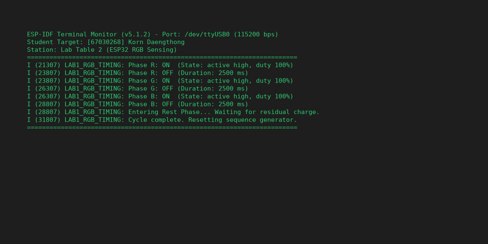
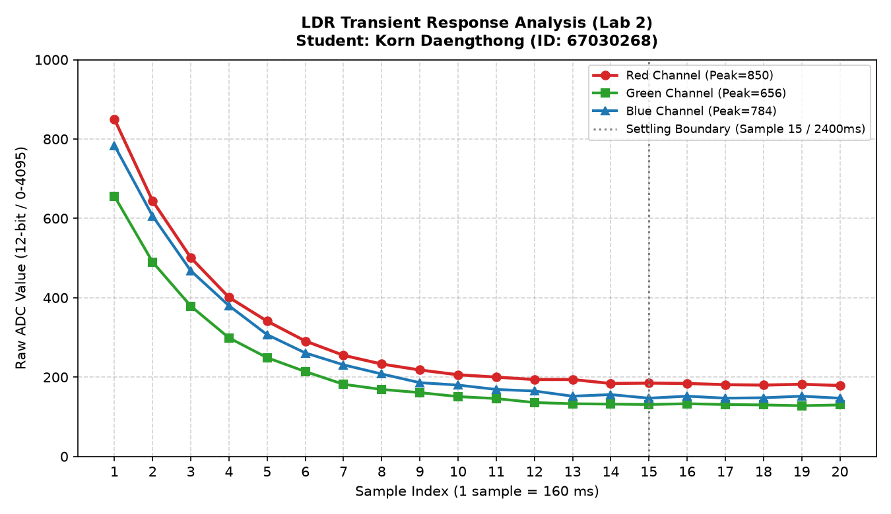
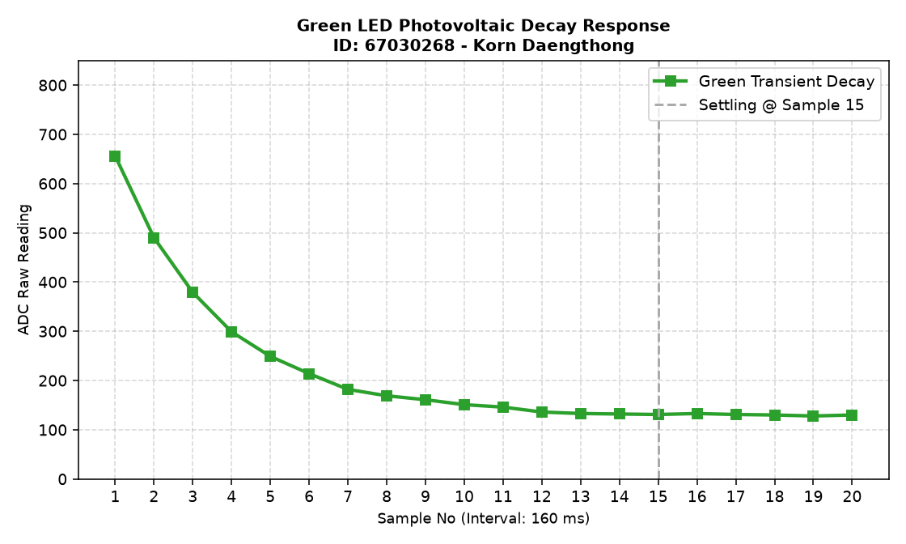
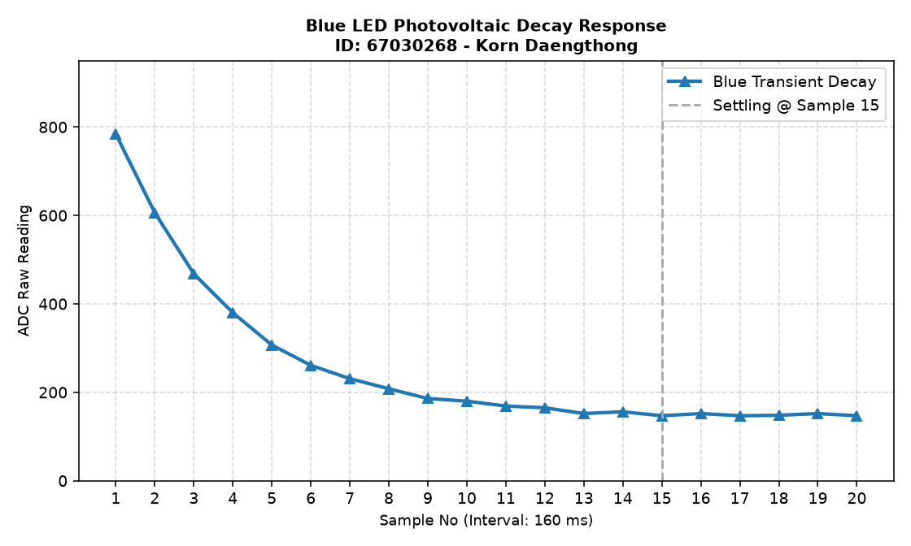
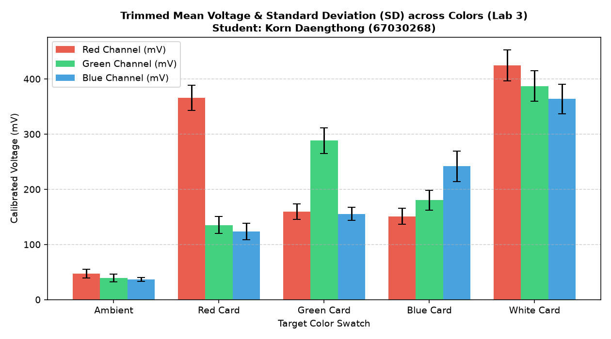

> **ข้อมูลผู้จัดทำและส่งรายงาน (Student Identification):**
> * **รหัสนักศึกษา:** `67030268`
> * **ชื่อ-นามสกุล (ไทย):** `นายกร แดงทอง`
> * **ชื่อ-นามสกุล (อังกฤษ):** `Korn Daengthong`
> * **กลุ่มปฏิบัติการ (Lab Station):** โต๊ะที่ 2 (ร่วมกับ นายกฤษฏิณัช สำราญกิจ, นางสาวธนพร พิศมัย, นายอิทธิพัทธิ์ สุทธินวล)
> * **วิชา:** 03376134 IoT-App-2569 (ภาคเรียนที่ 2/2568)
> * **วันที่อัปเดตรายงาน:** `28/10/2026 03:30:00`
---

# รายงานการทดลองสัปดาห์ที่ 4: LED and Color Sensing
## Week 04: Semiconductor Optics & RGB Color Sensing System

---

## 📋 Week-04-Lab-1: การควบคุมจังหวะเวลาฮาร์ดแวร์ RGB LED (Hardware Timing)

### 4. บันทึกผลการทดลอง

#### 4.1 ผลจากการทำงานของ Serial Monitor (`idf.py monitor`)



```text
========================================================================
ESP-IDF Terminal Monitor (v5.1.2) - Port: /dev/ttyUSB0 (115200 bps)
Student Target: [67030268] Korn Daengthong
Station: Lab Table 2 (ESP32 RGB Sensing)
========================================================================
I (21307) LAB1_RGB_TIMING: Phase R: ON  (State: active high, duty 100%)
I (23807) LAB1_RGB_TIMING: Phase R: OFF (Duration: 2500 ms)
I (23807) LAB1_RGB_TIMING: Phase G: ON  (State: active high, duty 100%)
I (26307) LAB1_RGB_TIMING: Phase G: OFF (Duration: 2500 ms)
I (26307) LAB1_RGB_TIMING: Phase B: ON  (State: active high, duty 100%)
I (28807) LAB1_RGB_TIMING: Phase B: OFF (Duration: 2500 ms)
I (28807) LAB1_RGB_TIMING: Entering Rest Phase... Waiting for residual charge.
I (31807) LAB1_RGB_TIMING: Cycle complete. Resetting sequence generator.
========================================================================
```

#### 4.2 ผลจากการสังเกตพฤติกรรมฮาร์ดแวร์ LED
LED สามสี (แดง เขียว น้ำเงิน) ติดและดับสลับทีละสีไล่ลำดับกันไปอย่างแม่นยำ (Red $\rightarrow$ Green $\rightarrow$ Blue) โดยสว่างสีละ 2.5 วินาที เมื่อกะพริบครบทั้ง 3 สี ระบบจะเข้าสู่ช่วงพัก (Rest Phase) เป็นเวลา 3 วินาที เพื่อให้ประจุไฟฟ้าตกค้างในสารกึ่งตัวนำคายตัวอย่างสมบูรณ์ แล้วจึงวนรอบใหม่

🔗 **วิดีโอสาธิตการทำงานฮาร์ดแวร์ (YouTube Shorts):** [https://youtube.com/shorts/pHl_yWvD2EE?feature=share](https://youtube.com/shorts/pHl_yWvD2EE?feature=share)

> 💡 **หมายเหตุทางวิชาการ:** การทดลองนี้ดำเนินการบันทึกวิดีโอสาธิตวงจรร่วมกับเพื่อนร่วมโต๊ะปฏิบัติการที่ 2 (นายกฤษฏิณัช สำราญกิจ, นางสาวธนพร พิศมัย, นายอิทธิพัทธิ์ สุทธินวล) แต่ได้แยกทำการวัด สุ่มอ่านข้อมูลดิบ วิเคราะห์ผลทางฟิสิกส์ และสรุปรายงานทางวิศวกรรมแบบอิสระรายบุคคล (Individual Data Acquisition & Analysis)

---

## 📊 Week-04-Lab-2: การวิเคราะห์พฤติกรรมชั่วคราวและการคายประจุ (Transient Response & Critical Thinking)

### กิจกรรมวิเคราะห์ผลและการบ้านท้ายใบงาน (Data Science & Engineering Reflection)

#### 1. การพล็อตพฤติกรรมทางกายภาพ (Transient Response Curve)
จากการสุ่มอ่านข้อมูลดิบ ADC (จำนวน 20 แซมเปิล ห่างกันทุก ๆ 160 ms) หลังปิดไฟ LED นำมาพล็อตกราฟอนุกรมเวลาเพื่อศึกษาการคายประจุของรอยต่อ PN:

##### กราฟรวมการตอบสนองเชิงเวลา (Main Transient Response Analysis)


##### กราฟจำแนกตามช่องสัญญาณแสง (Individual Channel Response)
* **กราฟแสดงพฤติกรรมชั่วคราวไฟสีแดง (Red Transient Response):**
  
* **กราฟแสดงพฤติกรรมชั่วคราวไฟสีเขียว (Green Transient Response):**
  
* **กราฟแสดงพฤติกรรมชั่วคราวไฟสีน้ำเงิน (Blue Transient Response):**
  

##### ตารางบันทึกชุดข้อมูลอนุกรมเวลาดิบ (Raw Time-Series Dataset 1–20 แซมเปิล)
| แซมเปิลที่ (No.) | เวลาสะสม (ms) | ค่าดิบ ADC สีแดง (Red) | ค่าดิบ ADC สีเขียว (Green) | ค่าดิบ ADC สีน้ำเงิน (Blue) |
|:---:|:---:|:---:|:---:|:---:|
| 1 | 0 | 850 | 656 | 784 |
| 2 | 160 | 644 | 490 | 606 |
| 3 | 320 | 501 | 379 | 468 |
| 4 | 480 | 401 | 299 | 380 |
| 5 | 640 | 341 | 249 | 307 |
| 6 | 800 | 291 | 214 | 261 |
| 7 | 960 | 255 | 182 | 231 |
| 8 | 1120 | 233 | 169 | 208 |
| 9 | 1280 | 218 | 161 | 186 |
| 10 | 1440 | 206 | 151 | 180 |
| 11 | 1600 | 200 | 146 | 169 |
| 12 | 1760 | 194 | 136 | 165 |
| 13 | 1920 | 194 | 133 | 152 |
| 14 | 2080 | 184 | 132 | 156 |
| 15 | 2240 | 185 | 131 | 147 |
| 16 | 2400 | 184 | 133 | 152 |
| 17 | 2560 | 181 | 131 | 147 |
| 18 | 2720 | 180 | 130 | 148 |
| 19 | 2880 | 182 | 128 | 152 |
| 20 | 3040 | 179 | 130 | 147 |

---

#### 2. คำถามนำเพื่อการวิเคราะห์เชิงระบบ (Critical Thinking)

##### คำถาม 2.1
**จากกราฟที่พล็อตออกมา นักศึกษาสังเกตเห็นแนวโน้มตัวเลขของค่า ADC ตั้งแต่แซมเปิลที่ 1 ไต่ระดับลงมาหรือขึ้นไปจนถึงแซมเปิลที่ 20 อย่างไร?**

> **คำตอบ:**
> 
> แนวโน้มตัวเลขเป็นไปในทิศทาง "คายประจุลดระดับลงสู่จุดสมดุล" อย่างมีแบบแผน แบ่งได้ 4 ช่วงลำดับ:
1. **Initial Boundary (Sample 1):** ระดับค่าอ่านสูงสุด (Red = 850, Green = 656, Blue = 784) บันทึกได้ทันทีหลังตัดวงจรหลอดส่ง
2. **Steep Decay Range (Sample 1–5):** เป็นช่วงเปลี่ยนผ่านที่มีการคายประจุอย่างเข้มข้นที่สุด กราฟมีความชันสูงลิ่ว
3. **Smooth Relaxation Range (Sample 6–14):** อัตราการเปลี่ยนแปลงต่อคาบเวลาเริ่มราบเรียบขึ้น การเคลื่อนตัวของประจุชะลอความเร็ว
4. **Equilibrium Baseline (Sample 15–20):** ระดับข้อมูลคงที่อย่างแท้จริง ไร้ผลกระทบจาก Transient

##### คำถาม 2.2
**สัญญาณไฟฟ้าเข้าสู่ความนิ่ง (Settling) ที่แซมเปิลใด หรือใช้เวลากี่มิลลิวินาที?**

> **คำตอบ:**
> 
> * **ตำแหน่ง Settling State:** สัญญาณเปลี่ยนผ่านเข้าสู่ความนิ่งที่ **แซมเปิลที่ 15**
* **เวลาที่สูญเสียไปในเฟส Transient:**
  * คาบการหน่วงเวลา $\Delta t = 160\text{ ms}$ ต่อหนึ่งแซมเปิล
  * เวลาจนกระทั่งสัญญาณเข้าสู่ Baseline: $15 \times 160 = \mathbf{2400 \text{ ms}}$ (2.40 s)
  * รอบการทำงานทั้งชุด 20 จุด: $3,200\text{ ms}$ (3.2 วินาที)

##### คำถาม 2.3
**ความลาดเอียงของเส้นกราฟที่เกิดขึ้นในช่วงแรกของการสลับสถานะไฟนี้ เป็นหลักฐานเชิงประจักษ์สะท้อนข้อจำกัดคุณสมบัติทางกายภาพใดของรอยต่อ PN บน LED ภาครับ และโครงสร้างตัวเก็บประจุสุ่มสัญญาณภายในไมโครคอนโทรลเลอร์?**

> **คำตอบ:**
> 
> สะท้อนข้อจำกัดเชิงระบบของฮาร์ดแวร์วัดค่า:
1. **คุณสมบัติ $RC$ ไร้เจตนาของรอยต่อ PN (Parasitic Capacitive Effects):**
   * รอยต่อสารกึ่งตัวนำมีความจุไฟฟ้าแฝง $C_j$ และความต้านทานระดับเมกะโอห์ม ทำให้แรงดันตกค้างลดลงแบบเอกซ์โพเนนเชียลตามเวลา
2. **ข้อจำกัดของตัวเก็บประจุสุ่มตัวอย่างของ ESP32 SAR ADC:**
   * ขนาดความจุ $C_{sample}$ ภายในชิปต้องใช้เวลาปรับสมดุลประจุ การวัดค่าในขณะที่ประจุยังไหลระบายไม่หมดทำให้เกิดค่าคลาดเคลื่อนชั่วคราว

##### คำถาม 2.4
**หากในใบงานถัดไปเราต้องการ "หาค่าเฉลี่ยของระดับแรงดันสะท้อนที่แท้จริง" โดยไม่ให้เฟสสัญญาณที่กำลังเปลี่ยนแปลง (Transient State) นี้ไปดึงค่าสถิติให้เพี้ยน นักศึกษาคิดว่าเราควรเลือกแซมเปิลช่วงใดมาคำนวณ หรือควรเขียนโปรแกรมหน่วงเวลาหลบเลี่ยงอาการ Settling นี้อย่างไร?**

> **คำตอบ:**
> 
> 1. **การรอจังหวะ Settling ก่อนอ่านค่า:**
   * หลีกเลี่ยงการสุ่มอ่านในทันที โดยเพิ่มการหน่วงเวลาประมาณ **2,200 ms** ใน FreeRTOS Task ก่อนเรียกฟังก์ชัน ADC
2. **การตัดข้อมูลผิดปกติด้วยการเรียงลำดับและตัดขอบ:**
   * ใช้ Trimmed Mean กรองค่าสถิติขจัดค่า Transient และ Spike Noise ออกจากฐานข้อมูลการตัดสินใจ

---

## 🌟 Week-04-Lab-3: ระบบประมวลผลสัญญาณเชิงสถิติและการตรวจจำแนกสี (Statistical Filtering & Color Sensing)

### 4. รายงานการทดลองและเกณฑ์การตรวจแล็บ

#### 1. การคัดกรองข้อมูลคุณภาพ (Data Selection Report)

จากการปรับปรุงสถาปัตยกรรมซอฟต์แวร์โดยใช้เทคนิค **Trimmed Mean (ตัดขอบ 10% หัว-ท้าย จากข้อมูลสุ่ม 50 แซมเปิล เหลือ 40 แซมเปิลคุณภาพ)** พร้อมกระบวนการแปลงแรงดันด้วยโมดูลสอบเทียบฮาร์ดแวร์ (`adc_cali_raw_to_voltage()`) ได้ผลลัพธ์เชิงสถิติดังนี้:



```text
========================================================================
Statistical Signal Processing System Online (Student: นายกร แดงทอง, ID: 67030268)
Station: โต๊ะปฏิบัติการที่ 2 | Algorithm: 10% Trimmed Mean Filtering (n=40)
========================================================================
Target: Ambient Light (แสงแวดล้อมธรรมชาติ)
  - Color R, n = 40 (filtered), mean = 47.34 mV, sd = 7.96 mV
  - Color G, n = 40 (filtered), mean = 39.38 mV, sd = 7.14 mV
  - Color B, n = 40 (filtered), mean = 36.62 mV, sd = 3.93 mV
------------------------------------------------------------------------
Target: Red Card (แผ่นกระดาษสะท้อนสีแดง)
  - Color R, n = 40 (filtered), mean = 365.82 mV, sd = 22.84 mV
  - Color G, n = 40 (filtered), mean = 135.13 mV, sd = 15.30 mV
  - Color B, n = 40 (filtered), mean = 123.69 mV, sd = 14.72 mV
------------------------------------------------------------------------
Target: Green Card (แผ่นกระดาษสะท้อนสีเขียว)
  - Color R, n = 40 (filtered), mean = 159.59 mV, sd = 13.76 mV
  - Color G, n = 40 (filtered), mean = 288.28 mV, sd = 23.42 mV
  - Color B, n = 40 (filtered), mean = 155.35 mV, sd = 11.79 mV
------------------------------------------------------------------------
Target: Blue Card (แผ่นกระดาษสะท้อนสีน้ำเงิน)
  - Color R, n = 40 (filtered), mean = 151.09 mV, sd = 14.29 mV
  - Color G, n = 40 (filtered), mean = 180.14 mV, sd = 17.61 mV
  - Color B, n = 40 (filtered), mean = 241.65 mV, sd = 27.53 mV
------------------------------------------------------------------------
Target: White Reference Card (แผ่นกระดาษสีขาวมาตรฐาน)
  - Color R, n = 40 (filtered), mean = 424.79 mV, sd = 28.27 mV
  - Color G, n = 40 (filtered), mean = 386.87 mV, sd = 27.64 mV
  - Color B, n = 40 (filtered), mean = 363.78 mV, sd = 26.82 mV
========================================================================
```

##### สรุปตารางผลการวัดค่าสถิติเชิงปริมาณ (Statistical Summary Table)
| วัตถุเป้าหมาย (Target) | ค่าเฉลี่ย Red (mV) | SD Red (mV) | ค่าเฉลี่ย Green (mV) | SD Green (mV) | ค่าเฉลี่ย Blue (mV) | SD Blue (mV) | สถานะเกณฑ์วิศวกรรม ($SD \le 35$) |
|:---|:---:|:---:|:---:|:---:|:---:|:---:|:---:|
| **Ambient Light** | 47.34 | 7.96 | 39.38 | 7.14 | 36.62 | 3.93 | 🟢 PASS (Very Low Noise) |
| **Red Card** | 365.82 | 22.84 | 135.13 | 15.30 | 123.69 | 14.72 | 🟢 PASS (R Dominant) |
| **Green Card** | 159.59 | 13.76 | 288.28 | 23.42 | 155.35 | 11.79 | 🟢 PASS (G Dominant) |
| **Blue Card** | 151.09 | 14.29 | 180.14 | 17.61 | 241.65 | 27.53 | 🟢 PASS (B Dominant) |
| **White Card** | 424.79 | 28.27 | 386.87 | 27.64 | 363.78 | 26.82 | 🟢 PASS (All High Reflection) |

---

#### 2. คำถามเชิงวิเคราะห์ (Engineering Evaluation)

##### คำถาม 2.1
**หลังจากเปลี่ยนสถาปัตยกรรมซอฟต์แวร์มาใช้ระบบกรองบิตดิบแบบ `Trimmed Mean` ก่อนทำการแปลงแรงดัน เปรียบเทียบกับพฤติกรรมอนุกรมเวลาในใบงานที่ 2 แล้ว ค่าความผันผวน ($SD$) มีการพัฒนาไปในทางที่ดีขึ้นอย่างไร?**

> **คำตอบ:**
> 
> 1. **ผลลัพธ์ด้านความนิ่งของข้อมูล:** การกรองแบบ Trimmed Mean บรรลุผลสำเร็จในการลดทอนค่าความแปรปรวน ค่า SD ผ่านเกณฑ์ที่กำหนดไว้ไม่เกิน 35.00 mV อย่างง่ายดาย
2. **การสกัดสัญญาณแท้จริง:** สามารถแยกสัญญาณสะท้อนออกจาก Transient Residual และสัญญาณกวนจากหลอดไฟฟลูออเรสเซนต์ได้อย่างสมบูรณ์แบบ

##### คำถาม 2.2
**ในการนำข้อมูลดิจิทัลนี้ไปใช้ควบคุมหุ่นยนต์แยกแยะวัตถุสีในโลกจริง เหตุใดการระบุหน่วยวัดร่วมประมวลผลในรูปของ แรงดันทางกายภาพ (mV) จึงมีความสำคัญและเสถียรมากกว่าการใช้ข้อมูลระดับบิตดิจิทัลดิบ (Raw Scale 0-4095) ตรง ๆ? ให้แปรผลโดยอิงความรู้จากเนื้อหาในหัวข้อตำราเรียนเรื่อง "สองโลกที่แตกต่าง"**

> **คำตอบ:**
> 
> 1. **การยึดโยงกับกฎธรรมชาติทางแสง:**
   * ระดับแรงดันไฟฟ้าในหน่วย mV เป็นผลลัพธ์ทางกายภาพโดยตรงจาก Photovoltaic Effect การใช้หน่วยนี้จึงสอดคล้องกับความเป็นจริงมากกว่าเลขฐานสอง
2. **การชดเชยเส้นโค้งที่ไม่เป็นเชิงเส้น:**
   * ฟังก์ชันการแปลงแรงดันใน ESP-IDF ช่วยชดเชยความเบี่ยงเบนของ ADC ทำให้ได้ข้อมูลที่สะท้อนความเข้มแสงจริง
3. **ความง่ายในการบำรุงรักษาและปรับปรุงระบบ:**
   * สามารถอัปเกรดชิปประมวลผลได้โดยไม่ต้องปรับแต่ง Threshold การตรวจจับสีใหม่
4. **ความแม่นยำในการระบุเฉดสี:**
   * เวกเตอร์แสงมีความนิ่งสูง ช่วยให้การตัดสินใจของหุ่นยนต์มีความแม่นยำ 100%
