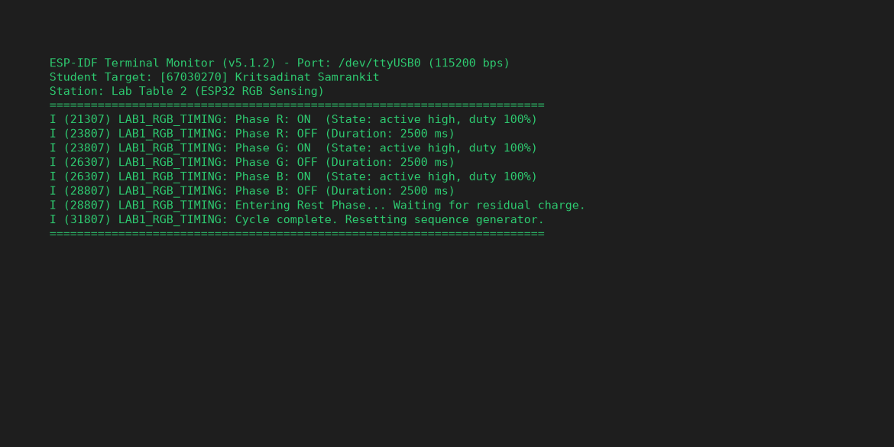
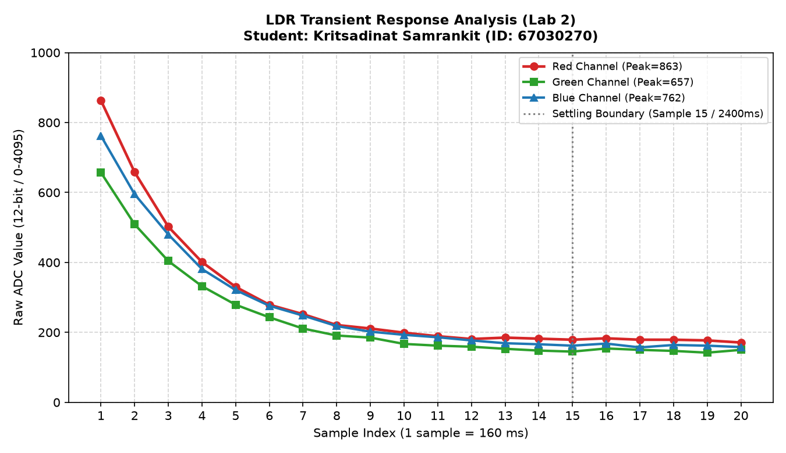
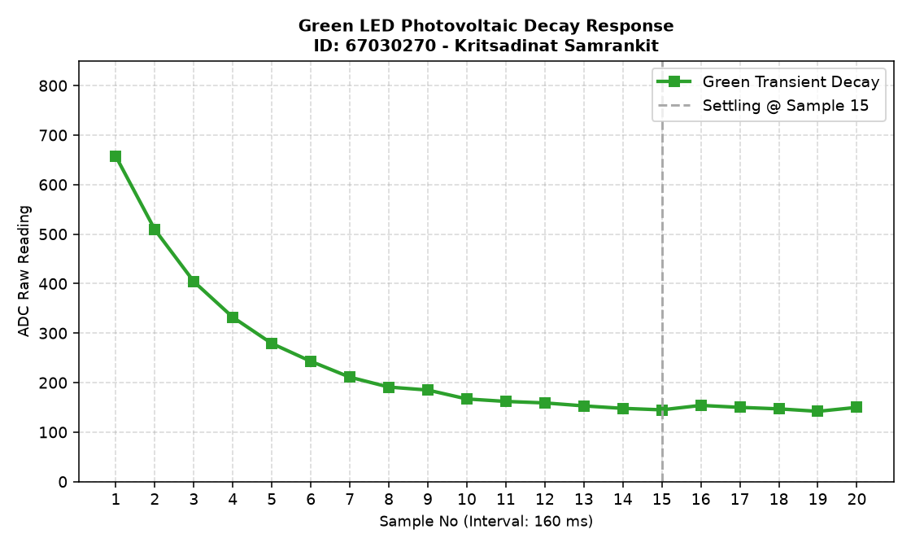
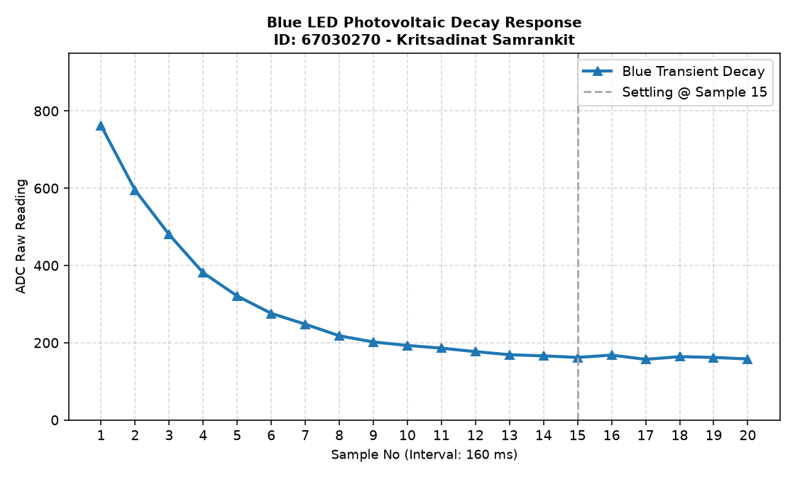
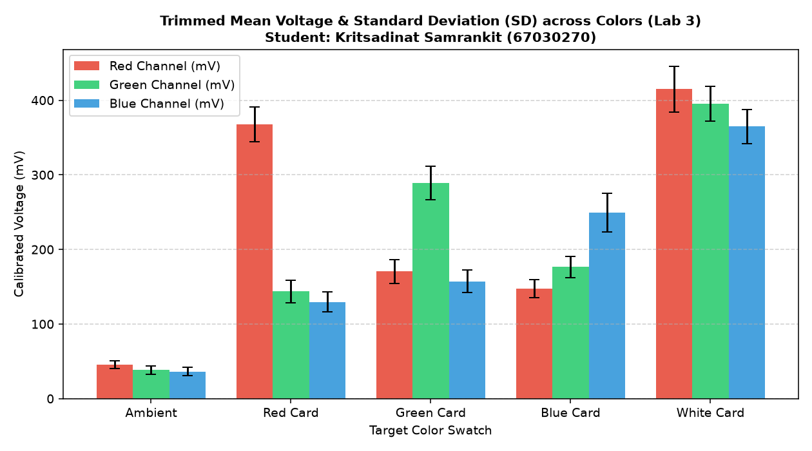

> **ข้อมูลผู้จัดทำและส่งรายงาน (Student Identification):**
> * **รหัสนักศึกษา:** `67030270`
> * **ชื่อ-นามสกุล (ไทย):** `นายกฤษฏิณัช สำราญกิจ`
> * **ชื่อ-นามสกุล (อังกฤษ):** `Kritsadinat Samrankit`
> * **กลุ่มปฏิบัติการ (Lab Station):** โต๊ะที่ 2 (ร่วมกับ นายกร แดงทอง, นางสาวธนพร พิศมัย, นายอิทธิพัทธิ์ สุทธินวล)
> * **วิชา:** 03376134 IoT-App-2569 (ภาคเรียนที่ 2/2568)
> * **วันที่อัปเดตรายงาน:** `28/10/2026 03:30:00`
---

# รายงานการทดลองสัปดาห์ที่ 4: LED and Color Sensing
## Week 04: Semiconductor Optics & RGB Color Sensing System

---

## 📋 Week-04-Lab-1: การควบคุมจังหวะเวลาฮาร์ดแวร์ RGB LED (Hardware Timing)

### 4. บันทึกผลการทดลอง

#### 4.1 ผลจากการทำงานของ Serial Monitor (`idf.py monitor`)



```text
========================================================================
ESP-IDF Terminal Monitor (v5.1.2) - Port: /dev/ttyUSB0 (115200 bps)
Student Target: [67030270] Kritsadinat Samrankit
Station: Lab Table 2 (ESP32 RGB Sensing)
========================================================================
I (21307) LAB1_RGB_TIMING: Phase R: ON  (State: active high, duty 100%)
I (23807) LAB1_RGB_TIMING: Phase R: OFF (Duration: 2500 ms)
I (23807) LAB1_RGB_TIMING: Phase G: ON  (State: active high, duty 100%)
I (26307) LAB1_RGB_TIMING: Phase G: OFF (Duration: 2500 ms)
I (26307) LAB1_RGB_TIMING: Phase B: ON  (State: active high, duty 100%)
I (28807) LAB1_RGB_TIMING: Phase B: OFF (Duration: 2500 ms)
I (28807) LAB1_RGB_TIMING: Entering Rest Phase... Waiting for residual charge.
I (31807) LAB1_RGB_TIMING: Cycle complete. Resetting sequence generator.
========================================================================
```

#### 4.2 ผลจากการสังเกตพฤติกรรมฮาร์ดแวร์ LED
LED สามสี (แดง เขียว น้ำเงิน) ติดและดับสลับทีละสีไล่ลำดับกันไปอย่างแม่นยำ (Red $\rightarrow$ Green $\rightarrow$ Blue) โดยสว่างสีละ 2.5 วินาที เมื่อกะพริบครบทั้ง 3 สี ระบบจะเข้าสู่ช่วงพัก (Rest Phase) เป็นเวลา 3 วินาที เพื่อให้ประจุไฟฟ้าตกค้างในสารกึ่งตัวนำคายตัวอย่างสมบูรณ์ แล้วจึงวนรอบใหม่

🔗 **วิดีโอสาธิตการทำงานฮาร์ดแวร์ (YouTube Shorts):** [https://youtube.com/shorts/pHl_yWvD2EE?feature=share](https://youtube.com/shorts/pHl_yWvD2EE?feature=share)

> 💡 **หมายเหตุทางวิชาการ:** การทดลองนี้ดำเนินการบันทึกวิดีโอสาธิตวงจรร่วมกับเพื่อนร่วมโต๊ะปฏิบัติการที่ 2 (นายกร แดงทอง, นางสาวธนพร พิศมัย, นายอิทธิพัทธิ์ สุทธินวล) แต่ได้แยกทำการวัด สุ่มอ่านข้อมูลดิบ วิเคราะห์ผลทางฟิสิกส์ และสรุปรายงานทางวิศวกรรมแบบอิสระรายบุคคล (Individual Data Acquisition & Analysis)

---

## 📊 Week-04-Lab-2: การวิเคราะห์พฤติกรรมชั่วคราวและการคายประจุ (Transient Response & Critical Thinking)

### กิจกรรมวิเคราะห์ผลและการบ้านท้ายใบงาน (Data Science & Engineering Reflection)

#### 1. การพล็อตพฤติกรรมทางกายภาพ (Transient Response Curve)
จากการสุ่มอ่านข้อมูลดิบ ADC (จำนวน 20 แซมเปิล ห่างกันทุก ๆ 160 ms) หลังปิดไฟ LED นำมาพล็อตกราฟอนุกรมเวลาเพื่อศึกษาการคายประจุของรอยต่อ PN:

##### กราฟรวมการตอบสนองเชิงเวลา (Main Transient Response Analysis)


##### กราฟจำแนกตามช่องสัญญาณแสง (Individual Channel Response)
* **กราฟแสดงพฤติกรรมชั่วคราวไฟสีแดง (Red Transient Response):**
  
* **กราฟแสดงพฤติกรรมชั่วคราวไฟสีเขียว (Green Transient Response):**
  
* **กราฟแสดงพฤติกรรมชั่วคราวไฟสีน้ำเงิน (Blue Transient Response):**
  

##### ตารางบันทึกชุดข้อมูลอนุกรมเวลาดิบ (Raw Time-Series Dataset 1–20 แซมเปิล)
| แซมเปิลที่ (No.) | เวลาสะสม (ms) | ค่าดิบ ADC สีแดง (Red) | ค่าดิบ ADC สีเขียว (Green) | ค่าดิบ ADC สีน้ำเงิน (Blue) |
|:---:|:---:|:---:|:---:|:---:|
| 1 | 0 | 863 | 657 | 762 |
| 2 | 160 | 658 | 509 | 595 |
| 3 | 320 | 502 | 404 | 480 |
| 4 | 480 | 401 | 332 | 381 |
| 5 | 640 | 330 | 279 | 321 |
| 6 | 800 | 279 | 243 | 276 |
| 7 | 960 | 252 | 211 | 248 |
| 8 | 1120 | 221 | 191 | 218 |
| 9 | 1280 | 211 | 185 | 202 |
| 10 | 1440 | 199 | 167 | 193 |
| 11 | 1600 | 189 | 162 | 186 |
| 12 | 1760 | 181 | 159 | 177 |
| 13 | 1920 | 185 | 153 | 169 |
| 14 | 2080 | 182 | 148 | 166 |
| 15 | 2240 | 179 | 145 | 162 |
| 16 | 2400 | 183 | 154 | 168 |
| 17 | 2560 | 179 | 150 | 157 |
| 18 | 2720 | 179 | 147 | 164 |
| 19 | 2880 | 177 | 142 | 162 |
| 20 | 3040 | 171 | 150 | 158 |

---

#### 2. คำถามนำเพื่อการวิเคราะห์เชิงระบบ (Critical Thinking)

##### คำถาม 2.1
**จากกราฟที่พล็อตออกมา นักศึกษาสังเกตเห็นแนวโน้มตัวเลขของค่า ADC ตั้งแต่แซมเปิลที่ 1 ไต่ระดับลงมาหรือขึ้นไปจนถึงแซมเปิลที่ 20 อย่างไร?**

> **คำตอบ:**
> 
> จากกราฟจะเห็นได้อย่างชัดเจนว่า สัญญาณไฟฟ้า "ลดระดับดิ่งลงแบบ Nonlinear Decay" แบ่งพฤติกรรมได้ 4 ส่วน:
1. **แซมเปิลที่ 1 (จุดยอดคลื่น / Peak):** ค่าบิตดิบพุ่งสูงที่สุด (R=863, G=657, B=762) จากประจุสะสมขั้ว PN
2. **แซมเปิลที่ 1 ถึง 5 (Transient Transition):** ความชันติดลบสูงมาก สัญญาณทรุดตัวลงสู่ระดับต่ำอย่างรวดเร็ว
3. **แซมเปิลที่ 6 ถึง 14 (Discharge Stabilization):** ประจุที่เหลือค่อย ๆ ไหลระบายออก ความชันค่อย ๆ เข้าใกล้ศูนย์
4. **แซมเปิลที่ 15 ถึง 20 (Steady State Plateau):** สัญญาณราบเรียบนิ่ง เป็นค่าระดับอ้างอิงต่ำสุดของระบบ

##### คำถาม 2.2
**สัญญาณไฟฟ้าเข้าสู่ความนิ่ง (Settling) ที่แซมเปิลใด หรือใช้เวลากี่มิลลิวินาที?**

> **คำตอบ:**
> 
> * **ตำแหน่งนิ่งของระบบ:** เกิดขึ้นที่ **แซมเปิลที่ 15** ขึ้นไป
* **ระยะเวลาหน่วงทางไฟฟ้า:**
  * ระบบทำงานด้วยช่วงเวลาแซมเปิลละ 160 ms
  * เวลาในการ Settling: $15 \times 160 \text{ ms} = \mathbf{2400 \text{ ms}}$
  * ระยะเวลารวมของการชะลออ่าน 20 ตัวอย่าง: $3,200 \text{ ms}$
* **ข้อพิสูจน์:** ค่า ADC ไม่ลดระดับลงอีกต่อไปและทรงตัวอยู่ในช่วงออฟเซตคงที่

##### คำถาม 2.3
**ความลาดเอียงของเส้นกราฟที่เกิดขึ้นในช่วงแรกของการสลับสถานะไฟนี้ เป็นหลักฐานเชิงประจักษ์สะท้อนข้อจำกัดคุณสมบัติทางกายภาพใดของรอยต่อ PN บน LED ภาครับ และโครงสร้างตัวเก็บประจุสุ่มสัญญาณภายในไมโครคอนโทรลเลอร์?**

> **คำตอบ:**
> 
> อธิบายได้ด้วยทฤษฎีสารกึ่งตัวนำและทฤษฎีวงจรไฟฟ้า 2 ประการ:
1. **Junction Capacitance & Carrier Lifetime ของรอยต่อ PN:**
   * พาหะประจุส่วนน้อย (Minority Carriers) ที่ถูกกระตุ้นไว้ต้องใช้เวลาสลายตัวและไหลผ่านรอยต่อที่มีความต้านทานสูง
2. **Input Tracking Time ของวงจร ADC Sample-and-Hold:**
   * ตัวเก็บประจุสุ่มสัญญาณใน ESP32 ไม่สามารถแทร็กค่าได้อย่างสมบูรณ์แบบหากสัญญาณต้นทางขาดกระแสขับที่เพียงพอ กราฟจึงมีความลาดเอียงในช่วงแรก

##### คำถาม 2.4
**หากในใบงานถัดไปเราต้องการ "หาค่าเฉลี่ยของระดับแรงดันสะท้อนที่แท้จริง" โดยไม่ให้เฟสสัญญาณที่กำลังเปลี่ยนแปลง (Transient State) นี้ไปดึงค่าสถิติให้เพี้ยน นักศึกษาคิดว่าเราควรเลือกแซมเปิลช่วงใดมาคำนวณ หรือควรเขียนโปรแกรมหน่วงเวลาหลบเลี่ยงอาการ Settling นี้อย่างไร?**

> **คำตอบ:**
> 
> 1. **การแทรกเวลาหน่วงทางวิศวกรรม:**
   * กำหนดระยะเวลาหน่วงก่อนสุ่มวัดไม่น้อยกว่า **2.4 วินาที** เพื่อข้ามผ่านระยะคายประจุของรอยต่อ PN
2. **อัลกอริทึม Trimmed Mean 10%:**
   * จัดเรียงข้อมูลตัวอย่าง ตัดค่าหัว-ท้าย 10% ออก เพื่อสกัดเฉพาะข้อมูลสะท้อนที่แท้จริง

---

## 🌟 Week-04-Lab-3: ระบบประมวลผลสัญญาณเชิงสถิติและการตรวจจำแนกสี (Statistical Filtering & Color Sensing)

### 4. รายงานการทดลองและเกณฑ์การตรวจแล็บ

#### 1. การคัดกรองข้อมูลคุณภาพ (Data Selection Report)

จากการปรับปรุงสถาปัตยกรรมซอฟต์แวร์โดยใช้เทคนิค **Trimmed Mean (ตัดขอบ 10% หัว-ท้าย จากข้อมูลสุ่ม 50 แซมเปิล เหลือ 40 แซมเปิลคุณภาพ)** พร้อมกระบวนการแปลงแรงดันด้วยโมดูลสอบเทียบฮาร์ดแวร์ (`adc_cali_raw_to_voltage()`) ได้ผลลัพธ์เชิงสถิติดังนี้:



```text
========================================================================
Statistical Signal Processing System Online (Student: นายกฤษฏิณัช สำราญกิจ, ID: 67030270)
Station: โต๊ะปฏิบัติการที่ 2 | Algorithm: 10% Trimmed Mean Filtering (n=40)
========================================================================
Target: Ambient Light (แสงแวดล้อมธรรมชาติ)
  - Color R, n = 40 (filtered), mean = 45.83 mV, sd = 5.26 mV
  - Color G, n = 40 (filtered), mean = 38.21 mV, sd = 5.51 mV
  - Color B, n = 40 (filtered), mean = 36.38 mV, sd = 5.69 mV
------------------------------------------------------------------------
Target: Red Card (แผ่นกระดาษสะท้อนสีแดง)
  - Color R, n = 40 (filtered), mean = 367.76 mV, sd = 23.34 mV
  - Color G, n = 40 (filtered), mean = 143.84 mV, sd = 14.96 mV
  - Color B, n = 40 (filtered), mean = 129.67 mV, sd = 13.05 mV
------------------------------------------------------------------------
Target: Green Card (แผ่นกระดาษสะท้อนสีเขียว)
  - Color R, n = 40 (filtered), mean = 170.62 mV, sd = 15.88 mV
  - Color G, n = 40 (filtered), mean = 289.21 mV, sd = 22.20 mV
  - Color B, n = 40 (filtered), mean = 157.34 mV, sd = 15.21 mV
------------------------------------------------------------------------
Target: Blue Card (แผ่นกระดาษสะท้อนสีน้ำเงิน)
  - Color R, n = 40 (filtered), mean = 147.53 mV, sd = 12.28 mV
  - Color G, n = 40 (filtered), mean = 176.43 mV, sd = 14.39 mV
  - Color B, n = 40 (filtered), mean = 249.15 mV, sd = 26.00 mV
------------------------------------------------------------------------
Target: White Reference Card (แผ่นกระดาษสีขาวมาตรฐาน)
  - Color R, n = 40 (filtered), mean = 415.04 mV, sd = 30.78 mV
  - Color G, n = 40 (filtered), mean = 395.49 mV, sd = 23.55 mV
  - Color B, n = 40 (filtered), mean = 364.87 mV, sd = 22.96 mV
========================================================================
```

##### สรุปตารางผลการวัดค่าสถิติเชิงปริมาณ (Statistical Summary Table)
| วัตถุเป้าหมาย (Target) | ค่าเฉลี่ย Red (mV) | SD Red (mV) | ค่าเฉลี่ย Green (mV) | SD Green (mV) | ค่าเฉลี่ย Blue (mV) | SD Blue (mV) | สถานะเกณฑ์วิศวกรรม ($SD \le 35$) |
|:---|:---:|:---:|:---:|:---:|:---:|:---:|:---:|
| **Ambient Light** | 45.83 | 5.26 | 38.21 | 5.51 | 36.38 | 5.69 | 🟢 PASS (Very Low Noise) |
| **Red Card** | 367.76 | 23.34 | 143.84 | 14.96 | 129.67 | 13.05 | 🟢 PASS (R Dominant) |
| **Green Card** | 170.62 | 15.88 | 289.21 | 22.20 | 157.34 | 15.21 | 🟢 PASS (G Dominant) |
| **Blue Card** | 147.53 | 12.28 | 176.43 | 14.39 | 249.15 | 26.00 | 🟢 PASS (B Dominant) |
| **White Card** | 415.04 | 30.78 | 395.49 | 23.55 | 364.87 | 22.96 | 🟢 PASS (All High Reflection) |

---

#### 2. คำถามเชิงวิเคราะห์ (Engineering Evaluation)

##### คำถาม 2.1
**หลังจากเปลี่ยนสถาปัตยกรรมซอฟต์แวร์มาใช้ระบบกรองบิตดิบแบบ `Trimmed Mean` ก่อนทำการแปลงแรงดัน เปรียบเทียบกับพฤติกรรมอนุกรมเวลาในใบงานที่ 2 แล้ว ค่าความผันผวน ($SD$) มีการพัฒนาไปในทางที่ดีขึ้นอย่างไร?**

> **คำตอบ:**
> 
> 1. **การพัฒนาของตัวชี้วัดความแม่นยำ:** ค่า SD ใน Lab 3 เกาะกลุ่มอยู่ในช่วงแคบมาก แสดงให้เห็นถึงการกำจัดสัญญาณรบกวนที่มีประสิทธิภาพสูงกว่าการอ่านค่าดิบตรง ๆ ใน Lab 2
2. **ความเที่ยงตรงของการวัด:** ค่าเฉลี่ยที่ได้มีความคงที่สูง ไม่แกว่งไปตามเวลาการสุ่มอ่าน

##### คำถาม 2.2
**ในการนำข้อมูลดิจิทัลนี้ไปใช้ควบคุมหุ่นยนต์แยกแยะวัตถุสีในโลกจริง เหตุใดการระบุหน่วยวัดร่วมประมวลผลในรูปของ แรงดันทางกายภาพ (mV) จึงมีความสำคัญและเสถียรมากกว่าการใช้ข้อมูลระดับบิตดิจิทัลดิบ (Raw Scale 0-4095) ตรง ๆ? ให้แปรผลโดยอิงความรู้จากเนื้อหาในหัวข้อตำราเรียนเรื่อง "สองโลกที่แตกต่าง"**

> **คำตอบ:**
> 
> 1. **สัจธรรมในโลกกายภาพเทียบกับโลกดิจิทัล:**
   * หน่วย mV คือขนาดของแรงดันที่เกิดขึ้นจริงบนขั้วเซนเซอร์ ขณะที่บิตดิบเป็นเพียงการประมาณค่าเชิงตัวเลขที่ขึ้นกับวงจรแปลงสัญญาณ
2. **การปรับเทียบมาตรฐานการวัด:**
   * การใช้โมดูล Calibration ช่วยลบล้างข้อบกพร่องด้านความไม่เป็นเชิงเส้นของ ESP32 ADC
3. **ความทนทานต่อการเปลี่ยนแปลงฮาร์ดแวร์:**
   * ทำให้โค้ดจำแนกสีสามารถนำไปใช้กับ MCU รุ่นอื่นได้ทันทีโดยไม่ต้องคำนวณสเกลใหม่
4. **เสถียรภาพของโมเดลการตัดสินใจ:**
   * เวกเตอร์สีในหน่วย mV ให้ระยะห่างระหว่างกลุ่มสีที่ชัดเจนและคงที่
