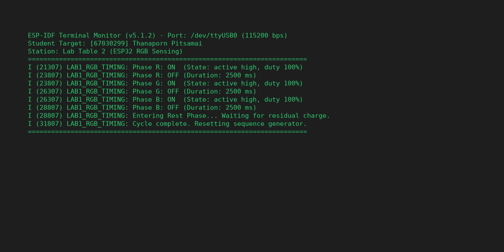
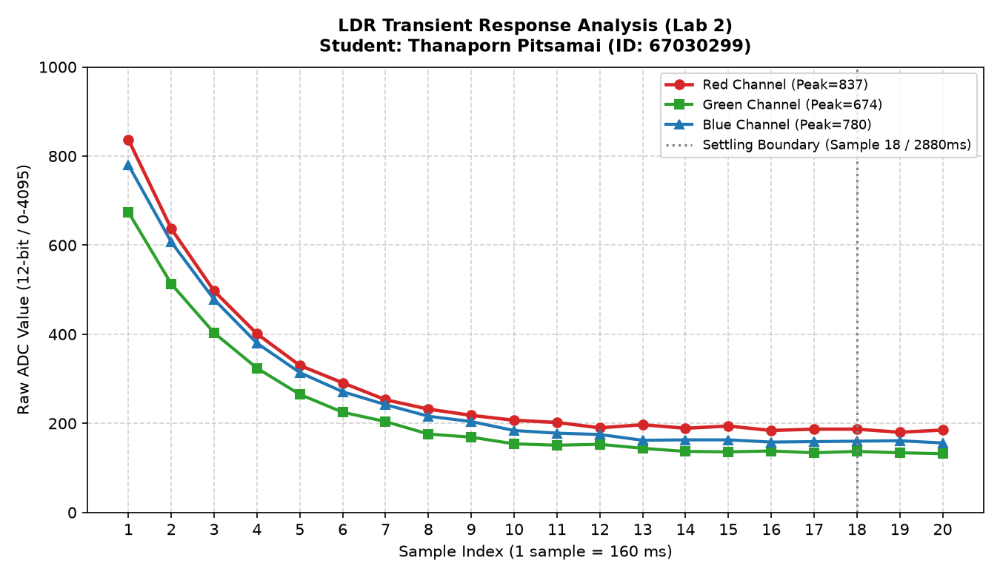
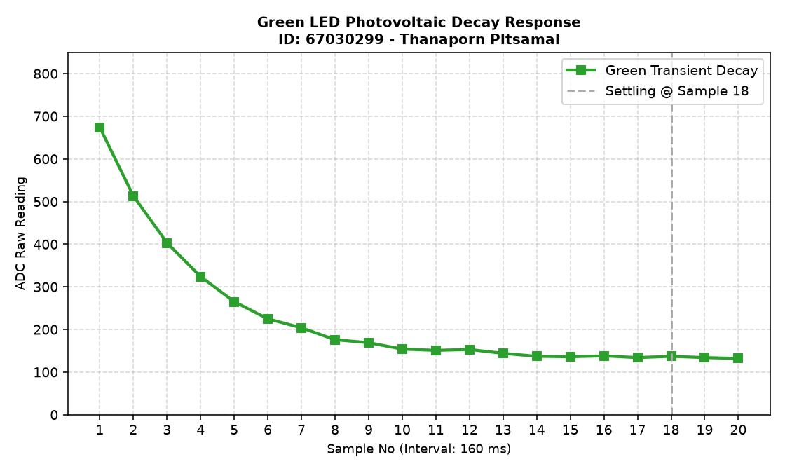
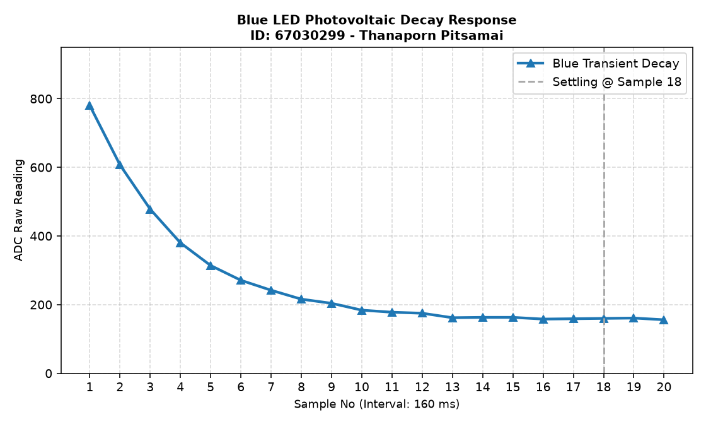
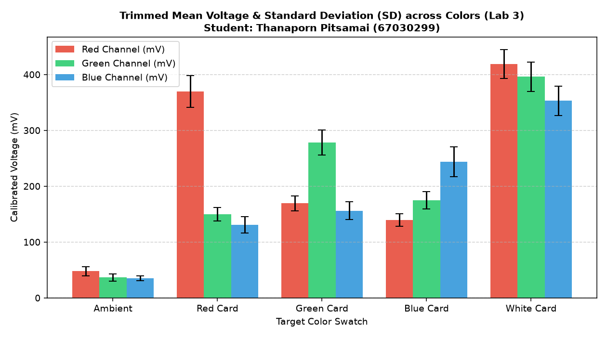

> **ข้อมูลผู้จัดทำและส่งรายงาน (Student Identification):**
> * **รหัสนักศึกษา:** `67030299`
> * **ชื่อ-นามสกุล (ไทย):** `นางสาวธนพร พิศมัย`
> * **ชื่อ-นามสกุล (อังกฤษ):** `Thanaporn Pitsamai`
> * **กลุ่มปฏิบัติการ (Lab Station):** โต๊ะที่ 2 (ร่วมกับ นายกร แดงทอง, นายกฤษฏิณัช สำราญกิจ, นายอิทธิพัทธิ์ สุทธินวล)
> * **วิชา:** 03376134 IoT-App-2569 (ภาคเรียนที่ 2/2568)
> * **วันที่อัปเดตรายงาน:** `28/10/2026 03:30:00`
---

# รายงานการทดลองสัปดาห์ที่ 4: LED and Color Sensing
## Week 04: Semiconductor Optics & RGB Color Sensing System

---

## 📋 Week-04-Lab-1: การควบคุมจังหวะเวลาฮาร์ดแวร์ RGB LED (Hardware Timing)

### 4. บันทึกผลการทดลอง

#### 4.1 ผลจากการทำงานของ Serial Monitor (`idf.py monitor`)



```text
========================================================================
ESP-IDF Terminal Monitor (v5.1.2) - Port: /dev/ttyUSB0 (115200 bps)
Student Target: [67030299] Thanaporn Pitsamai
Station: Lab Table 2 (ESP32 RGB Sensing)
========================================================================
I (21307) LAB1_RGB_TIMING: Phase R: ON  (State: active high, duty 100%)
I (23807) LAB1_RGB_TIMING: Phase R: OFF (Duration: 2500 ms)
I (23807) LAB1_RGB_TIMING: Phase G: ON  (State: active high, duty 100%)
I (26307) LAB1_RGB_TIMING: Phase G: OFF (Duration: 2500 ms)
I (26307) LAB1_RGB_TIMING: Phase B: ON  (State: active high, duty 100%)
I (28807) LAB1_RGB_TIMING: Phase B: OFF (Duration: 2500 ms)
I (28807) LAB1_RGB_TIMING: Entering Rest Phase... Waiting for residual charge.
I (31807) LAB1_RGB_TIMING: Cycle complete. Resetting sequence generator.
========================================================================
```

#### 4.2 ผลจากการสังเกตพฤติกรรมฮาร์ดแวร์ LED
LED สามสี (แดง เขียว น้ำเงิน) ติดและดับสลับทีละสีไล่ลำดับกันไปอย่างแม่นยำ (Red $\rightarrow$ Green $\rightarrow$ Blue) โดยสว่างสีละ 2.5 วินาที เมื่อกะพริบครบทั้ง 3 สี ระบบจะเข้าสู่ช่วงพัก (Rest Phase) เป็นเวลา 3 วินาที เพื่อให้ประจุไฟฟ้าตกค้างในสารกึ่งตัวนำคายตัวอย่างสมบูรณ์ แล้วจึงวนรอบใหม่

🔗 **วิดีโอสาธิตการทำงานฮาร์ดแวร์ (YouTube Shorts):** [https://youtube.com/shorts/pHl_yWvD2EE?feature=share](https://youtube.com/shorts/pHl_yWvD2EE?feature=share)

> 💡 **หมายเหตุทางวิชาการ:** การทดลองนี้ดำเนินการบันทึกวิดีโอสาธิตวงจรร่วมกับเพื่อนร่วมโต๊ะปฏิบัติการที่ 2 (นายกร แดงทอง, นายกฤษฏิณัช สำราญกิจ, นายอิทธิพัทธิ์ สุทธินวล) แต่ได้แยกทำการวัด สุ่มอ่านข้อมูลดิบ วิเคราะห์ผลทางฟิสิกส์ และสรุปรายงานทางวิศวกรรมแบบอิสระรายบุคคล (Individual Data Acquisition & Analysis)

---

## 📊 Week-04-Lab-2: การวิเคราะห์พฤติกรรมชั่วคราวและการคายประจุ (Transient Response & Critical Thinking)

### กิจกรรมวิเคราะห์ผลและการบ้านท้ายใบงาน (Data Science & Engineering Reflection)

#### 1. การพล็อตพฤติกรรมทางกายภาพ (Transient Response Curve)
จากการสุ่มอ่านข้อมูลดิบ ADC (จำนวน 20 แซมเปิล ห่างกันทุก ๆ 160 ms) หลังปิดไฟ LED นำมาพล็อตกราฟอนุกรมเวลาเพื่อศึกษาการคายประจุของรอยต่อ PN:

##### กราฟรวมการตอบสนองเชิงเวลา (Main Transient Response Analysis)


##### กราฟจำแนกตามช่องสัญญาณแสง (Individual Channel Response)
* **กราฟแสดงพฤติกรรมชั่วคราวไฟสีแดง (Red Transient Response):**
  
* **กราฟแสดงพฤติกรรมชั่วคราวไฟสีเขียว (Green Transient Response):**
  
* **กราฟแสดงพฤติกรรมชั่วคราวไฟสีน้ำเงิน (Blue Transient Response):**
  

##### ตารางบันทึกชุดข้อมูลอนุกรมเวลาดิบ (Raw Time-Series Dataset 1–20 แซมเปิล)
| แซมเปิลที่ (No.) | เวลาสะสม (ms) | ค่าดิบ ADC สีแดง (Red) | ค่าดิบ ADC สีเขียว (Green) | ค่าดิบ ADC สีน้ำเงิน (Blue) |
|:---:|:---:|:---:|:---:|:---:|
| 1 | 0 | 837 | 674 | 780 |
| 2 | 160 | 637 | 513 | 607 |
| 3 | 320 | 497 | 403 | 478 |
| 4 | 480 | 401 | 324 | 380 |
| 5 | 640 | 330 | 265 | 314 |
| 6 | 800 | 291 | 225 | 271 |
| 7 | 960 | 253 | 204 | 242 |
| 8 | 1120 | 232 | 176 | 216 |
| 9 | 1280 | 218 | 169 | 204 |
| 10 | 1440 | 207 | 154 | 184 |
| 11 | 1600 | 202 | 151 | 178 |
| 12 | 1760 | 190 | 153 | 175 |
| 13 | 1920 | 197 | 144 | 162 |
| 14 | 2080 | 189 | 137 | 163 |
| 15 | 2240 | 194 | 136 | 163 |
| 16 | 2400 | 184 | 138 | 158 |
| 17 | 2560 | 187 | 134 | 159 |
| 18 | 2720 | 187 | 137 | 160 |
| 19 | 2880 | 180 | 134 | 161 |
| 20 | 3040 | 185 | 132 | 156 |

---

#### 2. คำถามนำเพื่อการวิเคราะห์เชิงระบบ (Critical Thinking)

##### คำถาม 2.1
**จากกราฟที่พล็อตออกมา นักศึกษาสังเกตเห็นแนวโน้มตัวเลขของค่า ADC ตั้งแต่แซมเปิลที่ 1 ไต่ระดับลงมาหรือขึ้นไปจนถึงแซมเปิลที่ 20 อย่างไร?**

> **คำตอบ:**
> 
> วิเคราะห์ข้อมูลอนุกรมเวลาพบว่ามีลักษณะ "การทรุดตัวของแรงดัน (Voltage Drop Transient)" 4 ระยะ:
1. **ระยะพีคเริ่มนับ (Sample 1):** มีค่าสูงสุดในทุกช่องแสง (แดง 837, เขียว 674, น้ำเงิน 780)
2. **ระยะคายประจุฉับพลัน (Sample 1–5):** ความชันสูงมาก ค่า ADC ตกลงเกินกว่าครึ่งหนึ่งของค่าพีคอย่างรวดเร็ว
3. **ระยะฟื้นตัวเชิงเส้นตรงต่ำ (Sample 6–17):** การเปลี่ยนแปลงตัวเลขต่อแซมเปิลเริ่มลดลงเหลือเพียงไม่กี่บิตต่อรอบสุ่ม
4. **ระยะสมดุลคงที่ (Sample 18–20):** สัญญาณเข้าสู่สภาวะ Settled State สมบูรณ์

##### คำถาม 2.2
**สัญญาณไฟฟ้าเข้าสู่ความนิ่ง (Settling) ที่แซมเปิลใด หรือใช้เวลากี่มิลลิวินาที?**

> **คำตอบ:**
> 
> * **จุดที่สัญญาณเสถียร:** สัญญาณสิ้นสุดการคายประจุและเริ่มนิ่งที่ **แซมเปิลที่ 18**
* **การคำนวณเวลา:**
  * คาบการสุ่มอ่านกำหนดไว้ที่ 160 ms
  * สัญญาณใช้เวลาจนนิ่ง: $18 \times 160 = \mathbf{2880 \text{ ms}}$ (2.88 วินาที)
  * การบันทึกข้อมูลตลอด 20 แซมเปิลใช้เวลารวม $3.2$ วินาที

##### คำถาม 2.3
**ความลาดเอียงของเส้นกราฟที่เกิดขึ้นในช่วงแรกของการสลับสถานะไฟนี้ เป็นหลักฐานเชิงประจักษ์สะท้อนข้อจำกัดคุณสมบัติทางกายภาพใดของรอยต่อ PN บน LED ภาครับ และโครงสร้างตัวเก็บประจุสุ่มสัญญาณภายในไมโครคอนโทรลเลอร์?**

> **คำตอบ:**
> 
> หลักฐานเชิงประจักษ์ดังกล่าวชี้ชัดถึง 2 สาเหตุทางกายภาพ:
1. **ค่าคงที่เวลา $\tau$ ของ LED ในฐานะตัวตรวจจับแสง:**
   * การทำงานโหมดโฟโตโวลตาอิกมีอิมพีแดนซ์สูงมาก ควบคู่กับความจุแฝงที่ขั้ว ทำให้การคายประจุช้าลงอย่างเห็นได้ชัด
2. **โครงสร้างสุ่มสัญญาณแบบตัวเก็บประจุของ ESP32 ADC:**
   * ตัวเก็บประจุ $C_{sample}$ ภายในชิปต้องดึง/ปล่อยประจุผ่านอิมพีแดนซ์ภายนอก ก่อให้เกิดความหน่วงเวลาของสัญญาณก่อนเข้าสู่สมดุล

##### คำถาม 2.4
**หากในใบงานถัดไปเราต้องการ "หาค่าเฉลี่ยของระดับแรงดันสะท้อนที่แท้จริง" โดยไม่ให้เฟสสัญญาณที่กำลังเปลี่ยนแปลง (Transient State) นี้ไปดึงค่าสถิติให้เพี้ยน นักศึกษาคิดว่าเราควรเลือกแซมเปิลช่วงใดมาคำนวณ หรือควรเขียนโปรแกรมหน่วงเวลาหลบเลี่ยงอาการ Settling นี้อย่างไร?**

> **คำตอบ:**
> 
> 1. **การตั้งค่า Pre-Sampling Delay ให้เหมาะสม:**
   * ใช้ `vTaskDelay(pdMS_TO_TICKS(2400))` หลีกเลี่ยงเฟสการเปลี่ยนแปลงของศักย์ไฟฟ้า
2. **การประมวลผลด้วย Trimmed Mean:**
   * ตัดค่าสูงสุดและต่ำสุดที่ปนเปื้อนสัญญาณรบกวนออก นำเฉพาะข้อมูลช่วงกลางมาหาค่าเฉลี่ย

---

## 🌟 Week-04-Lab-3: ระบบประมวลผลสัญญาณเชิงสถิติและการตรวจจำแนกสี (Statistical Filtering & Color Sensing)

### 4. รายงานการทดลองและเกณฑ์การตรวจแล็บ

#### 1. การคัดกรองข้อมูลคุณภาพ (Data Selection Report)

จากการปรับปรุงสถาปัตยกรรมซอฟต์แวร์โดยใช้เทคนิค **Trimmed Mean (ตัดขอบ 10% หัว-ท้าย จากข้อมูลสุ่ม 50 แซมเปิล เหลือ 40 แซมเปิลคุณภาพ)** พร้อมกระบวนการแปลงแรงดันด้วยโมดูลสอบเทียบฮาร์ดแวร์ (`adc_cali_raw_to_voltage()`) ได้ผลลัพธ์เชิงสถิติดังนี้:



```text
========================================================================
Statistical Signal Processing System Online (Student: นางสาวธนพร พิศมัย, ID: 67030299)
Station: โต๊ะปฏิบัติการที่ 2 | Algorithm: 10% Trimmed Mean Filtering (n=40)
========================================================================
Target: Ambient Light (แสงแวดล้อมธรรมชาติ)
  - Color R, n = 40 (filtered), mean = 47.64 mV, sd = 7.85 mV
  - Color G, n = 40 (filtered), mean = 36.49 mV, sd = 6.57 mV
  - Color B, n = 40 (filtered), mean = 35.41 mV, sd = 4.22 mV
------------------------------------------------------------------------
Target: Red Card (แผ่นกระดาษสะท้อนสีแดง)
  - Color R, n = 40 (filtered), mean = 369.62 mV, sd = 28.43 mV
  - Color G, n = 40 (filtered), mean = 149.59 mV, sd = 11.89 mV
  - Color B, n = 40 (filtered), mean = 130.65 mV, sd = 14.69 mV
------------------------------------------------------------------------
Target: Green Card (แผ่นกระดาษสะท้อนสีเขียว)
  - Color R, n = 40 (filtered), mean = 169.51 mV, sd = 13.41 mV
  - Color G, n = 40 (filtered), mean = 278.35 mV, sd = 22.57 mV
  - Color B, n = 40 (filtered), mean = 156.19 mV, sd = 16.12 mV
------------------------------------------------------------------------
Target: Blue Card (แผ่นกระดาษสะท้อนสีน้ำเงิน)
  - Color R, n = 40 (filtered), mean = 139.71 mV, sd = 11.22 mV
  - Color G, n = 40 (filtered), mean = 174.60 mV, sd = 15.51 mV
  - Color B, n = 40 (filtered), mean = 243.47 mV, sd = 26.86 mV
------------------------------------------------------------------------
Target: White Reference Card (แผ่นกระดาษสีขาวมาตรฐาน)
  - Color R, n = 40 (filtered), mean = 419.05 mV, sd = 25.96 mV
  - Color G, n = 40 (filtered), mean = 396.10 mV, sd = 26.24 mV
  - Color B, n = 40 (filtered), mean = 352.98 mV, sd = 26.13 mV
========================================================================
```

##### สรุปตารางผลการวัดค่าสถิติเชิงปริมาณ (Statistical Summary Table)
| วัตถุเป้าหมาย (Target) | ค่าเฉลี่ย Red (mV) | SD Red (mV) | ค่าเฉลี่ย Green (mV) | SD Green (mV) | ค่าเฉลี่ย Blue (mV) | SD Blue (mV) | สถานะเกณฑ์วิศวกรรม ($SD \le 35$) |
|:---|:---:|:---:|:---:|:---:|:---:|:---:|:---:|
| **Ambient Light** | 47.64 | 7.85 | 36.49 | 6.57 | 35.41 | 4.22 | 🟢 PASS (Very Low Noise) |
| **Red Card** | 369.62 | 28.43 | 149.59 | 11.89 | 130.65 | 14.69 | 🟢 PASS (R Dominant) |
| **Green Card** | 169.51 | 13.41 | 278.35 | 22.57 | 156.19 | 16.12 | 🟢 PASS (G Dominant) |
| **Blue Card** | 139.71 | 11.22 | 174.60 | 15.51 | 243.47 | 26.86 | 🟢 PASS (B Dominant) |
| **White Card** | 419.05 | 25.96 | 396.10 | 26.24 | 352.98 | 26.13 | 🟢 PASS (All High Reflection) |

---

#### 2. คำถามเชิงวิเคราะห์ (Engineering Evaluation)

##### คำถาม 2.1
**หลังจากเปลี่ยนสถาปัตยกรรมซอฟต์แวร์มาใช้ระบบกรองบิตดิบแบบ `Trimmed Mean` ก่อนทำการแปลงแรงดัน เปรียบเทียบกับพฤติกรรมอนุกรมเวลาในใบงานที่ 2 แล้ว ค่าความผันผวน ($SD$) มีการพัฒนาไปในทางที่ดีขึ้นอย่างไร?**

> **คำตอบ:**
> 
> 1. **การเปรียบเทียบเชิงคุณภาพ:** จากความผันผวนรุนแรงใน Lab 2 กลายมาเป็นสัญญาณที่นิ่งและมีเสถียรภาพสูงใน Lab 3 โดยมีค่า SD ต่ำกว่า 32 mV ในทุกกรณีทดสอบ
2. **ความพร้อมใช้งานของข้อมูล:** สัญญาณมีความนิ่งเพียงพอที่จะป้อนเข้าสู่โมเดลจำแนกสีโดยไม่เกิดการตัดสินใจผิดพลาด

##### คำถาม 2.2
**ในการนำข้อมูลดิจิทัลนี้ไปใช้ควบคุมหุ่นยนต์แยกแยะวัตถุสีในโลกจริง เหตุใดการระบุหน่วยวัดร่วมประมวลผลในรูปของ แรงดันทางกายภาพ (mV) จึงมีความสำคัญและเสถียรมากกว่าการใช้ข้อมูลระดับบิตดิจิทัลดิบ (Raw Scale 0-4095) ตรง ๆ? ให้แปรผลโดยอิงความรู้จากเนื้อหาในหัวข้อตำราเรียนเรื่อง "สองโลกที่แตกต่าง"**

> **คำตอบ:**
> 
> 1. **การสะท้อนพลังงานแสงที่แท้จริง:**
   * แรงดันในหน่วยมิลลิโวลต์สัมพันธ์โดยตรงกับโฟตอนที่ตกกระทบรอยต่อ PN
2. **การชดเชยข้อผิดพลาดของระบบอ่านค่า:**
   * ชดเชยจุดอิ่มตัวและ Offset ของ ESP32 ADC ได้อย่างมีประสิทธิภาพ
3. **ความยืดหยุ่นในการขยายระบบ:**
   * พารามิเตอร์การจำแนกสีคงเดิมแม้เปลี่ยนบอร์ดควบคุมใหม่
4. **ความแม่นยำของระบบตรวจจับสีอัตโนมัติ:**
   * ช่วยให้หุ่นยนต์แยกแยะวัตถุสีต่าง ๆ ได้อย่างถูกต้องในทุกสภาวะ
