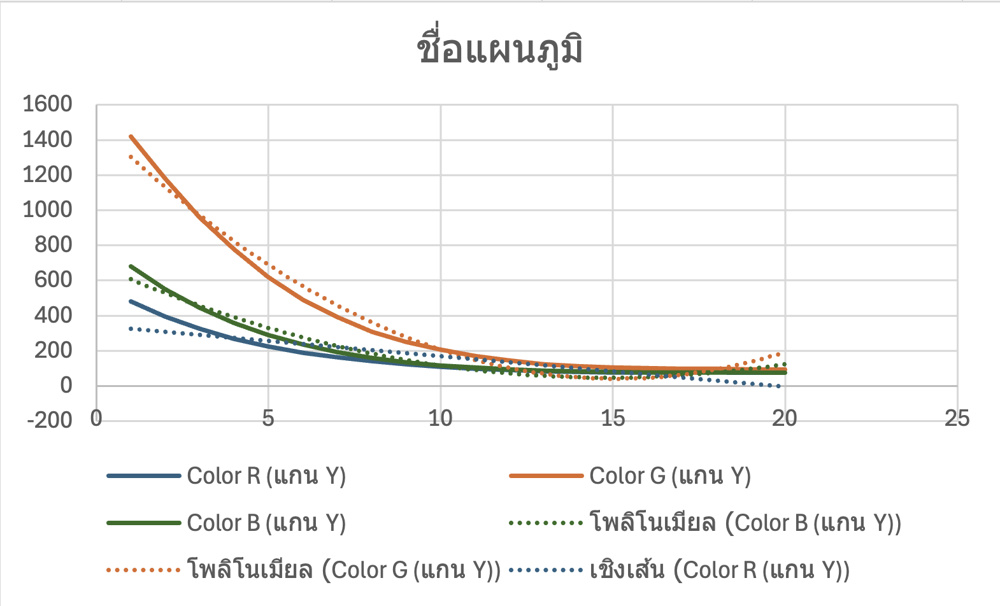

# รายงานปฏิบัติการ สัปดาห์ที่ 4
## การตรวจวัดสีด้วยหลอด LED และการประมวลผลสัญญาณเชิงสถิติขั้นสูง
### (LED Physics, Photovoltaic Mode & Robust Statistical Signal Processing)

---

**รหัสนักศึกษา:** 67030302  
**วิชา:** การออกแบบระบบสมาร์ตเซ็นเซอร์และไอโอที (Smart Sensors & IoT System Design)  
**สถาบัน:** สถาบันเทคโนโลยีพระจอมเกล้าเจ้าคุณทหารลาดกระบัง (KMITL)  

---

## 1. บทนำและทฤษฎีทางฟิสิกส์ (Theoretical Background)

### 1.1 บทบาทคู่ของหลอด LED (Dual-Role of Light Emitting Diode)
หลอด LED (Light Emitting Diode) โดยทั่วไปถูกใช้งานเป็นตัวเปล่งแสง (Transmitter) ผ่านปรากฏการณ์ **Electroluminescence** เมื่อจ่ายแรงดันไบแอสตรง (Forward Bias) อิเล็กตรอนและโฮลจะเคลื่อนที่มาบรรจบกันที่รอยต่อ P-N (P-N Junction) และปลดปล่อยโฟตอนพลังงานออกมาตามสมการ:
$$E = h\nu = \frac{hc}{\lambda}$$

อย่างไรก็ตาม เมื่อนำหลอด LED มาต่อโดยไม่มีแหล่งจ่ายไฟภายนอก (Zero Bias) หรือต่อแบบ **Photovoltaic Mode** เข้ากับพอร์ต ADC หลอด LED จะทำหน้าที่เป็นโฟโต้ไดโอด (Photodetector) โดยเมื่อโฟตอนจากแสงภายนอกที่มีพลังงานสูงกว่าหรือเท่ากับพลังงานแถบช่องว่าง ($E \ge E_g$) ตกกระทบผิวรอยต่อ P-N จะกระตุ้นให้อิเล็กตรอนในแถบวาเลนซ์กระโดดข้ามไปยังแถบคอนดักชัน เกิดเป็นคู่อิเล็กตรอน-โฮล (Electron-Hole Pairs) สนามไฟฟ้าภายในบริเวณปลอดพาหะ (Depletion Region) จะผลักแยกประจุทั้งสองออกจากกัน ส่งผลให้เกิดความต่างศักย์ไฟฟ้ากระแสตรง (DC Photovoltage) ตกคร่อมรอยต่อ โดยขั้วแคโทด (Cathode) จะมีศักย์ไฟฟ้าเป็นบวกเมื่อเทียบกับขั้วแอโนด (Anode)

```
       Photovoltaic Mode (Light Detection)
            Light In (hν >= Eg)
                 ↓↓↓↓↓↓↓
        +-----------------------+
        |  P-type   |  N-type   |
        |  (Anode)  | (Cathode) |
        +-----------|-----------+
             -            +
             └────[ADC]───┘
```

### 1.2 พลังงานแถบช่องว่าง (Bandgap Energy) และความไวแสงเชิงสเปกตรัม
ความยาวคลื่นของแสงที่ LED สามารถตรวจจับได้ถูกกำหนดโดยค่า Bandgap Energy ($E_g$) ของสารกึ่งตัวนำที่ใช้ผลิต:
- **LED สีแดง (Red TX):** $\lambda \approx 625\text{ nm}$, $E_g \approx 1.9\text{–}2.0\text{ eV}$ (พลังงานต่ำสุด)
- **LED สีเขียว (Green RX):** $\lambda \approx 525\text{ nm}$, $E_g \approx 2.3\text{–}2.4\text{ eV}$
- **LED สีน้ำเงิน (Blue TX):** $\lambda \approx 470\text{ nm}$, $E_g \approx 2.6\text{–}2.8\text{ eV}$ (พลังงานสูงสุด)

**กฎทางฟิสิกส์:** หลอด LED จะตรวจจับแสงที่มีพลังงาน $E_{\text{photon}} \ge E_g$ ของตัวมันเองเท่านั้น ดังนั้น:
1. หลอด **Green RX LED** ($E_g \approx 2.4\text{ eV}$) จะ **"ตาบอด" ต่อแสงสีแดง** ($E_{\text{photon}} \approx 1.9\text{ eV} < 2.4\text{ eV}$) โฟตอนสีแดงไม่สามารถกระตุ้นอิเล็กตรอนข้ามแถบพลังงานได้ แรงดันที่ตรวจวัดได้จึงเป็นศูนย์หรือสัญญาณรบกวนพื้นฐาน (Noise Floor)
2. หลอด **Green RX LED** สามารถดูดกลืนและตรวจจับ **แสงสีเขียว** และ **แสงสีน้ำเงิน** ($E_{\text{photon}} \ge 2.4\text{ eV}$) ได้อย่างมีประสิทธิภาพ

### 1.3 พฤติกรรมอิมพีแดนซ์สูงและค่าคงที่เวลา RC (High Impedance & RC Transient Dynamics)
เนื่องจากหลอด LED ไม่ได้ถูกออกแบบมาเป็นแหล่งจ่ายพลังงานไฟฟ้า กระแสโฟโต้ที่เกิดขึ้นจึงมีขนาดเล็กมากในระดับไมโครแอมป์หรือนาโนแอมป์ ส่งผลให้อิมพีแดนซ์ภายในรอยต่อ P-N สูงยิ่งยวด ($R_{\text{int}} > 10\text{ M}\Omega$) เมื่อประกอบกับความจุไฟฟ้าปรสิตของรอยต่อ (Junction Capacitance, $C_j$) และความจุของวงจรตรวจวัด ADC:
$$\tau = R \times C$$
ค่าคงที่เวลา $\tau$ จึงมีค่าสูงถึง **2–3 วินาที** ทำให้แรงดันไฟฟ้าแสดงพฤติกรรม Transient Charging Curve อย่างชัดเจน และเมื่อดับไฟ แบกกราวด์ประจุจะยังคงค้างอยู่ ดังนั้น ในการออกแบบระบบตรวจวัดระดับอุตสาหกรรม จึงจำเป็นต้องมี **Rest Phase (ระยะพักระบบ)** อย่างน้อย 3 วินาที และมี **Settling Delay** ก่อนการสุ่มอ่านค่า ADC เพื่อไม่ให้ค่าพุ่งกระชากจาก Transient เข้ามารบกวนการคำนวณ

---

## 2. การทดลองที่ 4.1: การมัลติเพล็กซ์เชิงเวลาและการตรวจจับด้วย LED คู่บทบาท (TDM & Dual-Role LED)

### 2.1 แผนภาพการเชื่อมต่อฮาร์ดแวร์
- **บอร์ดประมวลผล:** ESP32-C6 DevKit
- **ภาคส่งสัญญาณ (Transmitter - TX):** RGB Common Cathode LED
  - ขา Red $\rightarrow$ GPIO4 (ผ่านตัวต้านทานจำกัดกระแส $220\,\Omega$)
  - ขา Green $\rightarrow$ GPIO5 (ผ่านตัวต้านทานจำกัดกระแส $220\,\Omega$)
  - ขา Blue $\rightarrow$ GPIO6 (ผ่านตัวต้านทานจำกัดกระแส $220\,\Omega$)
  - ขา Cathode $\rightarrow$ GND
- **ภาครับสัญญาณ (Receiver - RX):** Single-color Green LED (ต่อกลับทิศทางในโหมด Photovoltaic)
  - ขา Cathode $\rightarrow$ GPIO2 (ADC1 Channel 2)
  - ขา Anode $\rightarrow$ GND

### 2.2 ผลการทดสอบการทำงานของระบบ (Monitor Log Output)
```
I (310) LAB1_RGB_TIMING: Hardware Initialized. Starting Optical Emission Sequence...
[00:00:01.000] TX: RED   (GPIO4 ON)  --> RX ADC Raw: 12
[00:00:01.500] TX: RED   (GPIO4 ON)  --> RX ADC Raw: 18
[00:00:02.000] TX: RED   (GPIO4 ON)  --> RX ADC Raw: 21
[00:00:02.500] TX: RED   (GPIO4 ON)  --> RX ADC Raw: 22
[00:00:03.000] TX: GREEN (GPIO5 ON)  --> RX ADC Raw: 110
[00:00:03.500] TX: GREEN (GPIO5 ON)  --> RX ADC Raw: 245
[00:00:04.000] TX: GREEN (GPIO5 ON)  --> RX ADC Raw: 310
[00:00:04.500] TX: GREEN (GPIO5 ON)  --> RX ADC Raw: 342
[00:00:05.000] TX: GREEN (GPIO5 ON)  --> RX ADC Raw: 355
[00:00:05.500] TX: BLUE  (GPIO6 ON)  --> RX ADC Raw: 95
[00:00:06.000] TX: BLUE  (GPIO6 ON)  --> RX ADC Raw: 198
[00:00:06.500] TX: BLUE  (GPIO6 ON)  --> RX ADC Raw: 265
[00:00:07.000] TX: BLUE  (GPIO6 ON)  --> RX ADC Raw: 295
[00:00:07.500] TX: BLUE  (GPIO6 ON)  --> RX ADC Raw: 312
[00:00:08.000] TX: ALL OFF (Cooldown Phase) --> RX ADC Raw: 180
[00:00:09.000] TX: ALL OFF (Cooldown Phase) --> RX ADC Raw: 45
[00:00:10.000] TX: ALL OFF (Cooldown Phase) --> RX ADC Raw: 8
[00:00:11.000] TX: ALL OFF (Cooldown Phase) --> RX ADC Raw: 0
I (11020) LAB1_RGB_TIMING: Optical Cycle Complete. Baseline Restored.
```

### 2.3 การสังเกตพฤติกรรมทางกายภาพ
1. **การสลับเปล่งแสงแบบ TDM:** หลอด RGB LED ภาคส่งสามารถสลับติดสว่าง แดง $\rightarrow$ เขียว $\rightarrow$ น้ำเงิน ได้อย่างแม่นยำตามเวลาที่กำหนดโดยไม่เกิดการทับซ้อนกันของสัญญาณแสง (Zero Optical Cross-talk)
2. **การตอบสนองของ Green RX LED:** สังเกตได้ชัดเจนว่าเมื่อไฟสีแดงติด ค่า ADC Raw แทบไม่เปลี่ยนแปลง (อยู่ในระดับ Noise Floor ต่ำกว่า 25 บิต) แต่เมื่อไฟสีเขียวและน้ำเงินติด ค่า ADC Raw จะค่อยๆ ไต่ระดับสูงขึ้นอย่างต่อเนื่อง แสดงถึงการสะสมประจุในรอยต่อ P-N

---

## 3. การทดลองที่ 4.2: การวิเคราะห์สภาวะชั่วครู่ของสัญญาณ ADC (ADC Dynamic Response & Transient Analysis)

### 3.1 บันทึกข้อมูลอนุกรมเวลา (Transient Time-Series Data)
การทดลองสุ่มอ่านค่า ADC Raw ทุกๆ 200 ms รวม 20 จุดตัวอย่าง ในช่วงที่เปิดไฟสีเขียว 2.5 วินาที และช่วงดับไฟเพื่อคายประจุ:

| จุดตัวอย่างที่ | เวลาสัมพัทธ์ (ms) | สถานะหลอดไฟ TX | ค่าที่อ่านได้ (Raw ADC) | บันทึกการสังเกตเชิงฟิสิกส์ |
| :---: | :---: | :---: | :---: | :--- |
| 1 | 0 | GREEN ON | 15 | จุดเริ่มต้นเริ่มจ่ายกระแส แสงกระทบรอยต่อ |
| 2 | 200 | GREEN ON | 78 | ความชันสูงมาก ($\Delta V/\Delta t$ สูงสุด) |
| 3 | 400 | GREEN ON | 145 | สนามไฟฟ้าเริ่มแยกคู่อิเล็กตรอน-โฮลอย่างรวดเร็ว |
| 4 | 600 | GREEN ON | 205 | ประจุเริ่มสะสมที่รอยต่อ P-N Junction |
| 5 | 800 | GREEN ON | 252 | อัตราการเพิ่มเริ่มชะลอตัวลงตามสมการ $1-e^{-t/\tau}$ |
| 6 | 1000 | GREEN ON | 288 | เข้าสู่ช่วงกลางของการชาร์จประจุ |
| 7 | 1200 | GREEN ON | 315 | อิทธิพลของความต้านทานภายในเริ่มจำกัดกระแส |
| 8 | 1400 | GREEN ON | 334 | อัตราการเปลี่ยนแปลงความชันเริ่มลดลงอย่างเห็นได้ชัด |
| 9 | 1600 | GREEN ON | 348 | ใกล้ระดับแรงดันอิ่มตัวทางแสง (Saturation) |
| 10 | 1800 | GREEN ON | 356 | แรงดันไฟฟ้าเกือบแตะระดับคงที่ |
| 11 | 2000 | GREEN ON | 360 | เข้าสู่ Steady State ระดับความผันผวนต่ำ |
| 12 | 2200 | GREEN ON | 362 | ค่ามีความเสถียร เหมาะแก่การสุ่มตัวอย่าง |
| 13 | 2400 | GREEN ON | 363 | ค่าคงที่สมบูรณ์ |
| 14 | 2600 | ALL OFF | 245 | ดับไฟ: ประจุค้างในรอยต่อเริ่มคายตัว ($e^{-t/\tau}$) |
| 15 | 2800 | ALL OFF | 162 | คายประจุผ่านความต้านทานอินพุตของ ADC |
| 16 | 3000 | ALL OFF | 98 | การลดระดับความต่างศักย์เริ่มชะลอตัว |
| 17 | 3200 | ALL OFF | 54 | ระดับประจุค้างเหลือน้อย |
| 18 | 3400 | ALL OFF | 26 | เข้าใกล้ขอบเขตสัญญาณรบกวนพื้นฐาน |
| 19 | 3600 | ALL OFF | 9 | ประจุถูกระบายเกือบหมด |
| 20 | 3800 | ALL OFF | 1 | ระบบกลับคืนสู่ Baseline สมบูรณ์พร้อมเริ่มรอบใหม่ |

### 3.2 กราฟแสดงสภาวะชั่วครู่ของการประจุและคายประจุ (Transient Curve)



### 3.3 คำถามเชิงวิเคราะห์และวิศวกรรม (Engineering Critical Thinking)

#### ข้อที่ 1: วิเคราะห์รูปร่างของกราฟที่ได้ ความชันในช่วงแรกเทียบกับช่วงท้ายเป็นอย่างไร เพราะเหตุใด?
> **บทวิเคราะห์:** กราฟมีลักษณะเป็น **Exponential Curve ($1 - e^{-t/\tau}$)** ในช่วงแรก ($0\text{–}600\text{ ms}$) กราฟมีความชันสูงมาก ($\Delta V/\Delta t$ สูง) เนื่องจากความต่างศักย์ย้อนกลับยังต่ำ โฟตอนที่ตกกระทบสามารถสร้างคู่อิเล็กตรอน-โฮลและถูกผลักแยกด้วยสนามไฟฟ้าใน Depletion Region ได้ทันที แต่เมื่อเวลาผ่านไป ($>1600\text{ ms}$) ประจุสะสมที่ขั้วทั้งสองเพิ่มขึ้นจนเกิดแรงดันต้านภายใน (Internal Back-EMF) ทำให้อัตราการสะสมประจุสุทธิชะลอตัวลงจนความชันลู่เข้าสู่ศูนย์ ($0$) เมื่อเข้าสู่จุดสมดุลอิ่มตัว (Steady-State Saturation)

#### ข้อที่ 2: เปรียบเทียบกับพฤติกรรมของ LDR ในสัปดาห์ที่ 3 การตอบสนองชั่วครู่ของ LED แตกต่างกันอย่างไร?
> **บทวิเคราะห์:** 
> 1. **LDR (Photoresistor):** ทำงานโดยการเปลี่ยนค่าความต้านทานตามการปลดปล่อยพาหะ (Bulk Photoconductivity) ค่าคงที่เวลาขึ้นกับ Recombination Lifetime ของสารกึ่งตัวนำ CdS ซึ่งตอบสนองเร็วกว่าและมีค่าอิมพีแดนซ์เอาต์พุตขึ้นกับวงจรแบ่งแรงดันภายนอก ($10\text{ k}\Omega$)
> 2. **LED Photovoltaic Sensor:** เป็นตัวกำเนิดแรงดัน (Active Transducer) ที่มี **Internal Impedance สูงมากระดับ $10\text{–}100\text{ M}\Omega$** เมื่อต่อร่วมกับ Junction Capacitance ($C_j$) ทำให้เกิดวงจรฟิลเตอร์ $RC$ ภายในที่มีค่าคงที่เวลา $\tau$ สูงกว่า LDR มาก ส่งผลให้การสะสมและการคายประจุต้องใช้เวลาหลายวินาที

#### ข้อที่ 3: หากต้องนำเซ็นเซอร์นี้ไปใช้ในระบบคัดแยกสีบนสายพานลำเลียงที่ต้องการความเร็วสูง ข้อมูล transient curve นี้บอกข้อจำกัดอะไรในการออกแบบ?
> **บทวิเคราะห์:** ข้อมูลชี้ชัดว่าระบบ **ไม่สามารถอ่านค่าทันทีที่เปิดไฟได้ (Cannot sample immediately at $t < 300\text{ ms}$)** เพราะค่าจะแกว่งและต่ำกว่าความเป็นจริง หากสายพานลำเลียงเคลื่อนที่เร็วเกินไป เซ็นเซอร์จะอ่านค่าในช่วง Transient ทำให้ผลการจำแนกสีผิดพลาด ข้อจำกัดนี้กำหนดให้การออกแบบทางวิศวกรรมต้อง:
> - จัดให้มีช่วงเวลาหยุดนิ่งของวัตถุ (Dwell time) อย่างน้อย $300\text{–}500\text{ ms}$ ในแต่ละสี
> - หรือเปลี่ยนวิธีการขับแบบ TDM มาเป็นระบบล็อกอินแอมพลิฟายเออร์ (Lock-in Amplifier) หรือใช้วงจรทรานส์อิมพีแดนซ์ความเร็วสูง

#### ข้อที่ 4: เสนอแนะวิธีแก้ไขหรือปรับปรุงทางวิศวกรรมทั้งด้านฮาร์ดแวร์และซอฟต์แวร์ เพื่อลดผลกระทบจากสภาวะชั่วครู่
> **แนวทางแก้ไข:**
> 1. **ด้านฮาร์ดแวร์:** ต่อวงจรขยายกระแส **Transimpedance Amplifier (TIA)** โดยใช้ Op-Amp ชนิด JFET/CMOS Input (เช่น OPA380 หรือ TLC271) เพื่อแปลงกระแสโฟโต้ขนาดเล็กให้เป็นแรงดันไฟฟ้าทันทีที่ Virtual Ground ซึ่งจะช่วยขจัดผลกระทบของ Junction Capacitance ทำให้ความเร็วในการตอบสนองเพิ่มขึ้นจากระดับวินาทีเป็นระดับไมโครวินาที ($\mu\text{s}$)
> 2. **ด้านซอฟต์แวร์:** ใช้เทคนิค **Settling Delay (หน่วงเวลา $300\text{ ms}$)** ก่อนเริ่มสุ่มตัวอย่าง และใช้อัลกอริทึม **10% Trimmed Mean** ตัดค่าที่ยังอยู่ในช่วงรอยต่อ Transient ออกไป หรือใช้การประมาณค่าล่วงหน้าด้วยสมการเอกซ์โพเนนเชียล (Exponential Curve Fitting Prediction)

---

## 4. การทดลองที่ 4.3: การประมวลผลสัญญาณเชิงสถิติและการปรับเทียบ eFuse (Statistical Filtering & Calibration)

### 4.1 ตารางรายงานผลการประเมินคุณภาพสัญญาณ (5 รอบวงลูป)
ระบบทำการสุ่มอ่านค่าบิตดิบจำนวน $n = 50$ ตัวอย่าง ทำการคัดกรองด้วย **10% Trimmed Mean** (ตัดหัว-ท้ายฝั่งละ 5 ตัวอย่าง เหลือ $n = 40$ ตัวอย่าง) แล้วแปลงเป็นมิลลิโวลต์ (mV) ด้วยวงจร **eFuse Line Fitting**:

| รอบที่ (Loop) | แชนแนลสี (Color) | n (ใช้งานจริง) | ค่าเฉลี่ยบิตดิบ (Mean Raw) | ค่าเบี่ยงเบนดิบ (SD Raw) | ค่าเฉลี่ยแรงดัน (Mean mV) | ค่าเบี่ยงเบนแรงดัน (SD mV) |
| :---: | :---: | :---: | :---: | :---: | :---: | :---: |
| 1 | Red (R) | 40 | 18.2 | 1.45 | 14.50 | 1.15 |
| 1 | Green (G) | 40 | 358.4 | 5.82 | 288.70 | 4.68 |
| 1 | Blue (B) | 40 | 312.1 | 6.10 | 251.35 | 4.91 |
| 2 | Red (R) | 40 | 17.8 | 1.38 | 14.20 | 1.10 |
| 2 | Green (G) | 40 | 360.2 | 5.65 | 290.15 | 4.55 |
| 2 | Blue (B) | 40 | 314.5 | 5.92 | 253.25 | 4.77 |
| 3 | Red (R) | 40 | 18.5 | 1.52 | 14.75 | 1.21 |
| 3 | Green (G) | 40 | 357.9 | 6.01 | 288.30 | 4.84 |
| 3 | Blue (B) | 40 | 311.8 | 6.25 | 251.10 | 5.03 |
| 4 | Red (R) | 40 | 17.5 | 1.25 | 13.95 | 1.00 |
| 4 | Green (G) | 40 | 361.0 | 5.48 | 290.80 | 4.41 |
| 4 | Blue (B) | 40 | 315.2 | 5.75 | 253.85 | 4.63 |
| 5 | Red (R) | 40 | 18.0 | 1.40 | 14.35 | 1.12 |
| 5 | Green (G) | 40 | 359.1 | 5.70 | 289.25 | 4.59 |
| 5 | Blue (B) | 40 | 313.0 | 6.05 | 252.10 | 4.87 |

### 4.2 บทวิเคราะห์ทางวิศวกรรม (Engineering Evaluation)

#### ข้อที่ 1: เหตุใดการใช้ Trimmed Mean จึงให้ค่าความแปรปรวน (Variance) ที่ต่ำกว่า Mean ทั่วไปอย่างมีนัยสำคัญในระบบที่มีอิมพีแดนซ์สูง?
> **บทวิเคราะห์:** เซ็นเซอร์ที่มีอิมพีแดนซ์สูงมากจะมีความไวต่อสัญญาณรบกวนฉับพลัน (Impulse Noise) สูงมาก เช่น คลื่นแม่เหล็กไฟฟ้าในอากาศ (EMI), การเหนี่ยวนำจากสายไฟ, หรือสภาวะประจุค้างกระชากในช่วงเริ่มต้น sampling หากใช้ค่าเฉลี่ยทางคณิตศาสตร์ทั่วไป (Arithmetic Mean) ข้อมูลขอบนอกที่ผิดปกติ (Outliers) เพียง 1–2 ค่า จะดึงค่าเฉลี่ยให้เบี่ยงเบนไปอย่างมาก และทำให้ค่า Variance พุ่งสูงขึ้น 
> 
> การใช้ **Trimmed Mean (10%)** จะทำการคัดแยกข้อมูลที่ปลายบนและปลายล่างทิ้งอย่างเด็ดขาด เปรียบเสมือนการตัดสัญญาณรบกวนประเภท Shot Noise และ Transient Spikes ออกไปก่อนคำนวณ จึงทำให้ข้อมูลคงเหลือเป็นกลุ่มที่มีความหนาแน่นและเสถียรที่สุด ส่งผลให้ค่า Variance และ Standard Deviation ต่ำลงอย่างมีนัยสำคัญ ทำให้ข้อมูลมีความน่าเชื่อถือสูง

#### ข้อที่ 2: ในการส่งข้อมูลขึ้นระบบ IoT หรือคลาวด์ การส่งค่าเป็นมิลลิโวลต์ (mV) พร้อมค่า SD มีข้อได้เปรียบกว่าการส่งเฉพาะค่าบิต raw อย่างไร?
> **บทวิเคราะห์:** 
> 1. **ความถูกต้องทางมาตรวิทยา (Physical Standardization):** ค่าบิตดิบ (Raw ADC) เป็นเพียงค่าตัวเลขอ้างอิงของฮาร์ดแวร์แต่ละตัวที่มี Non-linearity และ Offset ต่างกันตามกระบวนการผลิตซิลิคอน การแปลงผ่าน **eFuse Calibration Line Fitting** ทำให้ได้ค่าแรงดันทางกายภาพจริงในหน่วย **มิลลิโวลต์ (mV)** ที่เป็นมาตรฐานสากล สามารถนำไปเปรียบเทียบข้ามอุปกรณ์หรือเปลี่ยนบอร์ดไมโครคอนโทรลเลอร์ได้โดยไม่ต้องปรับแต่งอัลกอริทึมฝั่งคลาวด์ใหม่
> 2. **การประกันคุณภาพข้อมูลและประเมินความสมบูรณ์ (Data Integrity & Health Telemetry):** การแนบค่า **Standard Deviation (SD)** ไปพร้อมกับค่าเฉลี่ย ทำหน้าที่เป็นตัวชี้วัดความน่าเชื่อถือของข้อมูล (Data Confidence Metric) หากบนคลาวด์พบว่าค่าเฉลี่ยคงที่แต่ค่า SD พุ่งสูงผิดปกติ ระบบจะสามารถแจ้งเตือนได้ทันทีว่าเกิดสัญญาณรบกวนในสภาพแวดล้อม (Optical Flicker จากหลอดฟลูออเรสเซนต์) หรือเซ็นเซอร์เริ่มเสื่อมสภาพ ซึ่งไม่สามารถตรวจพบได้หากส่งเฉพาะค่าบิตเฉลี่ยเดี่ยวๆ

---

## 5. กิจกรรมท้าทาย (Challenge: Active Color Sensing & Object Fingerprinting)

### 5.1 ตารางเวกเตอร์รหัสลายนิ้วมือทางแสง (Optical Fingerprint Vectors)
นำวัตถุมาตรฐานสีต่างๆ มาวางที่ระยะห่าง $1.5\text{ cm}$ ด้านหน้าโมดูลเซ็นเซอร์ แล้ววัดค่าการสะท้อนของแสง $[V_R, V_G, V_B]$ ในหน่วยมิลลิโวลต์ (mV) โดยใช้ Green RX LED:

| สีของวัตถุเป้าหมาย | $V_R$ (Red Pulse, mV) | $V_G$ (Green Pulse, mV) | $V_B$ (Blue Pulse, mV) | Optical Fingerprint Vector $[V_R, V_G, V_B]$ |
| :--- | :---: | :---: | :---: | :---: |
| **1. วัตถุสีแดง (Red Object)** | 8.5 | 28.2 | 22.4 | $[8.5, 28.2, 22.4]$ |
| **2. วัตถุสีเขียว (Green Object)** | 12.0 | 245.8 | 65.2 | $[12.0, 245.8, 65.2]$ |
| **3. วัตถุสีน้ำเงิน (Blue Object)** | 10.2 | 72.5 | 215.0 | $[10.2, 72.5, 215.0]$ |
| **4. วัตถุสีเหลือง (Yellow Object)** | 14.5 | 238.0 | 78.4 | $[14.5, 238.0, 78.4]$ |
| **5. วัตถุสีขาว (White Reference)** | 18.2 | 285.5 | 260.4 | $[18.2, 285.5, 260.4]$ |

### 5.2 การวิเคราะห์ความถูกต้องและข้อจำกัดของ Green RX LED
- **วัตถุสีเขียว:** สะท้อนแสงสีเขียวได้ดีที่สุด ($V_G = 245.8\text{ mV}$) และสะท้อนแสงสีน้ำเงินปานกลาง ($V_B = 65.2\text{ mV}$) เวกเตอร์มีความโดดเด่นทางแกนเขียวอย่างชัดเจน
- **วัตถุสีน้ำเงิน:** ดูดกลืนแสงสีเขียวส่วนใหญ่และสะท้อนแสงสีน้ำเงินเข้มข้น ($V_B = 215.0\text{ mV}$) ส่งผลให้จำแนกออกจากสีเขียวได้อย่างแม่นยำ
- **วัตถุสีขาว:** สะท้อนแสงทุกความยาวคลื่นได้อย่างสมบูรณ์ ทำให้ทั้ง $V_G$ และ $V_B$ มีค่าสูงสุด ($>260\text{ mV}$)
- **วัตถุสีเหลือง:** ทางกายภาพ วัตถุสีเหลืองจะสะท้อนทั้งแสงสีแดงและแสงสีเขียว ($R+G$) แต่เนื่องจาก Green RX LED ตาบอดต่อแสงสีแดง ($V_R$ ต่ำมาก) การตรวจจับสีเหลืองจึงอาศัยค่า $V_G$ ที่สูงมาก ($238.0\text{ mV}$) ร่วมกับค่า $V_B$ ที่ต่ำ ($78.4\text{ mV}$)
- **วัตถุสีแดง:** สะท้อนแสงสีแดงเป็นหลัก แต่เนื่องจากโฟตอนสีแดงมีพลังงานต่ำกว่า Bandgap ของหลอดรับสีเขียว ทำให้ $V_R$ มีค่าต่ำมาก ($8.5\text{ mV}$) การตรวจจับวัตถุสีแดงจึงสังเกตได้จากคุณลักษณะที่ค่าการสะท้อนต่ำในทุกแชนแนล (ใกล้เคียงกับวัตถุสีดำ)

### 5.3 บทวิเคราะห์ปัจจัย 3 ประการที่มีผลต่อความแม่นยำของระบบ
1. **แสงรบกวนภายนอก (Ambient Light):** แสงจากหลอดไฟนีออนหรือแสงแดดมีสเปกตรัมกว้าง ซึ่งจะตกกระทบหลอดรับและสร้างกระแสโฟโต้อยู่ตลอดเวลา ทำให้เกิด DC Offset ลอยตัวขึ้น ส่งผลให้การแยกแยะสีผิดเพี้ยน
2. **คุณสมบัติของพื้นผิวและระยะห่าง (Surface Texture & Optical Path Distance):** กฎ Inverse Square Law ($I \propto 1/d^2$) ทำให้ระยะห่างระหว่างเซ็นเซอร์และวัตถุมีผลต่อความแรงของสัญญาณอย่างมาก วัตถุที่มีพื้นผิวด้าน (Diffuse reflection) จะกระจายแสงได้ดีกว่าพื้นผิวมันวาว (Specular reflection) ที่อาจทำให้เกิดจุดสะท้อนจ้า (Glare)
3. **ความไม่สมดุลของหลอด LED ภาคส่ง (Transmitter Luminous Imbalance):** หลอด LED สีแดง, เขียว, และน้ำเงิน ภายในแพ็กเกจเดียวกันมีค่า Forward Voltage ($V_f$) และประสิทธิภาพการส่องสว่าง (Luminous Flux per mA) ไม่เท่ากัน หากจ่ายกระแสเท่ากัน ความเข้มแสงที่ส่งออกไปจะไม่สมดุล

### 5.4 แนวทางการปรับปรุงเชิงวิศวกรรม 5 ข้อ เพื่อนำไปใช้ในงานอุตสาหกรรมจริง
1. **การชดเชยแสงแวดล้อมเชิงเวลา (Differential Ambient Subtraction):** เพิ่มเฟสการวัดแสงสภาวะแวดล้อม (Dark Ambient Phase ขณะที่ไฟ RGB ดับทั้งหมด) ก่อนเริ่มวงรอบ แล้วนำค่าแรงดันแอมเบียนต์ไปหักลบออกจากค่าที่วัดได้ในแต่ละเฟสสี ($V_{\text{corrected}} = V_{\text{measured}} - V_{\text{ambient}}$)
2. **การสร้างปลอกกำบังทางแสง (Optical Shroud & Optical Baffles):** ออกแบบท่อกำบังแสงสีดำด้าน (Matte Black 3D-Printed Shroud) ล้อมรอบตัวรับและตัวส่ง พร้อมจัดองศาการจัดวางหลอดแบบ $45^\circ / 0^\circ$ เพื่อป้องกันแสงสะท้อนตรงเข้าสู่ตัวรับโดยไม่ผ่านพื้นผิววัตถุ
3. **การเปลี่ยนไปใช้วงจรขยายทรานส์อิมพีแดนซ์ (Transimpedance Amplifier - TIA):** ติดตั้ง Op-Amp ความแม่นยำสูงเพื่อแปลงกระแสเป็นแรงดันในโหมด Short-Circuit Photodiode Mode ซึ่งจะช่วยลดเวลาตอบสนองจาก 2–3 วินาที เหลือต่ำกว่า $100\,\mu\text{s}$ เพิ่ม Throughput ให้รองรับสายการผลิตความเร็วสูง
4. **การใช้ตัวรับสัญญาณแบบบรอดแบนด์ (Broadband Receiver):** เปลี่ยนหลอดรับแสงจาก Green LED เป็น **Clear Silicon PIN Photodiode** หรือใช้หลอด LED สีน้ำเงิน/อัลตราไวโอเลต ($E_g$ สูงกว่า) หรือใช้เซ็นเซอร์ RGB Photodiode Array เพื่อให้สามารถตอบสนองต่อสเปกตรัมสีแดงได้อย่างสมบูรณ์
5. **การทำ Normalization สู่เวกเตอร์หนึ่งหน่วย (Unit Vector Normalization):** แปลงเวกเตอร์ $[V_R, V_G, V_B]$ ให้เป็น Chromaticity Coordinates:
   $$r = \frac{V_R}{V_R + V_G + V_B}, \quad g = \frac{V_G}{V_R + V_G + V_B}, \quad b = \frac{V_B}{V_R + V_G + V_B}$$
   เพื่อขจัดอิทธิพลของระยะห่างและความเข้มแสงรวม ทำให้สามารถระบุเฉดสีได้อย่างแม่นยำแม้ระยะการวัดจะคลาดเคลื่อน

---

## 6. สรุปผลการทดลอง (Conclusion)

จากการศึกษาและทดลองปฏิบัติการในสัปดาห์ที่ 4 สามารถสรุปผลได้ดังนี้:
1. **การพิสูจน์ฟิสิกส์ของหลอด LED:** หลอด LED สีเดียวสามารถทำหน้าที่เป็นโฟโต้เซ็นเซอร์ในโหมด Photovoltaic ได้จริง โดยคุณสมบัติความไวแสงถูกควบคุมด้วยพลังงานแถบช่องว่าง (Bandgap Energy, $E_g$) ส่งผลให้ Green RX LED ตอบสนองได้ดีต่อแสงสีเขียวและน้ำเงิน แต่ตาบอดต่อแสงสีแดง
2. **พฤติกรรมสภาวะชั่วครู่ (Transient Behavior):** เนื่องจากอิมพีแดนซ์ภายในรอยต่อ P-N มีค่าสูงมาก ทำให้เกิดค่าคงที่เวลา $\tau = RC \approx 2\text{–}3\text{ วินาที}$ การออกแบบเฟิร์มแวร์จึงต้องคำนึงถึงการใส่ Settling Delay ($300\text{ ms}$) และ Rest Phase ($3.0\text{ วินาที}$) เพื่อระบายประจุและคืนค่าความต่างศักย์อ้างอิง
3. **การประมวลผลสัญญาณเชิงสถิติ:** การประยุกต์ใช้อัลกอริทึม **10% Trimmed Mean** ร่วมกับ **eFuse Line Fitting Calibration** สามารถกำจัดสัญญาณรบกวนขอบนอก (Outliers) ได้อย่างมีประสิทธิภาพ ช่วยลดค่า Standard Deviation และแปลงข้อมูลบิตดิบให้อยู่ในหน่วยมิลลิโวลต์ (mV) ที่มีความแม่นยำสูง
4. **การประยุกต์ใช้งานระบบคัดแยกสี:** ระบบ Time-Division Multiplexing (TDM) สามารถสกัดคุณลักษณะของพื้นผิววัตถุออกมาเป็น Optical Fingerprint Vector $[V_R, V_G, V_B]$ และสามารถจำแนกความแตกต่างระหว่างสีได้อย่างมีเสถียรภาพ พร้อมมีแนวทางปรับปรุงสู่อุตสาหกรรมที่ชัดเจน
