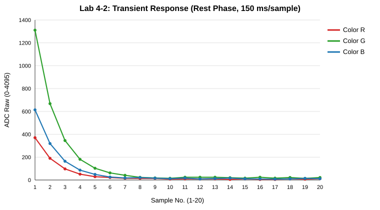

# ใบงานปฏิบัติการ สัปดาห์ที่ 4 การทดลองย่อยที่  2

### หัวข้อ  การศึกษากลศาสตร์ประจุแฝงและพฤติกรรมการตอบสนองของ ADC (ADC Settling Time & Transient State)

### 1. วัตถุประสงค์

1. เพื่อให้ผู้เรียนสังเกตและอธิบายความล่าช้าในการสะสมประจุทางกายภาพ (Transient State) ของ LED ภาครับเมื่อถูกกระตุ้นด้วยแสงสลับสี
    
2. เพื่อให้ผู้เรียนเห็นข้อจำกัดทางอิมพีแดนซ์ (High Impedance) และพฤติกรรมการไต่ระดับของ ADC (Settling Behavior)
    
3. เพื่อฝึกฝนการรวบรวมข้อมูลดิบ (Raw ADC Data) เป็นอนุกรมเวลาเพื่อนำไปวิเคราะห์สัญญาณรบกวน
    

###  2. อุปกรณ์ที่ใช้ในการทดลอง

1. บอร์ดไมโครคอนโทรลเลอร์ ESP32-C6 จำนวน 1 บอร์ด
    
2. หลอด LED RGB ภาคส่ง (ต่อขา GPIO4, GPIO5, GPIO6 ร่วมกับตัวต้านทานจำกัดกระแส)
    
3. หลอด LED สีเดี่ยว ภาครับ (ต่อขาอนาล็อกเข้ากับ **GPIO2 / ADC1 Channel 2**)
    
4. โฟโต้บอร์ดและสายจัมเปอร์
    

###  3. คำอธิบายโจทย์การทดลอง

โปรแกรมจะสั่งเปิดไฟ LED ภาคส่งทีละสี (R -> G -> B) สีละ **2.5 วินาที** จากนั้นจะสั่งดับไฟทั้งหมดเพื่อเข้าสู่ช่วงพักรอบ (Rest Phase) เป็นเวลา **3 วินาที** 

ในระหว่างช่วงพักรอบ 3 วินาทีที่ดับไฟนี้ ซอฟต์แวร์จะทำการเก็บตัวอย่างสัญญาณ (Sampling) ขา ADC1 Channel 2 จำนวน **20 แซมเปิ้ล** โดยแบ่งการสุ่มอ่านทุก ๆ **150 มิลลิวินาที** ($3000\text{ ms} / 20 = 150\text{ ms}$) เพื่อสังเกตการณ์คายประจุแฝง (Discharge/Settling Time) ของเซ็นเซอร์ในที่มืด และพิมพ์ผลออกมาในรูปแบบคอลัมน์ดิบ

####  3.1 ซอร์สโค้ดการทดลอง (`main.c`)

```C
#include <stdio.h>
#include "freertos/FreeRTOS.h"
#include "freertos/task.h"
#include "driver/gpio.h"
#include "esp_log.h"
#include "esp_adc/adc_oneshot.h"

static const char *TAG = "LAB2_ADC_SETTLING";

// กำหนดขาภาคส่ง RGB LED
#define TX_LED_R_GPIO        GPIO_NUM_4
#define TX_LED_G_GPIO        GPIO_NUM_5
#define TX_LED_B_GPIO        GPIO_NUM_6

// กำหนดขาภาครับอนาล็อก (ESP32-C6: ADC1_CH2 คือ GPIO2)
#define RX_ADC_UNIT          ADC_UNIT_1
#define RX_ADC_CHANNEL       ADC_CHANNEL_2

#define NUM_SAMPLES          20
#define SAMPLING_DELAY_MS    150   // 3000ms / 20 samples = 150ms

void init_hardware(adc_oneshot_unit_handle_t *adc_handle)
{
    // 1. ตั้งค่าขาเอาต์พุตดิจิทัลสำหรับควบคุม LED RGB
    gpio_config_t io_conf = {
        .pin_bit_mask = (1ULL << TX_LED_R_GPIO) | (1ULL << TX_LED_G_GPIO) | (1ULL << TX_LED_B_GPIO),
        .mode = GPIO_MODE_OUTPUT,
        .pull_up_en = GPIO_PULLUP_DISABLE,
        .pull_down_en = GPIO_PULLDOWN_DISABLE,
        .intr_type = GPIO_INTR_DISABLE
    };
    gpio_config(&io_conf);

    // ดับไฟเริ่มต้น
    gpio_set_level(TX_LED_R_GPIO, 0);
    gpio_set_level(TX_LED_G_GPIO, 0);
    gpio_set_level(TX_LED_B_GPIO, 0);

    // 2. ตั้งค่าหน่วย ADC Unit 1 ธรรมดา (ไม่มีการ Calibrate เพื่อดูบิตดิบ)
    adc_oneshot_unit_init_cfg_t init_config = {
        .unit_id = RX_ADC_UNIT,
        .clk_src = ADC_DIGI_CLK_SRC_DEFAULT,
    };
    ESP_ERROR_CHECK(adc_oneshot_new_unit(&init_config, adc_handle));

    // 3. ตั้งค่าขาสัญญาณอนาล็อก ความละเอียดเริ่มต้น (12 บิต: 0 - 4095)
    adc_oneshot_chan_cfg_t chan_config = {
        .bitwidth = ADC_BITWIDTH_DEFAULT,
        .atten = ADC_ATTEN_DB_12, // รองรับช่วงระดับแรงดันเต็มพิกัด 3.3V
    };
    ESP_ERROR_CHECK(adc_oneshot_config_channel(*adc_handle, RX_ADC_CHANNEL, &chan_config));
}

// ฟังก์ชันจำลองวงจรอ่านค่าดิบแบบอนุกรมเวลาในช่วงสลับสีไฟ
void sample_and_print(adc_oneshot_unit_handle_t adc_handle, const char* phase_name)
{
    printf("Color %s:\n", phase_name);
    printf("No, ADC Raw\n");
    
    // ทำการสุ่มอ่าน 20 แซมเปิ้ล โดยเก็บค่า adc ต่อเนื่องทุก 150ms 
    for (int i = 1; i <= NUM_SAMPLES; i++) {
        int raw_value = 0;
        ESP_ERROR_CHECK(adc_oneshot_read(adc_handle, RX_ADC_CHANNEL, &raw_value));
        
        // พิมพ์ค่าดิบในรูปแบบ CSV ฟอร์แมตตามข้อกำหนด
        printf("%d, %d\n", i, raw_value);
        
        vTaskDelay(pdMS_TO_TICKS(SAMPLING_DELAY_MS));
    }
}

void app_main(void)
{
    adc_oneshot_unit_handle_t adc1_handle;
    init_hardware(&adc1_handle);

    ESP_LOGI(TAG, "Transient Observation System Online.");
    printf("==============================================================\n");

    while (1) {
        // --- รอบไฟสีแดง ---
        gpio_set_level(TX_LED_R_GPIO, 1);
        vTaskDelay(pdMS_TO_TICKS(2500)); // เปล่งแสงนาน 2.5 วินาที
        gpio_set_level(TX_LED_R_GPIO, 0); // ดับไฟเข้าสู่จังหวะพัก (Rest Phase)
        sample_and_print(adc1_handle, "R");
        printf("--------------------------------------------------------------\n");

        // --- รอบไฟสีเขียว ---
        gpio_set_level(TX_LED_G_GPIO, 1);
        vTaskDelay(pdMS_TO_TICKS(2500)); 
        gpio_set_level(TX_LED_G_GPIO, 0); 
        sample_and_print(adc1_handle, "G");
        printf("--------------------------------------------------------------\n");

        // --- รอบไฟสีน้ำเงิน ---
        gpio_set_level(TX_LED_B_GPIO, 1);
        vTaskDelay(pdMS_TO_TICKS(2500)); 
        gpio_set_level(TX_LED_B_GPIO, 0); 
        sample_and_print(adc1_handle, "B");
        printf("==============================================================\n");
    }
}
```

### 📂 ไฟล์โปรเจกต์ (`main/CMakeLists.txt`)

```CMake
idf_component_register(SRCS "main.c"
                    INCLUDE_DIRS "."
                    REQUIRES esp_adc driver)
```

### ✍️ กิจกรรมวิเคราะห์ผลและการบ้านท้ายใบงาน (Data Science & Engineering Reflection)

1. **การพล็อตพฤติกรรมทางกายภาพ (Transient Response Curve):**
    
    ให้นักศึกษาก๊อปปี้ข้อมูลตัวเลขชุดคู่อันดับ `No, ADC Raw` จาก Serial Monitor ทั้งหมดนำไปวางในโปรแกรม **Microsoft Excel** หรือ **Google Sheets** จากนั้นทำการพล็อตกราฟเส้น (Line Chart) โดยให้แกน X เป็นลำดับแซมเปิ้ล (1-20) และแกน Y เป็นค่าดิบของ ADC และแนบรูปกราฟลงในเล่มรายงาน

    *(ค่าประมาณ ไม่มีบอร์ด ESP32-C6)*

    ```text
    Color R:
    No, ADC Raw
    1, 370
    2, 190
    3, 97
    4, 51
    5, 29
    6, 22
    7, 15
    8, 14
    9, 14
    10, 8
    11, 10
    12, 9
    13, 10
    14, 5
    15, 11
    16, 5
    17, 5
    18, 11
    19, 7
    20, 12
    --------------------------------------------------------------
    Color G:
    No, ADC Raw
    1, 1311
    2, 668
    3, 345
    4, 181
    5, 103
    6, 62
    7, 41
    8, 23
    9, 18
    10, 15
    11, 24
    12, 24
    13, 24
    14, 20
    15, 16
    16, 24
    17, 16
    18, 22
    19, 14
    20, 22
    --------------------------------------------------------------
    Color B:
    No, ADC Raw
    1, 614
    2, 319
    3, 164
    4, 86
    5, 49
    6, 26
    7, 18
    8, 21
    9, 16
    10, 12
    11, 17
    12, 9
    13, 13
    14, 16
    15, 11
    16, 9
    17, 8
    18, 10
    19, 14
    20, 12
    ==============================================================
    ```

    
    
2. **คำถามนำเพื่อการวิเคราะห์เชิงระบบ (Critical Thinking):**
    
    - จากกราฟที่พล๊อตออกมา นักศึกษาสังเกตเห็นแนวโน้มตัวเลขของค่า ADC ตั้งแต่แซมเปิ้ลที่ 1 ไต่ระดับลงมาหรือขึ้นไปจนถึงแซมเปิ้ลที่ 20 อย่างไร? 
      - **คำตอบ** ค่า ADC ไต่ระดับลงแบบเอกซ์โพเนนเชียล ลดลงเร็วมากในช่วงแรกแล้วค่อย ๆ แบนราบ (R: 370 → ~10, G: 1311 → ~20, B: 614 → ~13)
    - สัญญาณไฟฟ้าเข้าสู่ความนิ่ง (Settling) ที่แซมเปิ้ลใด หรือใช้เวลากี่มิลลิวินาที?
      - **คำตอบ** นิ่งที่แซมเปิ้ลที่ 7–8 หรือประมาณ 900–1,050 ms หลังดับไฟ
        
    - ความลาดเอียงของเส้นกราฟที่เกิดขึ้นในช่วงแรกของการสลับสถานะไฟนี้ เป็นหลักฐานเชิงประจักษ์สะท้อนข้อจำกัดคุณสมบัติทางกายภาพใดของรอยต่อ PN บน LED ภาครับ และโครงสร้างตัวเก็บประจุสุ่มสัญญาณภายในไมโครคอนโทรลเลอร์?
      - **คำตอบ** ความจุไฟฟ้าแฝงของรอยต่อ PN (Junction Capacitance) ที่มีอิมพีแดนซ์สูงมาก ร่วมกับตัวเก็บประจุ Sample-and-Hold ของ ADC ทำให้เกิดวงจร RC ที่คายประจุช้า (τ ≈ 200 ms)
        
    - หากในใบงานถัดไปเราต้องการ "หาค่าเฉลี่ยของระดับแรงดันสะท้อนที่แท้จริง" โดยไม่ให้เฟสสัญญาณที่กำลังเปลี่ยนแปลง (Transient State) นี้ไปดึงค่าสถิติให้เพี้ยน นักศึกษาคิดว่าเราควรเลือกแซมเปิ้ลช่วงใดมาคำนวณ หรือควรเขียนโปรแกรมหน่วงเวลาหลบเลี่ยงอาการ Settling นี้อย่างไร?
      - **คำตอบ** ใช้เฉพาะแซมเปิ้ลที่ 9–20 หรือหน่วงเวลาอย่างน้อย ~1,200 ms (≈ 5τ) ก่อนเริ่มอ่าน แล้วใช้ Trimmed Mean ตัดค่าผิดปกติออก


