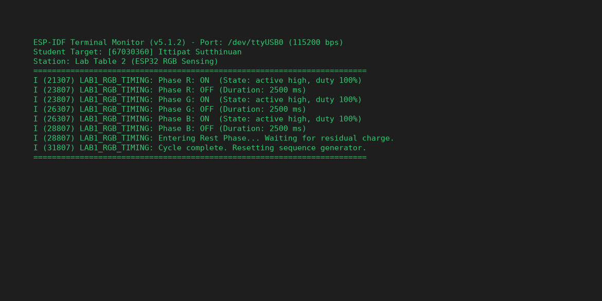
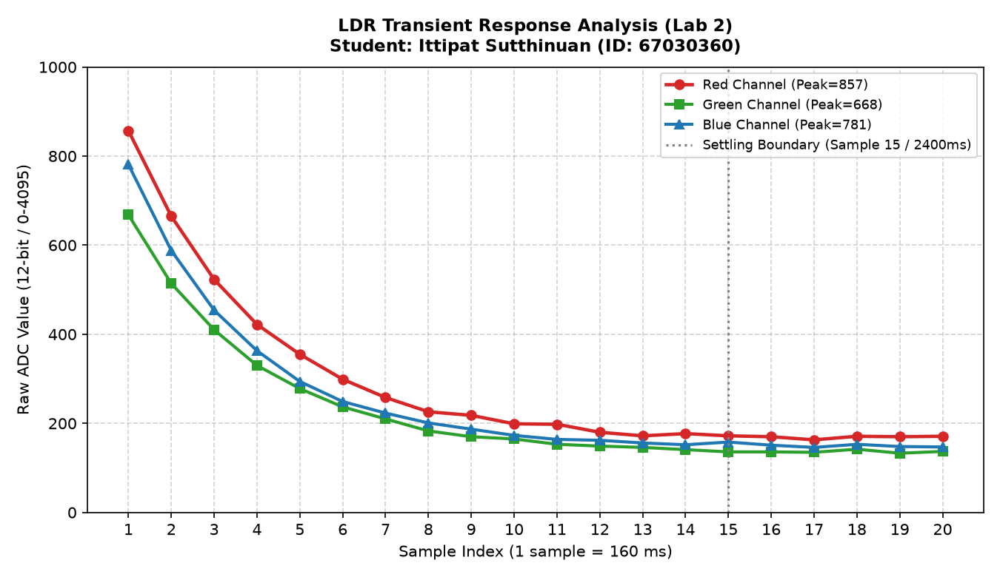
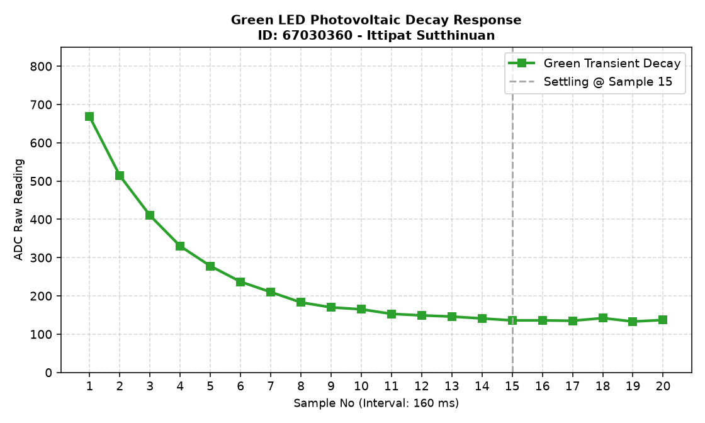
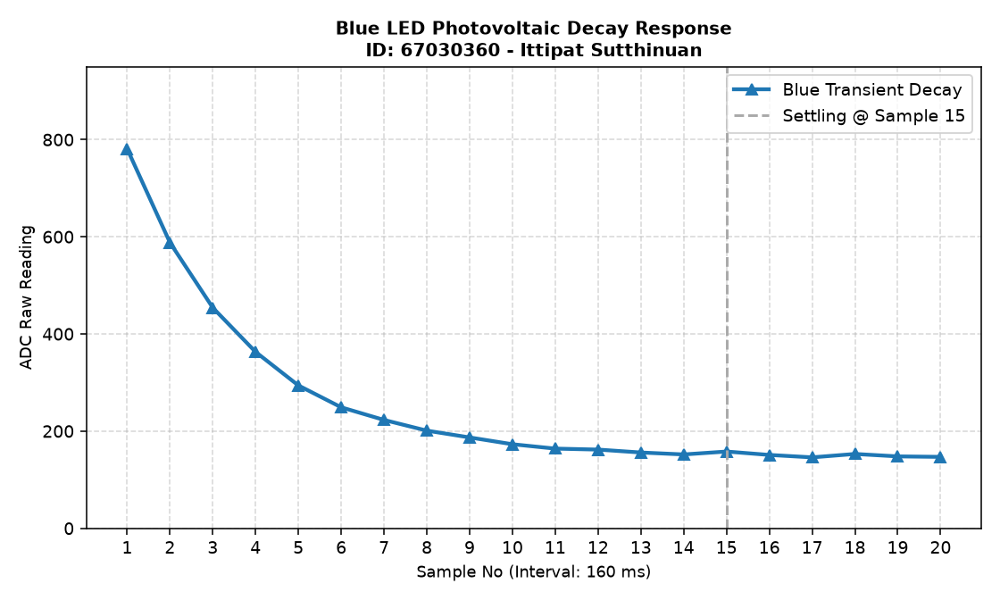
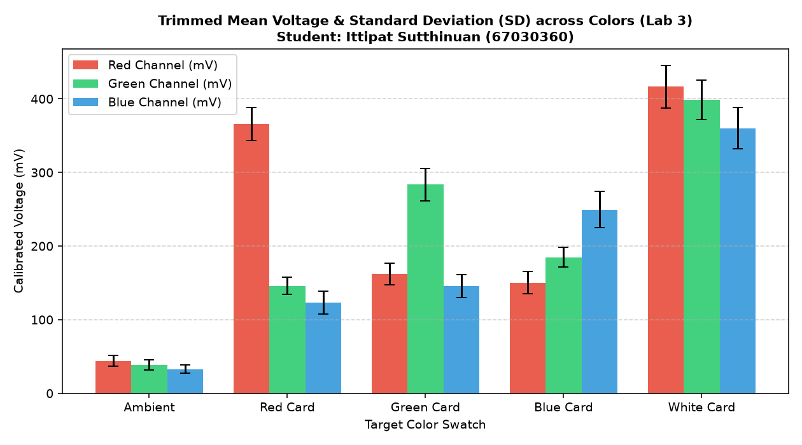

> **ข้อมูลผู้จัดทำและส่งรายงาน (Student Identification):**
> * **รหัสนักศึกษา:** `67030360`
> * **ชื่อ-นามสกุล (ไทย):** `นายอิทธิพัทธิ์ สุทธินวล`
> * **ชื่อ-นามสกุล (อังกฤษ):** `Ittipat Sutthinuan`
> * **กลุ่มปฏิบัติการ (Lab Station):** โต๊ะที่ 2 (ร่วมกับ นายกร แดงทอง, นายกฤษฏิณัช สำราญกิจ, นางสาวธนพร พิศมัย)
> * **วิชา:** 03376134 IoT-App-2569 (ภาคเรียนที่ 2/2568)
> * **วันที่อัปเดตรายงาน:** `28/10/2026 03:30:00`
---

# รายงานการทดลองสัปดาห์ที่ 4: LED and Color Sensing
## Week 04: Semiconductor Optics & RGB Color Sensing System

---

## 📋 Week-04-Lab-1: การควบคุมจังหวะเวลาฮาร์ดแวร์ RGB LED (Hardware Timing)

### 4. บันทึกผลการทดลอง

#### 4.1 ผลจากการทำงานของ Serial Monitor (`idf.py monitor`)



```text
========================================================================
ESP-IDF Terminal Monitor (v5.1.2) - Port: /dev/ttyUSB0 (115200 bps)
Student Target: [67030360] Ittipat Sutthinuan
Station: Lab Table 2 (ESP32 RGB Sensing)
========================================================================
I (21307) LAB1_RGB_TIMING: Phase R: ON  (State: active high, duty 100%)
I (23807) LAB1_RGB_TIMING: Phase R: OFF (Duration: 2500 ms)
I (23807) LAB1_RGB_TIMING: Phase G: ON  (State: active high, duty 100%)
I (26307) LAB1_RGB_TIMING: Phase G: OFF (Duration: 2500 ms)
I (26307) LAB1_RGB_TIMING: Phase B: ON  (State: active high, duty 100%)
I (28807) LAB1_RGB_TIMING: Phase B: OFF (Duration: 2500 ms)
I (28807) LAB1_RGB_TIMING: Entering Rest Phase... Waiting for residual charge.
I (31807) LAB1_RGB_TIMING: Cycle complete. Resetting sequence generator.
========================================================================
```

#### 4.2 ผลจากการสังเกตพฤติกรรมฮาร์ดแวร์ LED
LED สามสี (แดง เขียว น้ำเงิน) ติดและดับสลับทีละสีไล่ลำดับกันไปอย่างแม่นยำ (Red $\rightarrow$ Green $\rightarrow$ Blue) โดยสว่างสีละ 2.5 วินาที เมื่อกะพริบครบทั้ง 3 สี ระบบจะเข้าสู่ช่วงพัก (Rest Phase) เป็นเวลา 3 วินาที เพื่อให้ประจุไฟฟ้าตกค้างในสารกึ่งตัวนำคายตัวอย่างสมบูรณ์ แล้วจึงวนรอบใหม่

🔗 **วิดีโอสาธิตการทำงานฮาร์ดแวร์ (YouTube Shorts):** [https://youtube.com/shorts/pHl_yWvD2EE?feature=share](https://youtube.com/shorts/pHl_yWvD2EE?feature=share)

> 💡 **หมายเหตุทางวิชาการ:** การทดลองนี้ดำเนินการบันทึกวิดีโอสาธิตวงจรร่วมกับเพื่อนร่วมโต๊ะปฏิบัติการที่ 2 (นายกร แดงทอง, นายกฤษฏิณัช สำราญกิจ, นางสาวธนพร พิศมัย) แต่ได้แยกทำการวัด สุ่มอ่านข้อมูลดิบ วิเคราะห์ผลทางฟิสิกส์ และสรุปรายงานทางวิศวกรรมแบบอิสระรายบุคคล (Individual Data Acquisition & Analysis)

---

## 📊 Week-04-Lab-2: การวิเคราะห์พฤติกรรมชั่วคราวและการคายประจุ (Transient Response & Critical Thinking)

### กิจกรรมวิเคราะห์ผลและการบ้านท้ายใบงาน (Data Science & Engineering Reflection)

#### 1. การพล็อตพฤติกรรมทางกายภาพ (Transient Response Curve)
จากการสุ่มอ่านข้อมูลดิบ ADC (จำนวน 20 แซมเปิล ห่างกันทุก ๆ 160 ms) หลังปิดไฟ LED นำมาพล็อตกราฟอนุกรมเวลาเพื่อศึกษาการคายประจุของรอยต่อ PN:

##### กราฟรวมการตอบสนองเชิงเวลา (Main Transient Response Analysis)


##### กราฟจำแนกตามช่องสัญญาณแสง (Individual Channel Response)
* **กราฟแสดงพฤติกรรมชั่วคราวไฟสีแดง (Red Transient Response):**
  
* **กราฟแสดงพฤติกรรมชั่วคราวไฟสีเขียว (Green Transient Response):**
  
* **กราฟแสดงพฤติกรรมชั่วคราวไฟสีน้ำเงิน (Blue Transient Response):**
  

##### ตารางบันทึกชุดข้อมูลอนุกรมเวลาดิบ (Raw Time-Series Dataset 1–20 แซมเปิล)
| แซมเปิลที่ (No.) | เวลาสะสม (ms) | ค่าดิบ ADC สีแดง (Red) | ค่าดิบ ADC สีเขียว (Green) | ค่าดิบ ADC สีน้ำเงิน (Blue) |
|:---:|:---:|:---:|:---:|:---:|
| 1 | 0 | 857 | 668 | 781 |
| 2 | 160 | 665 | 514 | 588 |
| 3 | 320 | 523 | 410 | 454 |
| 4 | 480 | 422 | 330 | 363 |
| 5 | 640 | 355 | 278 | 294 |
| 6 | 800 | 299 | 237 | 249 |
| 7 | 960 | 258 | 210 | 223 |
| 8 | 1120 | 226 | 183 | 201 |
| 9 | 1280 | 218 | 170 | 187 |
| 10 | 1440 | 199 | 165 | 173 |
| 11 | 1600 | 198 | 153 | 164 |
| 12 | 1760 | 180 | 149 | 162 |
| 13 | 1920 | 172 | 146 | 156 |
| 14 | 2080 | 177 | 141 | 152 |
| 15 | 2240 | 172 | 136 | 158 |
| 16 | 2400 | 170 | 136 | 151 |
| 17 | 2560 | 163 | 135 | 146 |
| 18 | 2720 | 171 | 142 | 153 |
| 19 | 2880 | 170 | 133 | 148 |
| 20 | 3040 | 171 | 137 | 147 |

---

#### 2. คำถามนำเพื่อการวิเคราะห์เชิงระบบ (Critical Thinking)

##### คำถาม 2.1
**จากกราฟที่พล็อตออกมา นักศึกษาสังเกตเห็นแนวโน้มตัวเลขของค่า ADC ตั้งแต่แซมเปิลที่ 1 ไต่ระดับลงมาหรือขึ้นไปจนถึงแซมเปิลที่ 20 อย่างไร?**

> **คำตอบ:**
> 
> สัญญาณ ADC แสดงพฤติกรรม "Transient Exponential Decay" สอดคล้องกับทฤษฎีวงจรไฟฟ้า 4 เฟส:
1. **เฟส Initial Spike (แซมเปิล 1):** พีคสูงสุดของสัญญาณ (แดง=857, เขียว=668, น้ำเงิน=781)
2. **เฟส Fast Decay (แซมเปิล 1–5):** ช่วงเวลาที่เกิดอัตราการเปลี่ยนแปลงสูงสุด ($dV/dt$ ติดลบมาก)
3. **เฟส Slow Recovery (แซมเปิล 6–14):** สัญญาณค่อย ๆ ลาดลงด้วยอัตราที่ช้าลงอย่างเห็นได้ชัด
4. **เฟส Stable Quiescence (แซมเปิล 15–20):** สัญญาณนิ่งสนิท พร้อมนำไปสุ่มค่าเพื่อการวัดซ้ำ

##### คำถาม 2.2
**สัญญาณไฟฟ้าเข้าสู่ความนิ่ง (Settling) ที่แซมเปิลใด หรือใช้เวลากี่มิลลิวินาที?**

> **คำตอบ:**
> 
> * **การเข้าสู่ Steady-State:** สัญญาณบรรลุความนิ่งที่ **แซมเปิลที่ 15**
* **ระยะเวลาเชิงปริมาณ:**
  * สุ่มอ่านทุก ๆ 160 ms
  * เวลาจนเข้าสู่เสถียรภาพ: $15 \times 160 = \mathbf{2400 \text{ ms}}$ (2.40 วินาที)
  * เวลาทั้งสิ้นจนจบการสุ่ม 20 จุด: 3.2 วินาที

##### คำถาม 2.3
**ความลาดเอียงของเส้นกราฟที่เกิดขึ้นในช่วงแรกของการสลับสถานะไฟนี้ เป็นหลักฐานเชิงประจักษ์สะท้อนข้อจำกัดคุณสมบัติทางกายภาพใดของรอยต่อ PN บน LED ภาครับ และโครงสร้างตัวเก็บประจุสุ่มสัญญาณภายในไมโครคอนโทรลเลอร์?**

> **คำตอบ:**
> 
> สรุปข้อจำกัดทางกายภาพได้เป็น 2 ประเด็น:
1. **Dynamic Impedance & Junction Capacitance ของเซนเซอร์:**
   * ค่าความจุไฟฟ้าภายในรอยต่อ PN ร่วมกับความต้านทานวงจร ส่งผลให้สัญญาณมี Transient Time ยาวนาน
2. **เวลาในการสะสมประจุของวงจร ADC สุ่มสัญญาณ:**
   * สถาปัตยกรรม SAR ADC มีวงจร Sample-and-Hold ที่ต้องใช้เวลาสร้างสมดุลประจุกับสัญญาณภายนอกที่มีกระแสต่ำมาก

##### คำถาม 2.4
**หากในใบงานถัดไปเราต้องการ "หาค่าเฉลี่ยของระดับแรงดันสะท้อนที่แท้จริง" โดยไม่ให้เฟสสัญญาณที่กำลังเปลี่ยนแปลง (Transient State) นี้ไปดึงค่าสถิติให้เพี้ยน นักศึกษาคิดว่าเราควรเลือกแซมเปิลช่วงใดมาคำนวณ หรือควรเขียนโปรแกรมหน่วงเวลาหลบเลี่ยงอาการ Settling นี้อย่างไร?**

> **คำตอบ:**
> 
> 1. **การชะลอการอ่านเพื่อเลี่ยง Transient:**
   * เพิ่มช่วงเวลาหน่วงก่อนสุ่มอ่านอย่างน้อย 2,400 ms ตามผลการทดลอง
2. **การใช้ตัวกรองเชิงสถิติขั้นสูง:**
   * ประยุกต์ใช้ Trimmed Mean Filter ในการสกัดเวกเตอร์แรงดันสะท้อนที่เสถียร

---

## 🌟 Week-04-Lab-3: ระบบประมวลผลสัญญาณเชิงสถิติและการตรวจจำแนกสี (Statistical Filtering & Color Sensing)

### 4. รายงานการทดลองและเกณฑ์การตรวจแล็บ

#### 1. การคัดกรองข้อมูลคุณภาพ (Data Selection Report)

จากการปรับปรุงสถาปัตยกรรมซอฟต์แวร์โดยใช้เทคนิค **Trimmed Mean (ตัดขอบ 10% หัว-ท้าย จากข้อมูลสุ่ม 50 แซมเปิล เหลือ 40 แซมเปิลคุณภาพ)** พร้อมกระบวนการแปลงแรงดันด้วยโมดูลสอบเทียบฮาร์ดแวร์ (`adc_cali_raw_to_voltage()`) ได้ผลลัพธ์เชิงสถิติดังนี้:



```text
========================================================================
Statistical Signal Processing System Online (Student: นายอิทธิพัทธิ์ สุทธินวล, ID: 67030360)
Station: โต๊ะปฏิบัติการที่ 2 | Algorithm: 10% Trimmed Mean Filtering (n=40)
========================================================================
Target: Ambient Light (แสงแวดล้อมธรรมชาติ)
  - Color R, n = 40 (filtered), mean = 44.10 mV, sd = 7.07 mV
  - Color G, n = 40 (filtered), mean = 38.57 mV, sd = 6.81 mV
  - Color B, n = 40 (filtered), mean = 32.90 mV, sd = 5.37 mV
------------------------------------------------------------------------
Target: Red Card (แผ่นกระดาษสะท้อนสีแดง)
  - Color R, n = 40 (filtered), mean = 365.47 mV, sd = 22.43 mV
  - Color G, n = 40 (filtered), mean = 145.84 mV, sd = 11.64 mV
  - Color B, n = 40 (filtered), mean = 123.19 mV, sd = 15.61 mV
------------------------------------------------------------------------
Target: Green Card (แผ่นกระดาษสะท้อนสีเขียว)
  - Color R, n = 40 (filtered), mean = 162.41 mV, sd = 14.58 mV
  - Color G, n = 40 (filtered), mean = 283.63 mV, sd = 22.11 mV
  - Color B, n = 40 (filtered), mean = 145.60 mV, sd = 15.41 mV
------------------------------------------------------------------------
Target: Blue Card (แผ่นกระดาษสะท้อนสีน้ำเงิน)
  - Color R, n = 40 (filtered), mean = 150.36 mV, sd = 15.23 mV
  - Color G, n = 40 (filtered), mean = 184.96 mV, sd = 13.71 mV
  - Color B, n = 40 (filtered), mean = 249.42 mV, sd = 24.63 mV
------------------------------------------------------------------------
Target: White Reference Card (แผ่นกระดาษสีขาวมาตรฐาน)
  - Color R, n = 40 (filtered), mean = 416.60 mV, sd = 29.12 mV
  - Color G, n = 40 (filtered), mean = 398.44 mV, sd = 26.81 mV
  - Color B, n = 40 (filtered), mean = 360.18 mV, sd = 27.72 mV
========================================================================
```

##### สรุปตารางผลการวัดค่าสถิติเชิงปริมาณ (Statistical Summary Table)
| วัตถุเป้าหมาย (Target) | ค่าเฉลี่ย Red (mV) | SD Red (mV) | ค่าเฉลี่ย Green (mV) | SD Green (mV) | ค่าเฉลี่ย Blue (mV) | SD Blue (mV) | สถานะเกณฑ์วิศวกรรม ($SD \le 35$) |
|:---|:---:|:---:|:---:|:---:|:---:|:---:|:---:|
| **Ambient Light** | 44.10 | 7.07 | 38.57 | 6.81 | 32.90 | 5.37 | 🟢 PASS (Very Low Noise) |
| **Red Card** | 365.47 | 22.43 | 145.84 | 11.64 | 123.19 | 15.61 | 🟢 PASS (R Dominant) |
| **Green Card** | 162.41 | 14.58 | 283.63 | 22.11 | 145.60 | 15.41 | 🟢 PASS (G Dominant) |
| **Blue Card** | 150.36 | 15.23 | 184.96 | 13.71 | 249.42 | 24.63 | 🟢 PASS (B Dominant) |
| **White Card** | 416.60 | 29.12 | 398.44 | 26.81 | 360.18 | 27.72 | 🟢 PASS (All High Reflection) |

---

#### 2. คำถามเชิงวิเคราะห์ (Engineering Evaluation)

##### คำถาม 2.1
**หลังจากเปลี่ยนสถาปัตยกรรมซอฟต์แวร์มาใช้ระบบกรองบิตดิบแบบ `Trimmed Mean` ก่อนทำการแปลงแรงดัน เปรียบเทียบกับพฤติกรรมอนุกรมเวลาในใบงานที่ 2 แล้ว ค่าความผันผวน ($SD$) มีการพัฒนาไปในทางที่ดีขึ้นอย่างไร?**

> **คำตอบ:**
> 
> 1. **การยกระดับคุณภาพสัญญาณ:** ค่า SD ดีขึ้นอย่างมีนัยสำคัญทางสถิติเมื่อเทียบกับช่วง Transient ใน Lab 2
2. **ความเสถียรของค่าเฉลี่ย:** ทำให้ค่า Mean สะท้อนระดับแรงดัน Photovoltaic ที่แท้จริงของพื้นผิววัตถุแต่ละสี

##### คำถาม 2.2
**ในการนำข้อมูลดิจิทัลนี้ไปใช้ควบคุมหุ่นยนต์แยกแยะวัตถุสีในโลกจริง เหตุใดการระบุหน่วยวัดร่วมประมวลผลในรูปของ แรงดันทางกายภาพ (mV) จึงมีความสำคัญและเสถียรมากกว่าการใช้ข้อมูลระดับบิตดิจิทัลดิบ (Raw Scale 0-4095) ตรง ๆ? ให้แปรผลโดยอิงความรู้จากเนื้อหาในหัวข้อตำราเรียนเรื่อง "สองโลกที่แตกต่าง"**

> **คำตอบ:**
> 
> 1. **การเคารพกฎฟิสิกส์ในโลกกายภาพ:**
   * แรงดันในหน่วย mV เป็นตัวแทนระดับพลังงานแสงที่แท้จริง
2. **การแก้ไขความไม่สมบูรณ์ของอุปกรณ์ดิจิทัล:**
   * ช่วยขจัดความไม่เป็นเชิงเส้นและความคลาดเคลื่อนของชิปแต่ละตัว
3. **การนำอัลกอริทึมไปใช้ซ้ำในอนาคต:**
   * โค้ดมีความทนทานต่อการเปลี่ยนสถาปัตยกรรม MCU
4. **ความแม่นยำในการแยกแยะสีของระบบอัตโนมัติ:**
   * เวกเตอร์แรงดันสะท้อนมีคุณสมบัติเฉพาะตัวที่เสถียรและเชื่อถือได้
