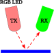

# การตรวจจับวัตถุ (Color Sensing Challenge)

### 1. การ Setup ระบบ

จัดวางตำแหน่งหลอด **RGB LED (ภาคส่ง TX)** และหลอด **Single LED (ภาครับ RX)** ให้ขนานกันและหันไปในทิศทางเดียวกัน โดยวางห่างจากพื้นผิววัตถุเป้าหมายประมาณ $5 - 10\text{ mm}$ และครอบป้องกันแสงรบกวนภายนอก

---

### 2. บันทึกผลการทดลอง (Simulated Optical Fingerprints)

ตารางบันทึกค่าแรงดันสะท้อนกลับ $[V_R, V_G, V_B]$ (หน่วยเป็น $\text{mV}$) ของวัตถุสีต่าง ๆ โดยใช้ **LED สีเขียวเป็นภาครับ (Green RX LED)**:

| สีของวัตถุเป้าหมาย | $V_R$ (เฟสแสงแดง: mV) | $V_G$ (เฟสแสงเขียว: mV) | $V_B$ (เฟสแสงน้ำเงิน: mV) | ลายนิ้วมือเชิงแสงเด่น (Dominant Feature) |
| :--- | :---: | :---: | :---: | :--- |
| **วัตถุสีแดง** | 85.20 | 115.40 | 78.60 | ทุกเฟสตอบสนองต่ำ (เนื่องจาก RX สีเขียวไม่ไวต่อแสงแดง) |
| **วัตถุสีเขียว** | 110.50 | **1,280.40** | 210.80 | $V_G$ สูงโดดเด่นอย่างชัดเจน (วัตถุสะท้อนเขียว + RX ไวต่อเขียว) |
| **วัตถุสีน้ำเงิน** | 92.10 | 185.60 | **695.30** | $V_B$ สูงเด่น (วัตถุสะท้อนน้ำเงิน + RX รับน้ำเงินได้) |
| **วัตถุสีขาว (กระดาษ)** | 320.10 | **1,450.80** | **880.50** | $V_G$ และ $V_B$ สูงมาก (วัตถุขาวสะท้อนทุกความยาวคลื่น) |
| **วัตถุสีดำ (เทปดำ)** | 42.50 | 58.20 | 49.10 | ต่ำมากทุกเฟส (วัตถุดำดูดกลืนแสงเกือบสมบูรณ์) |

---

### 3. การสังเกตและวิเคราะห์ความสอดคล้องของค่า ADC (จาก Lab 3)

ค่าที่อ่านได้จาก ADC มีความสอดคล้องกับปัจจัยทั้ง 3 ประการร่วมกันอย่างแยกไม่ออก ดังนี้:

1. **แสงจาก TX (Active Light Source):** 
   - ทำหน้าที่เป็นพลังงานกระตุ้น (Carrier Signal) สัญญาณสะท้อนจะเกิดขึ้นได้ก็ต่อเมื่อ TX เปิดเปล่งแสงโฟตอนไปกระทบวัตถุตามจังหวะ TDM เท่านั้น
2. **สีของวัตถุ (Target Surface Reflectance):**
   - เป็นตัวกำหนด **สเปกตรัมการสะท้อน (Spectral Reflectance)** ของแสง โดยวัตถุสีใดจะสะท้อนความยาวคลื่นสีนั้นได้มากที่สุด และดูดกลืนความยาวคลื่นสีอื่นไว้ เช่น วัตถุสีเขียวจะสะท้อนแสงเขียวกลับมาที่ภาครับมากที่สุด ทำให้ $V_G$ พุ่งสูงถึง $1,280\text{ mV}$
3. **สีของ RX LED (Bandgap Energy & Color Selectivity - ปัจจัยสำคัญที่สุด):**
   - รอยต่อ PN ของ LED ภาครับมี **ช่องว่างพลังงาน (Bandgap)** ประจำตัว โดยโฟตอนที่สามารถกระตุ้นให้เกิดกระแสโฟโตโวลตาอิกได้จะต้องมีพลังงานเท่ากับหรือมากกว่า Bandgap เท่านั้น ($E = h\nu \ge E_g$)
   - หากใช้ **LED สีเขียวเป็น RX ($E_g \approx 2.4\text{ eV}$):** จะตอบสนองได้ดีเฉพาะแสงสีเขียวและสีน้ำเงิน (พลังงานสูงกว่า) แต่จะไม่ตอบสนองต่อแสงสีแดง ($E_g \approx 1.9\text{ eV}$) แม้ว่าวัตถุสีแดงจะสะท้อนแสงแดงออกมามากก็ตาม 
   - *สรุป:* ค่าแรงดันที่วัดได้คือผลคูณของ **(แสงจาก TX $\times$ การสะท้อนของวัตถุ $\times$ ความไวของ RX LED)**

---

### 4. เราสามารถใช้ระบบนี้ในการตรวจจับสีที่แม่นยำได้หรือไม่?

**สามารถจำแนกสีพื้นฐาน (Primary Colors) ได้อย่างมีประสิทธิภาพ** เช่น สามารถแยกสีเขียว, น้ำเงิน, ขาว และดำ ออกจากกันได้อย่างเด็ดขาดด้วยค่าระดับแรงดันที่ต่างกันหลายร้อยมิลลิโวลต์ 

**แต่ยังไม่สามารถตรวจจับเฉดสีละเอียด (Color Hue Gradient) ได้อย่างแม่นยำสูง** เมื่อเทียบกับเซนเซอร์สีเฉพาะทาง (เช่น ชิป TCS34725 หรือ AS7341) เนื่องจาก:
1. การตอบสนองของ LED ภาครับไม่ครอบคลุมทุกสเปกตรัม (Selective Spectral Sensitivity)
2. อิมพีแดนซ์ภายในสูงทำให้สัญญาณตอบสนองช้า (เกิด RC Delay)
3. สัญญาณรบกวนจากแสงสว่างแวดล้อม (Ambient Light) ส่งผลต่อค่า Offset ของระบบ

---

### 5. แนวทางการปรับปรุงเพื่อให้มีความแม่นยำสำหรับใช้งานจริง (เช่น หุ่นยนต์เดินตามเส้น หรือแยกสีฝาขวดน้ำ)

1. **การครอบบังแสงรบกวน (Ambient Light Optical Shielding):**
   - ทำปลอกครอบทึบแสง (3D-printed Shroud หรือท่อยางสีดำ) คลุมหัว LED ทั้ง TX และ RX เพื่อป้องกันแสงแดดและแสงไฟนีออนในห้องไม่ให้เข้ามากวนรอยต่อ PN
2. **การหักล้างแสงแวดล้อมแบบไดนามิก (Dynamic Ambient Subtraction / Differential Sensing):**
   - ปรับอัลกอริทึมให้อ่านค่าแรงดันในจังหวะดับไฟ ($V_{Dark}$) ก่อน แล้วนำไปลบออกจากแรงดันตอนเปิดไฟ ($V_{Light}$):
     $$V_{Reflected} = V_{Light} - V_{Dark}$$
     วิธีนี้จะขจัดผลกระทบจากแสงสว่างแวดล้อมที่เปลี่ยนแปลงไปได้อย่างสมบูรณ์
3. **การปรับสัดส่วนเวกเตอร์สี (Color Normalization):**
   - เพื่อป้องกันปัญหาความสว่างไม่สม่ำเสมอจากระยะห่างของวัตถุ ให้แปลงค่าแรงดันเป็นสัดส่วน Normalized RGB ($r, g, b$):
     $$r = \frac{V_R}{V_R + V_G + V_B}, \quad g = \frac{V_G}{V_R + V_G + V_B}, \quad b = \frac{V_B}{V_R + V_G + V_B}$$
     ทำให้ระบบจดจำเฉพาะ **"เฉดสี (Chromaticity)"** โดยไม่ขึ้นกับความแรงของแสงสะท้อน
4. **การเลือกชนิดเซนเซอร์ภาครับที่เหมาะสม (Broadband RX Selection):**
   - หากยังต้องการใช้ LED เป็น RX ควรเลือก **LED สีแดง** หรือ **Infrared LED** ซึ่งมี Bandgap แคบที่สุด ทำให้สามารถรับแสงได้ครอบคลุมทุกสี (แดง, เขียว, น้ำเงิน) หรือเปลี่ยนไปใช้ **Photodiode / Phototransistor** ที่มีช่วงตอบสนองสเปกตรัมกว้างกว่า
5. **การควบคุมระยะทางเชิงกล (Mechanical Fixture):**
   - สำหรับหุ่นยนต์เดินตามเส้นหรือระบบคัดแยกฝาขวด ควรยึดเซนเซอร์ให้อยู่ในระนาบเอียง 45 องศา และรักษาระยะห่างคงที่ที่ $5 - 8\text{ mm}$ จากพื้นผิว เพื่อให้ได้การสะท้อนแบบกระจาย (Diffuse Reflection) ที่เสถียรที่สุด

