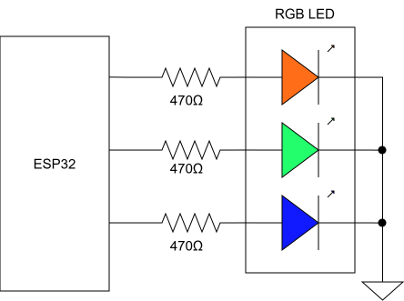

# ใบงานปฏิบัติการ สัปดาห์ที่ 4 การทดลองย่อยที่ 1


### หัวข้อ: การควบคุมจังหวะเวลาเอาต์พุตดิจิทัล (Time-Domain Multiplexing with RGB LED)

### 1. วัตถุประสงค์

1. เพื่อให้ผู้เรียนสามารถควบคุมขาสัญญาณดิจิทัลเอาต์พุต (GPIO) โดยใช้เฟรมเวิร์ก ESP-IDF 
    
2. เพื่อให้ผู้เรียนสามารถจัดการจังหวะเวลาทางกายภาพ (Transient & Steady States) ผ่านฟังก์ชัน FreeRTOS ในโปรแกรม
    
3. เพื่อฝึกฝนการเขียนลูปสลับสถานะของสัญญาณ (Active Phase) และการเว้นระยะพักประจุระบบ (Rest Phase) ก่อนนำไปใช้ในงาน Active Sensing
    

### 2. อุปกรณ์ที่ใช้ในการทดลอง

1. บอร์ดไมโครคอนโทรลเลอร์ ESP32  จำนวน 1 บอร์ด
    
2. หลอด LED สามสี (RGB LED) ชนิด Common Cathode หรือ Common Anode จำนวน 1 ดวง
    
3. ตัวต้านทาน (Resistor) ขนาด $330 \Omega$ หรือ $470 \Omega$ จำนวน 3 ตัว
    
4. โฟโต้บอร์ด (Breadboard) และสายจัมเปอร์ (Jumper Wires)
    

### 3. วงจรการทดลองและการคำนวณทางกายภาพ

ในโลกกายภาพ รอยต่อ PN ของ LED แต่ละสีมีแรงดันตกคร่อมและคุณสมบัติความจุไฟฟ้าแฝงต่างกัน 

นักศึกษาต้องต่อตัวต้านทานอนุกรมเข้ากับขา **GPIO4 (สีแดง)**, **GPIO5 (สีเขียว)**, และ **GPIO6 (สีน้ำเงิน)**  เพื่อจำกัดกระแสไฟฟ้าไม่ให้ชิปเกิดความเสียหาย




**รูปที่ 1** LED Common Cathode


**รูปที่ 2** LED Common Anode

#### **หมายเหตุ**
ถ้า LED ที่ได้มาเป็น Common Anode ให้ต่อ common เข้าไฟ +5 โวลต์ แต่ยังคงใช้ Resistor ค่าเดิม
ส่วนการเขียนโปรแกรมต้องกลับค่าบิตให้ตรงตามชนิด LED

#### 3.1 ตัวอย่างซอร์สโค้ดการทดลอง (`main.c`)

ให้นักศึกษาศึกษาโค้ดต่อไปนี้ และกรอกส่วนจังหวะเวลาให้ทำงานตรงตามเงื่อนไข: **ติดดับสลับกันทีละสีดวงละ 2.5 วินาที และเมื่อดับครบหมดทุกสี ให้เว้นระยะพักรอบ 3 วินาที**


```C
#include <stdio.h>
#include "freertos/FreeRTOS.h"
#include "freertos/task.h"
#include "driver/gpio.h"
#include "esp_log.h"

static const char *TAG = "LAB1_RGB_TIMING";

// กำหนดขา GPIO Safe Pins
#define LED_R_GPIO        GPIO_NUM_4
#define LED_G_GPIO        GPIO_NUM_5
#define LED_B_GPIO        GPIO_NUM_18

#define TIME_ACTIVE_MS    2500  // สลับติด-ดับทุกๆ 2.5 วินาที
#define TIME_REST_MS      3000  // เว้นระยะพักรอบ 3 วินาที

// ลอจิกสำหรับ Common Anode (+5V)
#define LED_ON            0     // ดึง 0V เพื่อให้ไฟไหล
#define LED_OFF           1     // ตัดกระแสเพื่อปิดไฟ

void init_rgb_gpio(void)
{
    gpio_config_t io_conf = {
        .pin_bit_mask = (1ULL << LED_R_GPIO) | (1ULL << LED_G_GPIO) | (1ULL << LED_B_GPIO),
        .mode = GPIO_MODE_OUTPUT,
        .pull_up_en = GPIO_PULLUP_DISABLE,
        .pull_down_en = GPIO_PULLDOWN_DISABLE,
        .intr_type = GPIO_INTR_DISABLE
    };
    gpio_config(&io_conf);

    // เริ่มต้นให้ดับทุกสี
    gpio_set_level(LED_R_GPIO, LED_OFF);
    gpio_set_level(LED_G_GPIO, LED_OFF);
    gpio_set_level(LED_B_GPIO, LED_OFF);
}

void app_main(void)
{
    init_rgb_gpio();
    ESP_LOGI(TAG, "RGB LED System Started (Pins: 4, 5, 18).");

    while (1) {
        // Red Phase
        ESP_LOGI(TAG, "Phase R (GPIO 4): ON");
        gpio_set_level(LED_R_GPIO, LED_ON);
        vTaskDelay(pdMS_TO_TICKS(TIME_ACTIVE_MS));
        gpio_set_level(LED_R_GPIO, LED_OFF);
        ESP_LOGI(TAG, "Phase R (GPIO 4): OFF");

        // Green Phase
        ESP_LOGI(TAG, "Phase G (GPIO 5): ON");
        gpio_set_level(LED_G_GPIO, LED_ON);
        vTaskDelay(pdMS_TO_TICKS(TIME_ACTIVE_MS));
        gpio_set_level(LED_G_GPIO, LED_OFF);
        ESP_LOGI(TAG, "Phase G (GPIO 5): OFF");

        // Blue Phase
        ESP_LOGI(TAG, "Phase B (GPIO 18): ON");
        gpio_set_level(LED_B_GPIO, LED_ON);
        vTaskDelay(pdMS_TO_TICKS(TIME_ACTIVE_MS));
        gpio_set_level(LED_B_GPIO, LED_OFF);
        ESP_LOGI(TAG, "Phase B (GPIO 18): OFF");

        // Rest Phase
        ESP_LOGI(TAG, "Entering Rest Phase...");
        vTaskDelay(pdMS_TO_TICKS(TIME_REST_MS)); 
        
        printf("-----------------------------------------------------------\n");
    }
}
```

#### 3.2 ไฟล์ `main/CMakeLists.txt`

เพื่อลงทะเบียนระบบพอร์ตและ GPIO ให้โปรเจกต์คอมไพล์ผ่านอย่างถูกต้อง แนะนำให้นักศึกษาใช้โครงสร้าง CMake พื้นฐานดังนี้


```CMake
idf_component_register(SRCS "main.c"
                    INCLUDE_DIRS "."
                    REQUIRES driver)
```

### 4.  บันทึกผลการทดลอง 

#### 4.1 จาก `idf.py monitor` 


![[Pasted image 20260720101634.png]]


#### 4.2 จากการสังเกตุ LED 

จะเริ่มต้นจากสีแดงกระพริบเป็นเขียวแล้วก็กระพริบน้ำเงิน แล้วดับไปแล้ว แล้วกลับมาแดงอีกครั้งวนไปเรื่อย ๆ 

