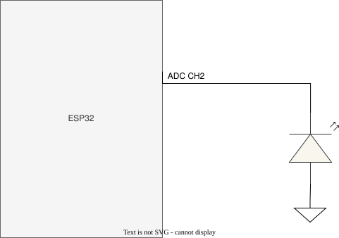

# ใบงานปฏิบัติการ สัปดาห์ที่ 4 การทดลองย่อยที่  2

### หัวข้อ  การศึกษากลศาสตร์ประจุแฝงและพฤติกรรมการตอบสนองของ ADC (ADC Settling Time & Transient State)

### 1. วัตถุประสงค์

1. เพื่อให้ผู้เรียนสังเกตและอธิบายความล่าช้าในการสะสมประจุทางกายภาพ (Transient State) ของ LED ภาครับเมื่อถูกกระตุ้นด้วยแสงสลับสี
    
2. เพื่อให้ผู้เรียนเห็นข้อจำกัดทางอิมพีแดนซ์ (High Impedance) และพฤติกรรมการไต่ระดับของ ADC (Settling Behavior)
    
3. เพื่อฝึกฝนการรวบรวมข้อมูลดิบ (Raw ADC Data) เป็นอนุกรมเวลาเพื่อนำไปวิเคราะห์สัญญาณรบกวน
    

###  2. อุปกรณ์ที่ใช้ในการทดลอง

1. บอร์ดไมโครคอนโทรลเลอร์ ESP32-C6 จำนวน 1 บอร์ด
    
2. หลอด LED RGB ภาคส่ง (ต่อขา GPIO4, GPIO5, GPIO6 ร่วมกับตัวต้านทานจำกัดกระแส)
    
3. หลอด LED สีเดี่ยว ภาครับ (ต่อขาอนาล็อกเข้ากับ **GPIO2 / ADC1 Channel 2**)
    
4. โฟโต้บอร์ดและสายจัมเปอร์
    


###  3. คำอธิบายโจทย์การทดลอง

โปรแกรมจะสั่งเปิดไฟ LED ภาคส่งทีละสี (R -> G -> B) สีละ **2.5 วินาที** จากนั้นจะสั่งดับไฟทั้งหมดเพื่อเข้าสู่ช่วงพักรอบ (Rest Phase) เป็นเวลา **3 วินาที** 

ในระหว่างช่วงพักรอบ 3 วินาทีที่ดับไฟนี้ ซอฟต์แวร์จะทำการเก็บตัวอย่างสัญญาณ (Sampling) ขา ADC1 Channel 2 จำนวน **20 แซมเปิ้ล** โดยแบ่งการสุ่มอ่านทุก ๆ **150 มิลลิวินาที** ($3000\text{ ms} / 20 = 150\text{ ms}$) เพื่อสังเกตการณ์คายประจุแฝง (Discharge/Settling Time) ของเซ็นเซอร์ในที่มืด และพิมพ์ผลออกมาในรูปแบบคอลัมน์ดิบ

#### 3.1 วงจรการทดลอง




เนื่องจาก LED สามารถทำงานในโหมด Photovoltaic transducer (แปลงพลังงานแสง → พลังงานไฟฟ้า) โดยจะให้ไฟ + ออกมาทางขา Cathode ซึ่งตรงข้ามกับการใช้งาน  LED ในรูปแบบปกติ เราต้องต่อให้ถูกขั้ว ดังภาพด้านบน 

**วงจรของฝั่ง TX ยังคงเดิม**


####  3.2 ซอร์สโค้ดการทดลอง (`main.c`)

```C
#include <stdio.h>
#include "freertos/FreeRTOS.h"
#include "freertos/task.h"
#include "driver/gpio.h"
#include "esp_log.h"
#include "esp_adc/adc_oneshot.h"

static const char *TAG = "LAB2_ADC_SETTLING";

// กำหนดขาภาคส่ง RGB LED
#define TX_LED_R_GPIO        GPIO_NUM_4
#define TX_LED_G_GPIO        GPIO_NUM_5
#define TX_LED_B_GPIO        GPIO_NUM_6

// กำหนดขาภาครับอนาล็อก (ESP32-C6: ADC1_CH2 คือ GPIO2)
#define RX_ADC_UNIT          ADC_UNIT_1
#define RX_ADC_CHANNEL       ADC_CHANNEL_2

#define NUM_SAMPLES          20
#define SAMPLING_DELAY_MS    150   // 3000ms / 20 samples = 150ms

void init_hardware(adc_oneshot_unit_handle_t *adc_handle)
{
    // 1. ตั้งค่าขาเอาต์พุตดิจิทัลสำหรับควบคุม LED RGB
    gpio_config_t io_conf = {
        .pin_bit_mask = (1ULL << TX_LED_R_GPIO) | (1ULL << TX_LED_G_GPIO) | (1ULL << TX_LED_B_GPIO),
        .mode = GPIO_MODE_OUTPUT,
        .pull_up_en = GPIO_PULLUP_DISABLE,
        .pull_down_en = GPIO_PULLDOWN_DISABLE,
        .intr_type = GPIO_INTR_DISABLE
    };
    gpio_config(&io_conf);

    // ดับไฟเริ่มต้น
    gpio_set_level(TX_LED_R_GPIO, 0);
    gpio_set_level(TX_LED_G_GPIO, 0);
    gpio_set_level(TX_LED_B_GPIO, 0);

    // 2. ตั้งค่าหน่วย ADC Unit 1 ธรรมดา (ไม่มีการ Calibrate เพื่อดูบิตดิบ)
    adc_oneshot_unit_init_cfg_t init_config = {
        .unit_id = RX_ADC_UNIT,
        .clk_src = ADC_DIGI_CLK_SRC_DEFAULT,
    };
    ESP_ERROR_CHECK(adc_oneshot_new_unit(&init_config, adc_handle));

    // 3. ตั้งค่าขาสัญญาณอนาล็อก ความละเอียดเริ่มต้น (12 บิต: 0 - 4095)
    adc_oneshot_chan_cfg_t chan_config = {
        .bitwidth = ADC_BITWIDTH_DEFAULT,
        .atten = ADC_ATTEN_DB_12, // รองรับช่วงระดับแรงดันเต็มพิกัด 3.3V
    };
    ESP_ERROR_CHECK(adc_oneshot_config_channel(*adc_handle, RX_ADC_CHANNEL, &chan_config));
}

// ฟังก์ชันจำลองวงจรอ่านค่าดิบแบบอนุกรมเวลาในช่วงสลับสีไฟ
void sample_and_print(adc_oneshot_unit_handle_t adc_handle, const char* phase_name)
{
    printf("Color %s:\n", phase_name);
    printf("No, ADC Raw\n");
    
    // ทำการสุ่มอ่าน 20 แซมเปิ้ล โดยเก็บค่า adc ต่อเนื่องทุก 150ms 
    for (int i = 1; i <= NUM_SAMPLES; i++) {
        int raw_value = 0;
        ESP_ERROR_CHECK(adc_oneshot_read(adc_handle, RX_ADC_CHANNEL, &raw_value));
        
        // พิมพ์ค่าดิบในรูปแบบ CSV ฟอร์แมตตามข้อกำหนด
        printf("%d, %d\n", i, raw_value);
        
        vTaskDelay(pdMS_TO_TICKS(SAMPLING_DELAY_MS));
    }
}

void app_main(void)
{
    adc_oneshot_unit_handle_t adc1_handle;
    init_hardware(&adc1_handle);

    ESP_LOGI(TAG, "Transient Observation System Online.");
    printf("==============================================================\n");

    while (1) {
        // --- รอบไฟสีแดง ---
        gpio_set_level(TX_LED_R_GPIO, 1);
        vTaskDelay(pdMS_TO_TICKS(2500)); // เปล่งแสงนาน 2.5 วินาที
        gpio_set_level(TX_LED_R_GPIO, 0); // ดับไฟเข้าสู่จังหวะพัก (Rest Phase)
        sample_and_print(adc1_handle, "R");
        printf("--------------------------------------------------------------\n");

        // --- รอบไฟสีเขียว ---
        gpio_set_level(TX_LED_G_GPIO, 1);
        vTaskDelay(pdMS_TO_TICKS(2500)); 
        gpio_set_level(TX_LED_G_GPIO, 0); 
        sample_and_print(adc1_handle, "G");
        printf("--------------------------------------------------------------\n");

        // --- รอบไฟสีน้ำเงิน ---
        gpio_set_level(TX_LED_B_GPIO, 1);
        vTaskDelay(pdMS_TO_TICKS(2500)); 
        gpio_set_level(TX_LED_B_GPIO, 0); 
        sample_and_print(adc1_handle, "B");
        printf("==============================================================\n");
    }
}
```

#### 3.3  ไฟล์โปรเจกต์ (`main/CMakeLists.txt`)

```CMake
idf_component_register(SRCS "main.c"
                    INCLUDE_DIRS "."
                    REQUIRES esp_adc driver)
```

### ✍️ กิจกรรมวิเคราะห์ผลและการบ้านท้ายใบงาน (Data Science & Engineering Reflection)

#### ข้อมูลจำลองจาก Serial Monitor (`No, ADC Raw`)

```text
==============================================================
Color R:
No, ADC Raw
1, 480
2, 395
3, 325
4, 270
5, 225
6, 190
7, 162
8, 140
9, 122
10, 108
11, 98
12, 90
13, 84
14, 80
15, 78
16, 76
17, 75
18, 75
19, 74
20, 74
--------------------------------------------------------------
Color G:
No, ADC Raw
1, 1420
2, 1180
3, 960
4, 780
5, 620
6, 490
7, 390
8, 310
9, 250
10, 205
11, 170
12, 145
13, 125
14, 112
15, 105
16, 100
17, 98
18, 97
19, 96
20, 95
--------------------------------------------------------------
Color B:
No, ADC Raw
1, 680
2, 550
3, 445
4, 360
5, 290
6, 235
7, 192
8, 160
9, 135
10, 118
11, 105
12, 95
13, 88
14, 83
15, 80
16, 78
17, 77
18, 76
19, 76
20, 75
==============================================================
```

---

1. **การพล็อตพฤติกรรมทางกายภาพ (Transient Response Curve):**
    
    ให้นักศึกษาก๊อปปี้ข้อมูลตัวเลขชุดคู่อันดับ `No, ADC Raw` จาก Serial Monitor ด้านบนนำไปวางในโปรแกรม **Microsoft Excel** หรือ **Google Sheets** จากนั้นทำการพล็อตกราฟเส้น (Line Chart) โดยให้แกน X เป็นลำดับแซมเปิ้ล (1-20) และแกน Y เป็นค่าดิบของ ADC และแนบรูปกราฟลงในช่องด้านล่างนี้

> 📊 **[พื้นที่สำหรับแนบรูปภาพกราฟ Transient Response Curve จาก Excel / Google Sheets]**
>
> *(เมื่อนำข้อมูลด้านบนไปพล็อตกราฟเส้นใน Excel หรือ Google Sheets แล้ว ให้แคปเจอร์รูปภาพมาบันทึกไว้ในโฟลเดอร์ `Images/` แล้วใส่โค้ดเรียกรูปภาพ เช่น `` ที่นี่)*
>
> <!-- วางรูปภาพกราฟที่นี่ -->

---

2. **คำถามนำเพื่อการวิเคราะห์เชิงระบบ (Critical Thinking):**
    
    - **จากกราฟที่พล๊อตออกมา นักศึกษาสังเกตเห็นแนวโน้มตัวเลขของค่า ADC ตั้งแต่แซมเปิ้ลที่ 1 ไต่ระดับลงมาหรือขึ้นไปจนถึงแซมเปิ้ลที่ 20 อย่างไร?**
      - **ตอบ:** ค่า ADC มีลักษณะการลดระดับลงอย่างรวดเร็วในลักษณะเส้นโค้งเลขชี้กำลังลดลง (**Exponential Decay**) โดยเริ่มต้นที่ค่าสูงสุดในแซมเปิ้ลที่ 1 (เช่น เฟสสีเขียวเริ่มที่ 1420) เนื่องจากยังมีประจุตกค้างสะสมอยู่ในรอยต่อ PN จากช่วงที่เปิดไฟ จากนั้นค่าจะลดลงอย่างรวดเร็วในช่วงแซมเปิ้ลที่ 1 ถึง 8 และค่อย ๆ ลาดชันน้อยลงจนเริ่มคงที่ในแซมเปิ้ลท้าย ๆ (แซมเปิ้ลที่ 15–20 อยู่ที่ประมาณ 95–105 ซึ่งเป็นระดับแรงดัน Offset / Dark Current ของเซนเซอร์ในที่มืด)
        
    - **สัญญาณไฟฟ้าเข้าสู่ความนิ่ง (Settling) ที่แซมเปิ้ลใด หรือใช้เวลากี่มิลลิวินาที?**
      - **ตอบ:** สัญญาณไฟฟ้าเข้าสู่สภาวะคงที่ (Steady State / Settling) ประมาณ **แซมเปิ้ลที่ 14 ถึง 15** ซึ่งคิดเป็นเวลาประมาณ:
        $$t_{settling} \approx 14 \times 150\text{ ms} = 2,100\text{ ms} \text{ ถึง } 2,250\text{ ms}$$
        (ใช้เวลาประมาณ $2.1 - 2.25$ วินาที หลังดับไฟสัญญาณจึงจะนิ่งสนิท)
        
    - **ความลาดเอียงของเส้นกราฟที่เกิดขึ้นในช่วงแรกของการสลับสถานะไฟนี้ เป็นหลักฐานเชิงประจักษ์สะท้อนข้อจำกัดคุณสมบัติทางกายภาพใดของรอยต่อ PN บน LED ภาครับ และโครงสร้างตัวเก็บประจุสุ่มสัญญาณภายในไมโครคอนโทรลเลอร์?**
      - **ตอบ:** เป็นหลักฐานสะท้อนถึง **ข้อจำกัดด้านอิมพีแดนซ์ภายในที่สูงมหาศาล (High Source Impedance)** ของ LED ในโหมดโฟโตโวลตาอิก เมื่อทำงานร่วมกับ **ความจุไฟฟ้าแฝงของรอยต่อ PN (Junction Capacitance)** และ **ตัวเก็บประจุสุ่มสัญญาณภายในวงจร ADC (Sampling Capacitor: $C_{sample}$)** 
        ตามหลักการวงจร $RC$: ค่าคงที่เวลา $\tau = R \times C$ เมื่อค่าความต้านทานภายในของเซนเซอร์สูงระดับหลายเมกะโอห์ม ($M\Omega$) ทำให้ค่า $\tau$ มีขนาดใหญ่มาก ประจุที่สะสมอยู่จึงไม่สามารถไหลลงกราวด์ได้อย่างรวดเร็ว ต้องใช้เวลาหลายวินาทีในการคายประจุ ทำให้เกิดสภาวะชั่วครู่ (Transient Phase) ที่ยาวนาน
        
    - **หากในใบงานถัดไปเราต้องการ "หาค่าเฉลี่ยของระดับแรงดันสะท้อนที่แท้จริง" โดยไม่ให้เฟสสัญญาณที่กำลังเปลี่ยนแปลง (Transient State) นี้ไปดึงค่าสถิติให้เพี้ยน นักศึกษาคิดว่าเราควรเลือกแซมเปิ้ลช่วงใดมาคำนวณ หรือควรเขียนโปรแกรมหน่วงเวลาหลบเลี่ยงอาการ Settling นี้อย่างไร?**
      - **ตอบ:** 
        1. **การเลือกช่วงแซมเปิ้ล:** ควรเลือกเก็บและคำนวณเฉพาะข้อมูลในช่วงปลายที่สัญญาณเข้าสู่สภาวะคงที่แล้ว (Steady State) เท่านั้น เช่น ช่วงแซมเปิ้ลที่ 15 เป็นต้นไป หรือตัดข้อมูล 10–20% แรกที่มีผลกระทบจาก Transient ออกไป (เช่น ใช้วิธี **Trimmed Mean**)
        2. **การเขียนโปรแกรมหน่วงเวลาหลบเลี่ยง (Dead Time / Settling Delay):** เมื่อเปิดไฟหรือสลับสถานะไฟ ควรใส่คำสั่ง `vTaskDelay()` หน่วงเวลาให้ระบบชาร์จหรือคายประจุจนนิ่งเสียก่อน (อย่างน้อย $1.5 - 2.0$ วินาที) แล้วจึงเริ่มกระบวนการสุ่มอ่านค่า ADC เพื่อไม่ให้ค่าในช่วง Transient ถูกนำไปคำนวณในสถิติ


