# Week 04: LED Physics, Photovoltaic Active Sensing & Robust Statistical Filtering

## 1. บทนำ (Introduction)
ในสัปดาห์ที่ 3 เราได้ศึกษาความแตกต่างระหว่างโลกกายภาพ (Physical World) และโลกดิจิทัล (Digital World) ตลอดจนปัจจัยที่ทำลายความสมบูรณ์ของสัญญาณ (Signal Integrity) และการแปลงสัญญาณจากความต้านทานเป็นแรงดันไฟฟ้าด้วยวงจร Voltage Divider

ในสัปดาห์ที่ 4 นี้ เราจะก้าวเข้าสู่การเรียนรู้ความสัมพันธ์ระดับฟิสิกส์ของอุปกรณ์สารกึ่งตัวนำในหัวข้อ **"ไดโอดเปล่งแสง (LED) จากตัวจ่ายพลังงานสู่เซนเซอร์วัดแสงเชิงแสง"** และการประยุกต์ใช้วิธีการตรวจจับแบบแอกทีฟ (**Active Sensing**) ร่วมกับการประมวลผลสัญญาณเชิงสถิติบนไมโครคอนโทรลเลอร์ **ESP32 / ESP32-C6**

โดยทั่วไป **LED (Light Emitting Diode)** ถูกจัดเป็นอุปกรณ์เอาต์พุตหรือ **Actuator** (Output Transducer) ที่ทำหน้าที่แปลงพลังงานไฟฟ้าให้เป็นพลังงานแสง (Radiant Energy) ในสภาวะไบอัสตรง (Forward Bias) แต่ด้วยคุณสมบัติเชิงฟิสิกส์ของ **รอยต่อสารกึ่งตัวนำ PN (PN Junction)** เมื่อมีโฟตอนของแสงภายนอกวิ่งเข้ามาชนบริเวณปลอดพาหะ (Depletion Region) จะเกิดคู่ประจุอิเล็กตรอน-โฮล และสร้างความต่างศักย์ไฟฟ้ากระแสตรงขึ้นมาตาม **ปรากฏการณ์โฟโตโวลตาอิก (Photovoltaic Effect)** เสมือนเป็นเซลล์แสงอาทิตย์ขนาดจิ๋ว ทำให้เราสามารถใช้ LED ธรรมดาทำหน้าที่เป็น **เซนเซอร์รับแสงอนาล็อก (Input Sensor)** ได้โดยตรง

อย่างไรก็ตาม การใช้งาน LED เป็นเซนเซอร์ภาครับมีข้อจำกัดทางกายภาพที่ท้าทาย ได้แก่ **อิมพีแดนซ์ภายในที่สูงมหาศาล (High Impedance)** ทำให้เกิดความเฉื่อยในการชาร์จและคายประจุ ($RC\text{ Time Constant}$ ช้า) และ **ความไวเฉพาะช่วงสีตามช่องว่างพลังงาน (Bandgap Color Selectivity)** นักศึกษาจึงจะได้เรียนรู้การผสานวงจรฮาร์ดแวร์ การจัดการเวลาด้วย FreeRTOS และการกรองสัญญาณเชิงสถิติชั้นสูง:

1. **Semiconductor PN Junction & Optical Physics**: สถาปัตยกรรมของสารกึ่งตัวนำ P-type, N-type, บริเวณปลอดพาหะ (Depletion Region), การรวมตัวของอิเล็กตรอน-โฮลเพื่อปล่อยโฟตอน, และปรากฏการณ์โฟโตโวลตาอิกย้อนกลับ
2. **Physical Constraints & Charge Dynamics**: ศึกษาพฤติกรรมสภาวะชั่วครู่ (Transient State), อัตราความเฉื่อยในการสะสมประจุ (Settling Time), และการคายประจุแฝงในช่วงพักรอบ (Rest Phase)
3. **Time-Domain Multiplexed Active Sensing**: เทคนิคการสลับแสงภาคส่ง RGB LED (แดง $\rightarrow$ เขียว $\rightarrow$ น้ำเงิน) ตามแกนเวลา เพื่อตรวจจับแสงสะท้อนจากวัตถุและสร้างเป็น **"ลายนิ้วมือเชิงแสง (Optical Fingerprint)"**
4. **Statistical Signal Processing on MCU**: การขจัดสัญญาณรบกวน (Noise Filtering) ด้วยค่าเฉลี่ยเลขคณิต (Arithmetic Mean), การใช้ส่วนเบี่ยงเบนมาตรฐาน (Standard Deviation: SD) ประเมินเสถียรภาพของสัญญาณ, และอัลกอริทึม **Trimmed Mean (Outlier Rejection)**
5. **On-Chip ADC Calibration**: การแปลงค่าดิจิทัลดิบ (Raw ADC Bits) ให้เป็นหน่วยแรงดันไฟฟ้าจริงในระดับมิลลิโวลต์ (mV) ด้วยระบบ eFuse Calibration บน ESP-IDF

> [!IMPORTANT]
> **ข้อพึงระวังเกี่ยวกับสภาพแวดล้อมการคอมไพล์ (ESP-IDF Compatibility Note)**
> เนื่องจากเฟรมเวิร์ก ESP-IDF มีการพัฒนาอย่างต่อเนื่อง (v4.x, v5.x, v6.x) อาจมีความแตกต่างของชื่อฟังก์ชันหรือโครงสร้างไลบรารี ADC (เช่น ไดรเวอร์ดั้งเดิม `driver/adc.h` เทียบกับไดรเวอร์ใหม่ `esp_adc/adc_oneshot.h` และ `esp_adc/adc_cali.h`) โค้ดตัวอย่างในใบงานได้รับการทดสอบบนสภาพแวดล้อมของผู้สอน นักศึกษาอาจต้องตรวจสอบและปรับแต่งพารามิเตอร์ขา GPIO และ API ให้สอดคล้องกับรุ่นของ ESP-IDF และบอร์ดชิป (ESP32 หรือ ESP32-C6) ที่ใช้งานจริง

---

## 2. แผนผังเนื้อหาการเรียนรู้ประจำสัปดาห์ (Lesson Roadmap)

<p align="center"></p>
<p align="center">  แผนผังเนื้อหาการเรียนรู้ประจำสัปดาห์ (Lesson Roadmap)</p>

---

## 3. ตารางเปรียบเทียบโหมดการทำงานและคุณสมบัติทางแสงของ LED

### 3.1 การเปรียบเทียบโหมดการทำงานของ LED (Forward Bias vs Photovoltaic Mode)

| คุณสมบัติ | โหมดขับแสง (Forward Bias Emitter) | โหมดตรวจจับแสง (Photovoltaic Sensor Mode) |
| :--- | :--- | :--- |
| **หน้าที่ทางระบบ** | ตัวกระตุ้น / สั่งการ (**Actuator / Output Transducer**) | ตัวตรวจวัด / รับรู้ (**Sensor / Input Transducer**) |
| **การแปลงพลังงาน** | พลังงานไฟฟ้า $\rightarrow$ พลังงานแสง (Radiant Energy) | พลังงานแสง (Photons) $\rightarrow$ พลังงานไฟฟ้า (DC Voltage) |
| **กลไกทางฟิสิกส์** | อิเล็กตรอนรวมตัวกับโฮล ปลดปล่อยโฟตอน ($E = h\nu$) | แสงกระตุ้นเกิดคู่อิเล็กตรอน-โฮล สนามไฟฟ้าในรอยต่อแยกประจุ |
| **การต่อขั้วไฟฟ้า** | จ่ายไฟบวกที่ Anode (+), ไฟลบที่ Cathode (-) | ขั้ว Cathode (-) ปลดปล่อยศักย์บวก ($+$), Anode ปลดปล่อยศักย์ลบ ($-$) |
| **ระดับกระแส/แรงดัน** | กระแส $2\text{ mA} - 20\text{ mA}$, แรงดันตกคร่อม $1.8\text{ V} - 3.2\text{ V}$ | กระแสระดับนาโนแอมป์ ($\text{nA}$), แรงดันไฟฟ้า $0 - 1500\text{ mV}$ |
| **อิมพีแดนซ์ (Impedance)** | ต่ำ (Low Impedance) ตอบสนองได้รวดเร็วระดับ $\mu\text{s}$ | สูงมหาศาล (High Impedance) เกิดค่าคงที่เวลา $RC$ นาน $2-3$ วินาที |
| **พฤติกรรมการตอบสนอง** | สว่างทันทีเมื่อแรงดันสูงกว่าค่าขีดเริ่มเปลี่ยน ($V_f$) | ต้องรอเวลาสะสมประจุ (Settling Time) จนเข้าสู่ Steady State |

### 3.2 คุณสมบัติช่องว่างพลังงานและความไวแสงจำเพาะ (Bandgap Energy & Color Selectivity)

| ชนิดสีของ LED | พลังงานช่องว่าง (Bandgap Energy) | ความยาวคลื่นที่เปล่งแสง ($\lambda$) | แรงดันตกคร่อม ($V_f$) | พฤติกรรมเมื่อทำหน้าที่เป็นเซนเซอร์ภาครับ |
| :--- | :---: | :---: | :---: | :--- |
| **LED สีแดง** | แคบ ($\sim 1.9\text{ eV}$) | $\sim 620 - 660\text{ nm}$ | $\sim 1.8\text{ V} - 2.0\text{ V}$ | มีช่องว่างพลังงานแคบ ไวต่อการรับแสงสเปกตรัมกว้าง (รับแสงแดง, เขียว, น้ำเงินได้) |
| **LED สีเขียว** | ปานกลาง ($\sim 2.4\text{ eV}$) | $\sim 520 - 550\text{ nm}$ | $\sim 2.0\text{ V} - 2.4\text{ V}$ | ดูดกลืนแสงที่มีพลังงานสูงกว่า เช่น เขียวและน้ำเงิน แต่ไม่ตอบสนองต่อแสงสีแดง |
| **LED สีน้ำเงิน** | กว้าง ($\sim 3.1\text{ eV}$) | $\sim 450 - 475\text{ nm}$ | $\sim 3.0\text{ V} - 3.2\text{ V}$ | ตอบสนองได้ดีเฉพาะแสงสีน้ำเงิน/UV แทบไม่ตอบสนองต่อแสงสีแดงหรือเขียว |

---

## 4. โครงสร้างวงจรฮาร์ดแวร์และการประมวลผลเชิงสถิติ (Circuit & Statistical Processing)

### 4.1 ตารางการต่อสายฮาร์ดแวร์ Active Sensing System

การทดลองใช้โครงสร้างภาคส่งแบบ **Common Cathode RGB LED** (หรือ Common Anode) และภาครับเป็น **LED สีเดี่ยว** หันขนานไปในทิศทางเดียวกัน:

| ส่วนการทำงาน | อุปกรณ์ | ขาบนอุปกรณ์ | ขาต่อบนบอร์ดไมโครคอนโทรลเลอร์ | บทบาทหน้าที่ |
| :--- | :--- | :--- | :--- | :--- |
| **ภาคส่ง (TX)** | RGB LED | ขา Red (ผ่าน $470\Omega$) | **GPIO 4** | ควบคุมเปิด-ปิดแสงสีแดงตามจังหวะ TDM |
| **ภาคส่ง (TX)** | RGB LED | ขา Green (ผ่าน $470\Omega$) | **GPIO 5** | ควบคุมเปิด-ปิดแสงสีเขียวตามจังหวะ TDM |
| **ภาคส่ง (TX)** | RGB LED | ขา Blue (ผ่าน $470\Omega$) | **GPIO 6** *(หรือขาอื่นที่ว่าง)* | ควบคุมเปิด-ปิดแสงสีน้ำเงินตามจังหวะ TDM |
| **ภาคส่ง (TX)** | RGB LED | ขา Common Cathode | **GND** (หรือ $3.3\text{V}$ หากเป็น Common Anode) | ขากราวด์ร่วมของภาคส่ง |
| **ภาครับ (RX)** | LED สีเดี่ยว | ขา Cathode (ขาสั้น) | **GPIO 2** (ADC1_CH2) | ขั้วศักย์บวกในโหมดโฟโตโวลตาอิก ส่งสัญญาณเข้า ADC |
| **ภาครับ (RX)** | LED สีเดี่ยว | ขา Anode (ขายาว) | **GND** | ขั้วอ้างอิงกราวด์ของภาครับ |

```
        ESP32-C6 / ESP32                              Optical Target Object
      +-------------------+                             +-----------------+
      |            GPIO 4 |--[ 470 ohm ]--> Red   LED \ |                 |
      |            GPIO 5 |--[ 470 ohm ]--> Green LED -\| [Emitted Light] |
      |            GPIO 6 |--[ 470 ohm ]--> Blue  LED -/|                 |
      |                   |                             |  Surface of     |
      |   GPIO 2 (ADC_CH2)|<-----[Cathode] Single LED <-|  Target Color   |
      |               GND |--------------------[Anode]  | [Reflected Light|
      +-------------------+                             +-----------------+
```

### 4.2 ระเบียบวิธีประมวลผลสัญญาณเชิงสถิติ (Statistical Signal Processing Pipeline)

1. **การหาค่าเฉลี่ยเลขคณิต (Arithmetic Mean - Low-pass Filtering):**
   $$\bar{x} = \frac{1}{n} \sum_{i=1}^{n} x_i$$
2. **การหาส่วนเบี่ยงเบนมาตรฐาน (Sample Standard Deviation - Noise Quantification):**
   $$SD = \sqrt{\frac{\sum_{i=1}^{n} (x_i - \bar{x})^2}{n - 1}}$$
   - $SD$ ใกล้ $0$ บ่งชี้ว่าสัญญาณนิ่ง เสถียรสูง
   - $SD$ สูง บ่งชี้ว่ามีสัญญาณรบกวนภายนอก (เช่น แสงกะพริบจากไฟเพดาน 50Hz หรือการสั่นไหว)
3. **อัลกอริทึม 10% Trimmed Mean (Outlier Rejection):**
   - เก็บข้อมูลดิบ $n = 50$ แซมเปิ้ล $\rightarrow$ ทำการเรียงลำดับด้วย `qsort` จากน้อยไปมาก
   - ตัดข้อมูลที่กระโดดผิดปกติหัวและท้ายออกฝั่งละ $10\%$ ($5$ ตัวอย่างล่างสุด และ $5$ ตัวอย่างบนสุด)
   - นำข้อมูล $40$ ตัวอย่างตรงกลางมาคำนวณค่าเฉลี่ยและส่งเข้าฟังก์ชัน Calibration เพื่อแปลงเป็นมิลลิโวลต์ ($\text{mV}$)

---

## 5. รายการเอกสารบทเรียนและใบงานประจำสัปดาห์

1. **[Week-04-Lecture.md](Week-04-Lecture.md)** - เอกสารประกอบการบรรยาย: ฟิสิกส์รอยต่อ PN, กลไกการเปล่งแสงและการทำงานย้อนกลับเป็น Photovoltaic Sensor, สถาปัตยกรรม Time-Domain Multiplexing, และคณิตศาสตร์สถิติเพื่อการกรองสัญญาณรบกวน
2. **[Lab/Week-04-Lab-1.md](Lab/Week-04-Lab-1.md)** - **ใบงานปฏิบัติการที่ 4.1: การควบคุมจังหวะเวลาเอาต์พุตดิจิทัล (Time-Domain Multiplexing with RGB LED)** - การต่อวงจรขับกระแสหลอด RGB LED ด้วย GPIO, การคำนวณกำลังงานและแรงดันตกคร่อม, และการจัดเฟสเวลา Active/Rest ด้วย FreeRTOS
3. **[Lab/Week-04-Lab-2.md](Lab/Week-04-Lab-2.md)** - **ใบงานปฏิบัติการที่ 4.2: การศึกษากลศาสตร์ประจุแฝงและพฤติกรรมการตอบสนองของ ADC (ADC Settling Time & Transient State)** - การทดสอบ LED ภาครับในโหมดโฟโตโวลตาอิก, การบันทึกกราฟการไต่ระดับแรงดัน (Settling Time), และการคายประจุแฝงในช่วงพักดับไฟ
4. **[Lab/Week-04-Lab-3.md](Lab/Week-04-Lab-3.md)** - **ใบงานปฏิบัติการที่ 4.3: การประมวลผลสัญญาณเชิงสถิติและการแปลงข้อมูลสู่โลกดิจิทัล (Robust Statistical Filtering)** - การประยุกต์ใช้อัลกอริทึม Sorting, 10% Trimmed Mean, การคำนวณ SD เพื่อตรวจสอบระดับ Noise, และการแปลง Raw ADC เป็นค่ามิลลิโวลต์ผ่าน eFuse Calibration

---

## 6. เครื่องมือและอุปกรณ์ที่จำเป็น (Prerequisites & Equipment)

* **ฮาร์ดแวร์สำหรับการทดลอง**:
  * บอร์ดไมโครคอนโทรลเลอร์ **ESP32** หรือ **ESP32-C6** จำนวน 1 บอร์ด
  * หลอด **RGB LED** (ชนิด Common Cathode หรือ Common Anode) จำนวน 1 ตัว
  * หลอด **LED สีเดี่ยว** (เช่น สีแดง, เขียว หรือน้ำเงิน ขนาด 5 มม.) จำนวน 1 ตัว สำหรับทำหน้าที่เป็นภาครับ
  * ตัวต้านทานจำกัดกระแส **$330\text{ }\Omega$ หรือ $470\text{ }\Omega$ (1/4W)** จำนวน 3 ตัว
  * เบรดบอร์ด (Breadboard) และสายต่อวงจร (Jumper Wires)
  * กระดาษสีหรือแผ่นวัตถุตัวอย่างสีต่างๆ (เช่น แดง, เขียว, น้ำเงิน, ขาว, ดำ) สำหรับใช้ทดสอบการสะท้อนแสง
* **ซอฟต์แวร์และเครื่องมือพัฒนา**:
  * สภาพแวดล้อมการพัฒนา **ESP-IDF v5.x / v6.x** ติดตั้งพร้อมใช้งาน
  * โปรแกรม **Visual Studio Code** พร้อมส่วนขยาย ESP-IDF หรือ Command Line Terminal (`idf.py`)
  * เครื่องมือ Serial Monitor สำหรับแสดงผลข้อมูลและติดตามค่าล็อก (`idf.py monitor`)
