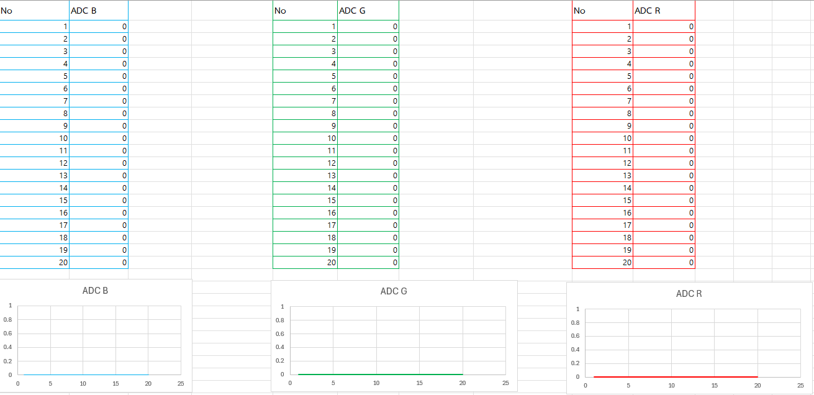

### ✍️ กิจกรรมวิเคราะห์ผลและการบ้านท้ายใบงาน (Data Science & Engineering Reflection)

1. **การพล็อตพฤติกรรมทางกายภาพ (Transient Response Curve):**
    


    
    
2. **คำถามนำเพื่อการวิเคราะห์เชิงระบบ (Critical Thinking):**
    
    - จากกราฟที่พล๊อตออกมา นักศึกษาสังเกตเห็นแนวโน้มตัวเลขของค่า ADC ตั้งแต่แซมเปิ้ลที่ 1 ไต่ระดับลงมาหรือขึ้นไปจนถึงแซมเปิ้ลที่ 20 อย่างไร? 
    ```
    ค่า ADC ของทั้ง 3 แชนเนล (B, G, R) มีค่าเป็น 0 คงที่ ในทุกๆ แซมเปิ้ล
    ```
    
    - สัญญาณไฟฟ้าเข้าสู่ความนิ่ง (Settling) ที่แซมเปิ้ลใด หรือใช้เวลากี่มิลลิวินาที?
    ```
    เนื่องจากข้อมูลมีค่าเป็น 0 ราบเรียบตั้งแต่แซมเปิ้ลแรก จึงไม่มีช่วงสัญญาณสวิง
    ```    
    - ความลาดเอียงของเส้นกราฟที่เกิดขึ้นในช่วงแรกของการสลับสถานะไฟนี้ เป็นหลักฐานเชิงประจักษ์สะท้อนข้อจำกัดคุณสมบัติทางกายภาพใดของรอยต่อ PN บน LED ภาครับ และโครงสร้างตัวเก็บประจุสุ่มสัญญาณภายในไมโครคอนโทรลเลอร์?
    ```
    ไม่มีเส้นลาดเอียง
    ```

    - หากในใบงานถัดไปเราต้องการ "หาค่าเฉลี่ยของระดับแรงดันสะท้อนที่แท้จริง" โดยไม่ให้เฟสสัญญาณที่กำลังเปลี่ยนแปลง (Transient State) นี้ไปดึงค่าสถิติให้เพี้ยน นักศึกษาคิดว่าเราควรเลือกแซมเปิ้ลช่วงใดมาคำนวณ หรือควรเขียนโปรแกรมหน่วงเวลาหลบเลี่ยงอาการ Settling นี้อย่างไร?
    ```
    1. เขียนโปรแกรมหน่วงเวลา: ใส่คำสั่ง delayMicroseconds() สั้นๆ คั่นระหว่างคำสั่งเปิดไฟกับการอ่านค่า ADC เพื่อรอให้สัญญาณนิ่งก่อนสุ่มค่า
    2. เลือกช่วงแซมเปิ้ล (ถ้าเก็บข้อมูลมาแล้ว): ตัดข้อมูลช่วงแรกที่กราฟยังสวิงทิ้งไป (เช่น แซมเปิ้ลที่ 1-5) แล้วเอาเฉพาะช่วงที่กราฟแบนราบแล้วมาหาค่าเฉลี่ยครับ
    ```